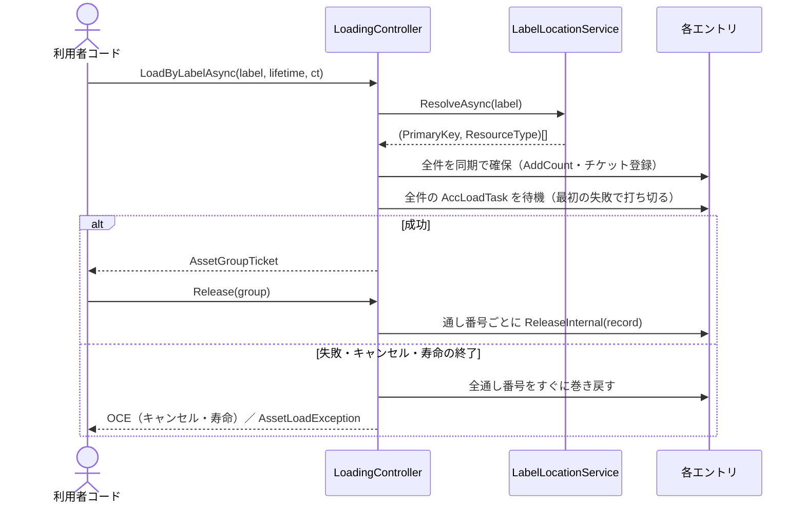

# 設計：AddressableManager Label 一括ロード

> 対象：`requirements.md`（承認済み版） ／ 作成日：2026-10-01 ／ ステータス：承認済み ／ 対象 Unity バージョン：6000.3.23f1

## 1. 実装アプローチ

Label ロードは、新しい仕組みを足さずに、既存の「1件ずつの Load」を Controller の中で組み合わせて作る。RefCount・重複ロードの共有・寿命の管理は、既存の処理をそのまま使う。

処理の流れ：
- `LabelLocationService`（Service）が、Label のロケーションを型を絞らずに取得する
- `LoadingController` が、(PrimaryKey, ResourceType) の組ごとに、その型で読み込む
- 結果は `AssetGroupTicket` にまとめて返す

詳細な手順・例外の表・サンプルコードは、仕様書を正とする（詳細：`src/AddressableManager/Assets/Docs/specs/loading-spec.md` の「Label 一括ロード」の章）。

主な設計判断：
- **Load の時点では型を指定せず、取り出すときに完全一致で指定する**
  - 利用者が Label の中身の型を知らなくて済むようにするため
  - 基底型では探さない。`Object` を指定したときに、1枚の画像が Texture2D と Sprite の2件として重複して返るのを避けるため
- **重複ロードの判定キーを `(AssetKey, Type)` にする**
  - Label で読んだ分と、単体の `LoadAsync<Sprite>` で読んだ分を、同じエントリで共有するため
  - 同じアセットを別の型で読むと handle は別になるが、中身は同じバンドル内のオブジェクトなので、メモリ上で二重には持たない
  - 失うもの：単体の `LoadAsync<Texture2D>` と `LoadAsync<Sprite>` を取り違えても、例外で気づけなくなる。方針として受け入れ、仕様書に明記する
- **Label ロードは「確保（同期）」と「待機」の2段階に分ける**
  - 確保：エントリの取得または作成・`AddCount`・チケット登録を、全件ぶん await の前に同期で行う。この時点で全件の通し番号がそろう
  - 待機：各エントリの `AccLoadTask` を、最初の失敗で打ち切る形で待つ（`AsyncCompat.WaitAllOrFirstFault`）。`Task.WhenAll` は全件の完了を待つため、1件が失敗しても最も遅いロードが終わるまで待ち続けてしまうので使わない
  - 効果：失敗・キャンセル・寿命の終了が起きたら、残りのロードを待たずに全件をすぐ巻き戻せる。ロード中のエントリは、既存の `DisposeWorkerWhenCompleted` がロード完了後に破棄する
  - 共有ロードタスクはもともと `Task` で統一されているので、待機を `Task` 側に寄せることで `#if` の出し分けも増やさずに済む
- **解放は、すべてチケットの記録（record）を起点にする**
  - record に「エントリへの参照・型・まとめチケットへの参照」を持たせる
  - `ReleaseInternal` は、Registry にあるエントリが record のエントリと同じ場合だけ取り除く
  - 効果：失敗したエントリの削除後に、同じキーで新しいエントリができても、誤ってそちらを減らさない（既存の不具合の修正）
- **まとめチケットは class にする**
  - 取り出し結果のキャッシュと「解放済み」の印という、変わる状態を持つため。struct だとコピーごとに状態が分かれる
  - 寿命で回収されたときも、record からまとめチケットを引いて無効にする。リーク警告も1枚につき1件にまとめる
- **実行時の型から Worker を作るときは、型ごとに delegate をキャッシュする**
  - `MakeGenericMethod` と `Delegate.CreateDelegate` で作った delegate から、既存の `Create<T>` を呼ぶ
  - 単体の Load は、これまでどおり `Create<T>` を直接呼ぶ（リフレクションを通さない）

検討した代替案と却下理由：
- **Load 時に型を指定させる案**（`LoadByLabelAsync<T>`、または型の配列を渡す形）：利用者が Label の中身の型を把握している必要があり、中〜大規模では運用できないため却下
- **型を指定せず `Object` として読む案**：Sprite が Texture2D として返る。単体の型付き Load と型違いで衝突するため却下
- **Label 文字列で解放する案**（`ReleaseByLabel`）：同じ Label を複数の呼び出し元が読んだ場合に、どの分を解放するか決められないため却下
- **判定キーを変えずに、1つのアドレスにつき1つの型だけを読む案**：画像を Texture2D と Sprite のどちらで読むかを自動で決める確実な方法が無いため却下。これにより、`addressable-manager-design.md` 5.3 の「`AssetKey` に型を含める設計」の却下は取り消す
- **失敗したら残りのロードを最後まで待ってから巻き戻す案**：枠の確保が同期で終わるので待つ必要がなく、待ち時間が最も遅いロードに合わせて延びるだけなので却下
- **`Activator.CreateInstance` / `Expression.Compile` で Worker を作る案**：IL2CPP でインタプリタ実行になる、ストリッピングの影響を受けやすい、といった問題があるため却下

## 2. 変更するコンポーネント

配置先は `src/AddressableManager/Assets/@MAH/AddressableManager/` を起点とする。

| 対象（クラス/ファイル） | 変更内容 | 新規/修正 |
|---|---|---|
| `Runtime/Core/AssetGroupTicket.cs` | 利用者向けのまとめチケット（`sealed class`・`MAH.AddressableManager`）。`AccLabel`／`AccCount`／`AccIsReleased`／`TryGetAsset<T>`／`GetAssets<T>` を公開する。内部向けに `Invalidate()` を持つ | 新規 |
| `Runtime/Core/Loading/Model/AssetEntryKey.cs` | Registry の判定キー `(AssetKey, Type)`（internal readonly struct） | 新規 |
| `Runtime/Core/Loading/Service/ILabelLocationService.cs`／`LabelLocationService.cs`／`LabelLocation.cs` | Label のロケーションを解決する Service。`UnityEngine.Object` ではない型の除外、重複の除外と警告、handle の解放を担当する | 新規 |
| `Runtime/Core/Loading/Model/AssetRegistryModel.cs`／`AssetEntryModel.cs` | 判定キーを `AssetEntryKey` に変える。参照が同じ場合だけ削除する処理を追加する | 修正 |
| `Runtime/Core/Loading/Model/IssuedTicketRecord.cs`／`IssuedTicketRegistryModel.cs` | record にエントリへの参照・型・まとめチケットへの参照を持たせる | 修正 |
| `Runtime/Core/Loading/Service/IAssetLoaderServiceFactory.cs`／`AssetLoaderServiceFactory.cs` | `Create(AssetKey, Type)` を追加する（型ごとにキャッシュした delegate から `Create<T>` を呼ぶ） | 修正 |
| `Runtime/Core/Loading/Controller/LoadingController.cs` | 確保と待機に分ける。型違い検出を削除する。`LoadByLabelAsync`／`Release(AssetGroupTicket)` を追加する。解放経路を record 起点にする。`ReleaseLifetime` でまとめチケットを無効にする。コンストラクタに Service を加える | 修正 |
| `Runtime/Core/Interfaces/IAssetHandler.cs`／`Loading/Handler/AssetHandler.cs` | `LoadByLabelAsync`／`Release(AssetGroupTicket)` を追加する（Task/UniTask の出し分けは既存と同じ） | 修正 |
| `Runtime/Core/Logger/AddressableLogger.cs` | まとめチケット用のリーク警告（label と件数）を追加する | 修正 |
| `Runtime/Core/AddressableManager.cs` | `LabelLocationService` を生成して Controller に渡す | 修正 |
| `Runtime/Core/AsyncCompat.cs` | 全件の完了、または最初の失敗で完了する `Task` を返す `WaitAllOrFirstFault` を追加する | 修正 |
| `Samples/AddressableLoad/Scripts/LabelLoadSampleView.cs` | 手動検証用の View。Label の読み込み、取り出し、まとめての解放、二重解放、Scene 寿命、該当0件の Label を試す | 新規 |
| `Samples/AddressableLoad/Scenes/LabelLoadScene.unity` | 上記のシーン。`SpriteLoadScene` のレイアウトを元に、AudioSource を加える | 新規 |
| `Samples/AddressableLoad/Scripts/SampleSceneNames.cs`／`SampleSceneNavigatorView.cs`・既存3シーン | `LABEL_SCENE` と遷移ボタンを追加する | 修正 |
| `ProjectSettings/EditorBuildSettings.asset` | `LabelLoadScene` を登録する | 修正 |
| `Tests/Editor/Fakes/FakeLabelLocationService.cs` | EditMode テスト用の偽の Service | 新規 |
| `Tests/Editor/Fakes/FakeAssetLoaderServiceFactory.cs`／`LoadingControllerTestBase.cs` | `Create(key, Type)` を追加し、Service を注入する | 修正 |
| `Tests/Editor/LoadingControllerLabelTests.cs` | Label 一括ロードの EditMode テスト一式 | 新規 |
| `Tests/Editor/LoadingControllerLoadTests.cs` | 型違い例外のテスト（42〜51行目）を、「別エントリとして読める」の確認に書き換える | 修正 |

## 3. データ構造の変更

ScriptableObject・設定アセット・セーブデータの変更は無い。既存データのマイグレーションも不要。

ランタイムの内部状態の変更：
- `AssetRegistryModel` の Dictionary のキー：`AssetKey` → `AssetEntryKey`（`AssetKey` と `Type` の組）
- `IssuedTicketRecord` に追加するもの：エントリへの参照（`AssetEntryModel`）、型、まとめチケットへの参照（単体の Load では `null`）
- `AssetKey` そのものは変えない（「入口の種別＋値」の同一判定は維持し、型は Registry のキー側で持つ）

Addressables の設定は変えない。サンプルは、コミット済みの既存ラベル `Manual` / `Scene` / `Owner` をそのまま使う。

## 4. 影響範囲の分析

- **既存機能への影響**：
  - 同じアドレスを別の型で `LoadAsync` すると、これまでは `InvalidOperationException` だったが、今後は別エントリとして成功する
  - 解放経路を record 起点にしたことで、単体の Load の明示解放・寿命による回収・キャンセル時の巻き戻しの内部処理が変わる。外から見える振る舞いは変わらないことを、既存テストで確認する
  - `IAssetHandler` にメソッドが増える（独自に実装しているクラスはコンパイルエラーになる。現状は `AssetHandler` のみ）
  - `LoadingController` のコンストラクタが変わる（`AddressableManager` とテスト基盤が影響を受ける）
  - 既存のサンプル3シーンに、遷移ボタンが1つ増える
- **永続的ドキュメント（`src/AddressableManager/Assets/Docs/`・`Docs/`）への影響**：
  - `addressable-manager-design.md`
    - 5.3 の「`AssetKey` に型を含める設計」を削除する
    - 3.5・5.3 の「まとめてロードしたい場合は `LoadAsync` を複数回呼ぶ」を、`LoadByLabelAsync` の案内に書き換える
    - 3.6 と Controller の責務（型違い検出の削除）を更新する
    - 5.3 に「Label 文字列による解放」を採用しない理由を追記する
    - 6章（決定事項）に、方針を変えた理由と失うものを追記する
  - `specs/loading-spec.md`
    - 「Label 一括ロード」の章を新設する
    - 3.1（判定キー）、6.1（「`LoadAsync` を複数回呼ぶ」の文）、7.1・7.3（Registry のキー）、8章（`IAssetHandler`）を更新する
  - `diagrams/loading-class.md`：`AssetGroupTicket`・`AssetEntryKey`・`ILabelLocationService` を追加する
  - `diagrams/loading-sequence.md`：Label 一括ロードの正常系と異常系を追加する
  - `conventions.md`：7.2（型の分類）と10章（レイヤー別の命名例）に、新しい型を追記する（パターンそのものは変えない）
  - `Docs/glossary.md`：「Label 一括ロード」「まとめチケット（Group Ticket）」を追加する
- **テストへの影響**：
  - `LoadingControllerLoadTests` の型違い例外の1件を書き換える
  - `LoadingControllerTestBase` のコンストラクタ呼び出しを更新する
  - `LoadingControllerLabelTests` を新設する。既存の不具合の回帰テストも、ここと `LoadingControllerLoadTests` に追加する
  - PlayMode テストは変更しない（Label のケースはスコープ外）

## 5. 図表（必要な場合）

概要レベルの図だけをここに置く。詳細図は `src/AddressableManager/Assets/Docs/diagrams/loading-sequence.md` に追加する（ステップ2）。

