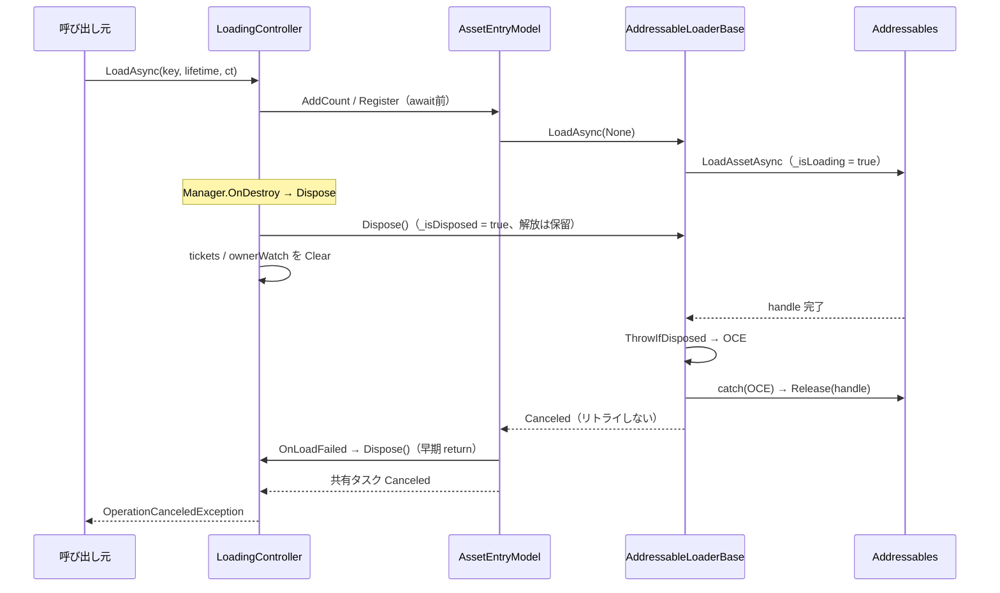
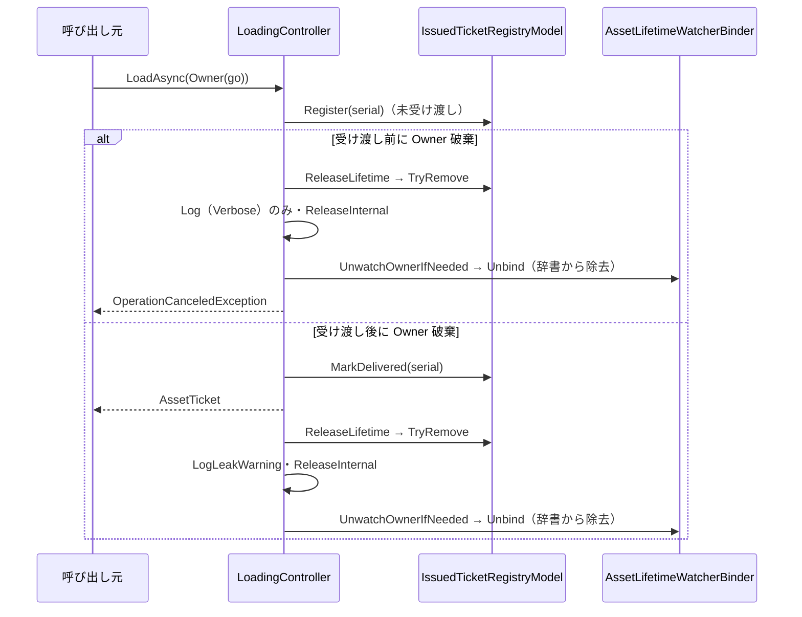

# 設計：Loading 機能のレビュー指摘修正

> 対象：`requirements.md`（承認済み版） ／ 作成日：2026-10-02 ／ ステータス：承認済み ／ 対象 Unity バージョン：6000.3.23f1

## 1. 実装アプローチ

修正は、新しい仕組みを足さずに、既存の経路の「抜け」を塞ぐ形で行う。解放経路は `ReleaseInternal` の1本のまま変えない。

詳細な手順・例外の表・サンプルコードは、仕様書を正とする（`src/AddressableManager/Assets/Docs/specs/loading-spec.md`。更新はステップ8）。

主な設計判断：
- **Worker が、ロード中の Dispose を自分で処理する（🔴）**
  - `_isLoading`（handle の完了待ちの間だけ true）と `_isDisposed` を持つ。`Dispose()` は、完了待ちの間は handle を解放せず印を付けるだけにする。
  - `LoadAsync` は、各試行の開始時・await の直後・リトライ待機の直前で、破棄済みかを確認する。破棄済みなら `OperationCanceledException` を投げる。try の中で投げた分は、既存の `catch (OperationCanceledException)` が handle を解放して再送出する。新しい解放経路は作らない。
  - `_handle.IsDone` で判定しない理由：handle の完了から await の継続までの間に Dispose が来ると、そこで handle を解放してしまい、元の不具合と同じになる。
  - `ObjectDisposedException` ではなく OCE にする理由：共有ロードタスクが Faulted ではなく Canceled になり、誰も await していなくても未観測の例外にならない。Controller が「寿命の終了で OCE」としているのとも揃う。
  - Registry（`DisposeAllAndClear`）側ではなく Worker 側で守る理由：Worker 単体で破棄後の安全が保証され、Controller・Model の変更が要らない。
- **回復の見込みがない例外は、リトライしない（🟢）**
  - 例外チェーンに `InvalidKeyException` を含む場合は、即座に `AssetLoadException` にする。判定は `IsUnrecoverable(Exception)`（private static）に切り出す。
- **リーク警告は「受け渡し済みのチケット」だけに出す（🟡）**
  - `IssuedTicketRecord` に `_isDelivered` を持たせ、呼び出し元に結果を返す直前に `MarkDelivered(serial)` で立てる。
  - 受け渡し前に寿命が終わった分は、呼び出し元が Release を呼びようがないので、警告ではなく `Log`（Verbose）だけにする。
  - `IssuedTicketRecord` は readonly struct のため、`AsDelivered()` で複製を返し、`IssuedTicketRegistryModel.MarkDelivered` が差し替える。スタックトレースは複製元のものを引き継ぐ（取得し直さない）。
- **Owner の監視は、どの経路でも自己修復する（🟡）**
  - `ReleaseLifetime` は、早期 return をやめて、最後に必ず `UnwatchOwnerIfNeeded(scope_id)` を呼ぶ。
  - `LoadAsync` は、`ResolveScope` の前にキーの null／空を確認する。`ResolveScope` の後に例外が出る入口を減らす。
- **Binder は、Watcher を辞書で管理する（🟡）**
  - `List` を `Dictionary<LifetimeScopeId, AssetLifetimeWatcher>` に変える（Owner 寿命は、1 GameObject につき1スコープ）。`Unbind` は、owner が破棄済みでも先に辞書から取り除く。
  - `AssetLifetimeWatcher.OnDestroy` は、`ToArray()` をやめて、末尾から「取り出し → `RemoveAt` → 通知」を行う（確保 0。通知の中から `Unregister` されても影響しない）。
- **`AssetGroupTicket.Fill` は、Model の型を受け取らない（🟢）**
  - `Fill(string[] addresses, Type[] asset_types, Object[] assets, long[] serials)` にして、`Core.Loading` への using を無くす。
  - Controller は、確保時に `addresses`・`asset_types` を詰め、待機の後に `assets` を詰める。
- **ポーリングは `Time.unscaledDeltaTime` で進める（🟡）**
  - ポーリングは「Watcher が取りこぼした分」の回収経路であり、ゲーム内時間に従う理由が無い。`Tick(float)` のシグネチャは変えない。
- **`ct.Register` は static ラムダに状態を渡す（🟢）**

検討した代替案と却下理由：
- **`DisposeAllAndClear` を、ロード中のエントリには `DisposeWorkerWhenCompleted()` で解放する形にする案**：Worker 単体の安全が保証されず、Registry 経由以外の `Dispose` で同じ不具合が残るため却下（Worker 側の修正と併用する案も、二重の仕組みになるため見送り）
- **内部に CTS を持たせて、リトライ待機を即座に打ち切る案**：待機は最大 `_retryDelayMs` で終わり、実害が小さいため、スコープ外とした
- **リーク警告を、呼び出し元ごとに受け渡しの印を持たせず、`ReleaseLifetime` 側で「`AccLoadTask` が完了しているか」で判定する案**：受け渡し前に完了していても、呼び出し元が await から戻る前に寿命が終わる場合を区別できないため却下
- **`AssetGroupTicket.Fill` を、`internal` の引数ごとインターフェース化する案**：配列4本を渡すだけで足り、型を増やす利点が無いため却下

## 2. 変更するコンポーネント

配置先は `src/AddressableManager/Assets/@MAH/AddressableManager/` を起点とする。

| 対象（クラス/ファイル） | 変更内容 | 新規/修正 |
|---|---|---|
| `Runtime/Core/Loading/Service/AddressableLoaderBase.cs`（Service） | `_isLoading`／`_isDisposed`／`ThrowIfDisposed()` を追加する。`Dispose()` を、ロード中は解放を保留する形にする。`LoadAsync` に破棄の確認を3か所入れ、catch のログを分ける。`IsUnrecoverable(Exception)` を追加し、回復不能な例外はリトライしない | 修正 |
| `Runtime/Core/Loading/Controller/LoadingController.cs`（Controller） | `LoadAsync` にキーの事前チェックと `MarkDelivered` を追加する。`LoadByLabelAsync` の配列を `addresses`／`asset_types`／`assets` に変え、`Fill` の後に `MarkDelivered` を呼ぶ。`ReleaseLifetime` は、最後に必ず `UnwatchOwnerIfNeeded` を呼び、リーク警告を受け渡し済みの分に限る。古いコメントを削除する | 修正 |
| `Runtime/Core/Loading/Model/IssuedTicketRecord.cs`（Model） | `_isDelivered`／`AccIsDelivered`／`AsDelivered()` を追加する | 修正 |
| `Runtime/Core/Loading/Model/IssuedTicketRegistryModel.cs`（Model） | `MarkDelivered(long serial)` を追加する | 修正 |
| `Runtime/Core/Loading/Lifetime/AssetLifetimeWatcherBinder.cs`（Lifetime） | `List` を `Dictionary<LifetimeScopeId, AssetLifetimeWatcher>` に変える。`Unbind` は先に辞書から外す。`AccBoundCount` を追加する | 修正 |
| `Runtime/Core/Loading/Lifetime/AssetLifetimeWatcher.cs`（Lifetime） | `OnDestroy` の `ToArray()` をやめ、末尾から取り除きながら通知する | 修正 |
| `Runtime/Core/AddressableManager.cs`（Manager） | `LateUpdate` に渡す値を `Time.unscaledDeltaTime` に変える | 修正 |
| `Runtime/Core/AssetGroupTicket.cs`（公開型） | `Fill` の引数を `string[]`／`Type[]`／`Object[]`／`long[]` に変え、`using MAH.AddressableManager.Core.Loading;` を削除する | 修正 |
| `Runtime/Core/AsyncCompat.cs` | `WithCancellation`（`Task`・`Task<T>`）の `ct.Register` を、static ラムダ＋状態引数にする | 修正 |
| `Tests/Editor/AssetGroupTicketTests.cs` | `Fill` の新しい引数に合わせる | 修正 |
| `Tests/Editor/LoadingControllerLabelTests.cs` | `LoadByLabelAsyncLifetimeEndsWhileLoadingThrowsOperationCanceled` の期待値を、リーク警告 0件に変える。受け渡し後の回収は 1件のままであることを確認する | 修正 |
| `Tests/Editor/LoadingControllerLifetimeTests.cs` | 空キー＋Owner 寿命・受け渡し前後の寿命終了とリーク警告・Owner 破棄後の監視残りが無いことのテストを追加する | 修正 |
| `Tests/Editor/AssetLifetimeWatcherBinderTests.cs` | 実際の Binder の単体テスト（破棄済み owner の `Unbind`・同じ owner への2回目の `Bind`） | 新規 |
| `Tests/Runtime/LoadingPlayModeTests.cs` | ロード中に Manager を破棄するテストを追加する。存在しないアドレスのテストを、リトライしない旨の名前とコメントに改め、所要時間を確認する | 修正 |
| `src/AddressableManager/Assets/Docs/specs/loading-spec.md` | 3章（ロード中の Dispose・リトライしない例外）、5.4・5.7（`unscaledDeltaTime`）、10章・13.7（リーク警告の条件）、13章（`Fill` の引数）を更新する | 修正 |

## 3. データ構造の変更

ScriptableObject・設定アセット・セーブデータの変更は無い。マイグレーションも不要。

ランタイムの内部状態の変更：
- `IssuedTicketRecord` に、受け渡し済みの印（`bool`）を追加する
- `AssetLifetimeWatcherBinder` の Watcher の記録：`List<AssetLifetimeWatcher>` → `Dictionary<LifetimeScopeId, AssetLifetimeWatcher>`
- `AddressableLoaderBase<T>` に、`_isLoading`・`_isDisposed`（`bool`）を追加する

公開 API（`IAssetHandler`・`AssetTicket<T>`・`AssetGroupTicket` の公開メンバー）と、`IAssetLifetimeWatcherBinder`・`IAssetLoaderWorker` のシグネチャは変えない。`AssetGroupTicket.Fill` は `internal` のため、利用者には影響しない。

## 4. 影響範囲の分析

- **既存機能への影響**：
  - 利用者から見える挙動の変化は3つ
    1. ロード中に寿命が終わった分には、リーク警告が出なくなる（`OperationCanceledException` は従来どおり届く）
    2. 存在しないアドレスは、リトライ（既定で約2秒）を待たずに、1回で `AssetLoadException` になる
    3. `timeScale = 0` の間もポーリングが進む
  - ロード中に Manager を破棄したときの、破棄後のリトライと handle のリークが無くなる
  - `ReleaseInternal` の1経路は変わらない。単体の Load・Label 一括ロードの明示解放・巻き戻しの外から見える振る舞いは変わらない
- **永続的ドキュメント（`src/AddressableManager/Assets/Docs/`）への影響**：
  - `specs/loading-spec.md`：3章・5.4・5.7・10章・13章（13.2 のコード例と 13.7）を更新する（ステップ8）
  - `addressable-manager-design.md`・`conventions.md`・`Docs/glossary.md`・`diagrams/`：影響なし（概要・命名・用語・クラス構成は変わらない。`diagrams/loading-class.md` は、`Fill` の引数が図に載っていれば追従する。ステップ8で確認する）
- **テストへの影響**：
  - 期待値を変えるのは、`LoadByLabelAsyncLifetimeEndsWhileLoadingThrowsOperationCanceled`（リーク警告 1件 → 0件）と、`AssetGroupTicketTests`（`Fill` の引数）のみ
  - 追加：EditMode（`LoadingControllerLifetimeTests`・新規の `AssetLifetimeWatcherBinderTests`）、PlayMode（ロード中の Manager 破棄）
  - `FakeAssetLoaderWorker`・`FakeAssetLifetimeWatcherBinder` は変えない（interface のシグネチャが変わらないため）
- **リスク**：
  - `InvalidKeyException` が `OperationException` に包まれて届くかは、Addressables 2.9.1 の実装に依存する。InnerException を辿って判定し、実機の Play で例外の型を1回確認する
  - ロード中の Manager 破棄の PlayMode テストは、「Use Asset Database」でロードがすぐに完了すると再現できない。その場合は `Assert.Inconclusive` にして、誤って成功しないようにする

## 5. 図表（必要な場合）

概要レベルの図だけをここに置く。クラス構成は変わらないため、`diagrams/` への追加は行わない。

ロード中に Manager が破棄された場合（🔴の修正後）：

受け渡し前後で変わるリーク警告の条件：

