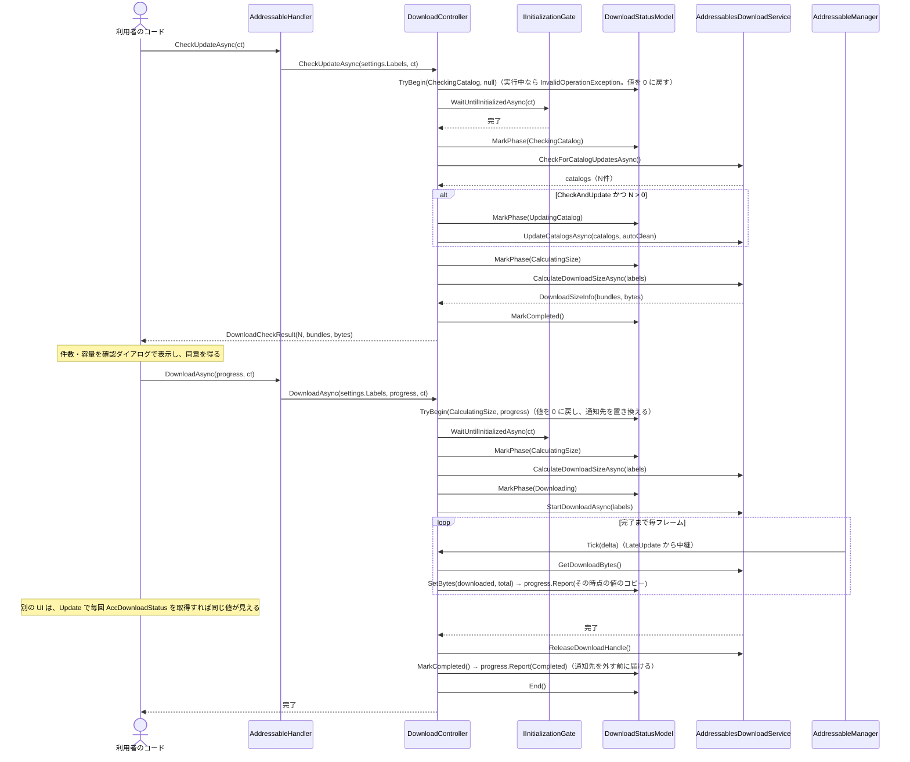
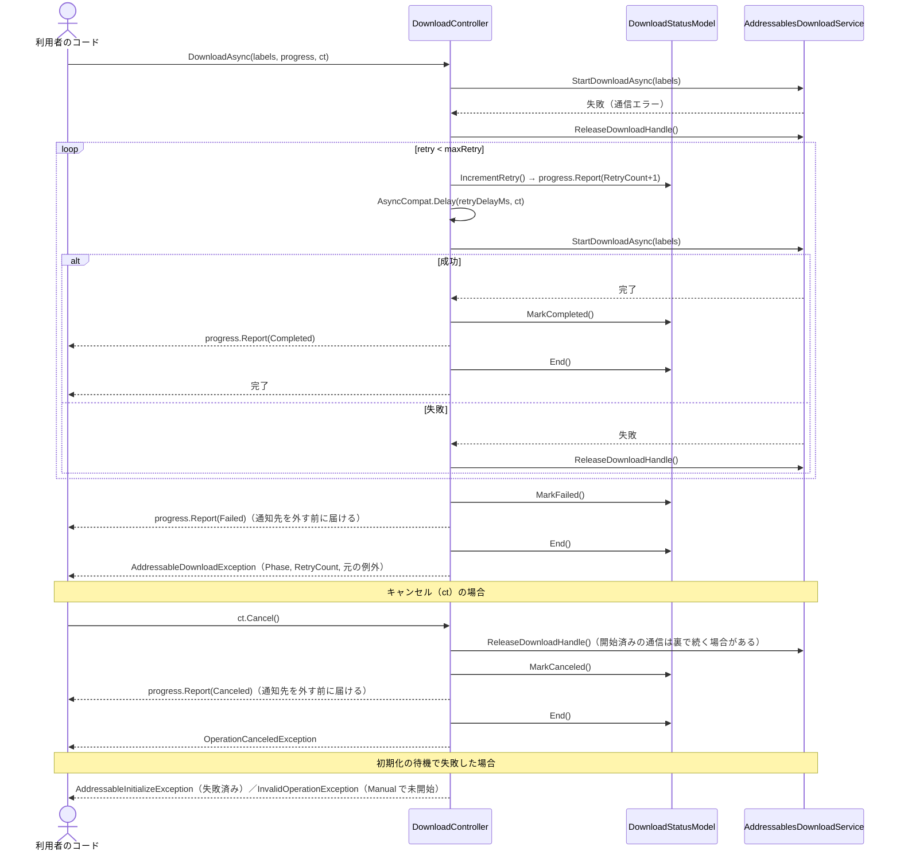
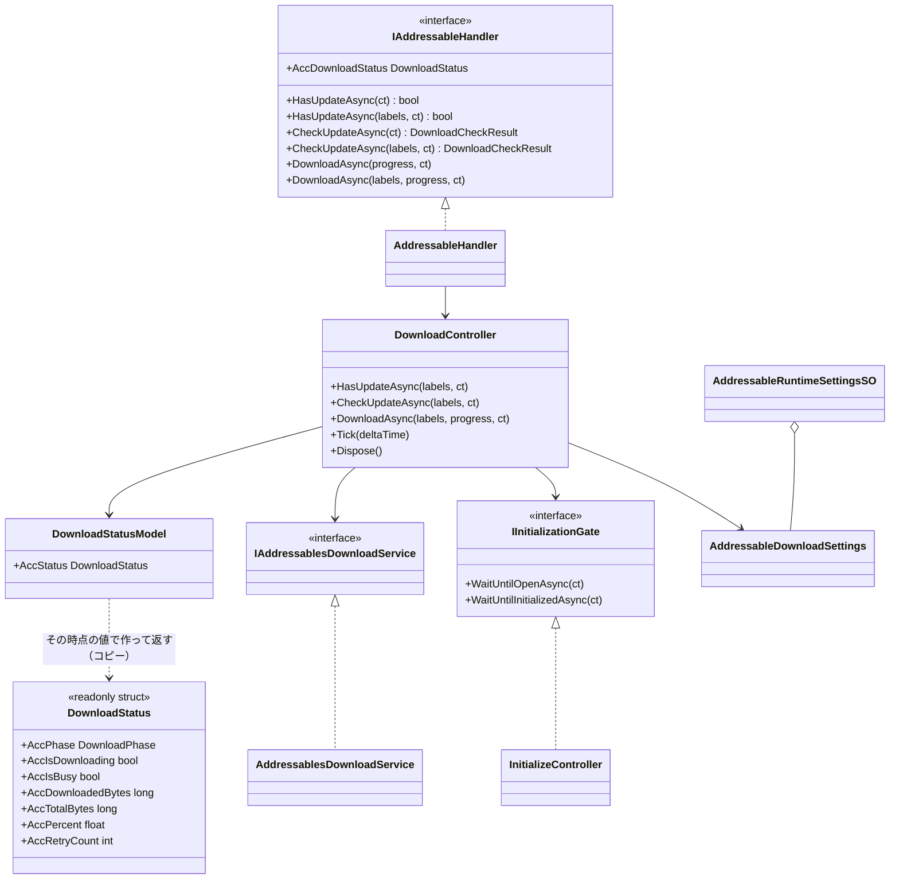

# 設計：AddressableManager ダウンロード（Download）機能

> 対象：`requirements.md`（承認済み版） ／ 作成日：2026-10-08 ／ ステータス：承認済み ／ 対象 Unity バージョン：6000.3.23f1

## 1. 実装アプローチ

この機能の仕様は、ステップ1で `src/AddressableManager/Docs/specs/download-spec.md` として書き、仕様書を正とする。本書は、仕様を実装に落とす順序・配線・実装時の判断だけを書く。

方針：
- カタログの確認・更新・ダウンロードの実行と状態遷移は `DownloadController`（ピュア C#）に集める。状態データは `DownloadStatusModel`、Addressables の呼び出しは `AddressablesDownloadService` に分ける。Manager は生成・配線・`LateUpdate` の中継だけを行う
- 利用者が触れる入口は `IAddressableHandler` の1つに集約する（別の Handler は作らない。設計仕様書 3.3・3.7）。`AddressableHandler` は転送するだけにする
- 初期化の待機は `IInitializationGate`（`Core/Interfaces/`）だけを通す。`WaitUntilInitializedAsync` を足し、`InitializeController` が実装する。Download は `Core.Initialize` を知らない。ゲートの待機は共有タスクのため、シンボルに関係なく常に `Task`
- 進捗は Manager の `LateUpdate` → `OnLateUpdate` → `DownloadController.Tick` で通知する（`InitializeController.Tick` と同じ形）。毎フレームの `await` ループは書かない
- 状態は `DownloadStatusModel` のフィールド（段階・バイト数・リトライ回数）に持ち、`AccDownloadStatus` と `IProgress` には、その時点の値で作った `readonly struct` の `DownloadStatus` を渡す
- DI コンテナは使わず、`AddressableManager.Awake` での手動 `new` で配線する（LifetimeScope・`IScopeInstaller` への登録なし）

実装時の判断：
- **件数を自前で数える**：`Addressables.GetDownloadSizeAsync` は合計バイトしか返さず、バンドル数が分からない。`LoadResourceLocationsAsync(labels, MergeMode.Union)` で得た場所の依存をたどり、`ILocationSizeData` を持つバンドルを重複なく集めて `ComputeSize(location, ResourceManager) > 0` のものを数える。`GetDownloadSizeAsync` と同じ判定を自前で行うため、Addressables を更新したときの確認項目として仕様書の改修ガイドに書く（Editor の Use Asset Database ではバンドルが無く、常に 0 件）
- **`HasUpdateAsync` はカタログの更新有無を先に見る**：更新のあるカタログが1件以上なら、サイズ計算をせずに `true` を返す（通信が `.hash` の取得だけで済む）。0 件なら、今のカタログで対象 Label のバンドルを数える（カタログを更新したのにダウンロードしていない状態でも `true` になる）。`UpdateCatalogs` は呼ばない
- **`UpdateCatalogs` には確認で得た ID を明示して渡す**：`UpdateCatalogs` を引数なしで呼ぶと、フラグが立っているカタログを更新する（Addressables 2.9.1 の `AddressablesImpl.cs`）。`CheckForCatalogUpdates(true)` の `true` は結果を入れた操作の handle を解放する指定で、フラグは消えない。確認だけで更新しない経路（`HasUpdateAsync`・`CheckOnly`）では `UpdateCatalogs` を一切呼ばない
- **ダウンロードの handle は自分で解放する**：`DownloadDependenciesAsync` を `autoReleaseHandle: false` で呼び、`Tick` で Service の `GetDownloadBytes()`（内部で `GetDownloadStatus()` を読む）を呼ぶ。完了・失敗の経路は Service の `try/finally` で、キャンセル・`Dispose` の経路は `ReleaseDownloadHandle()` で `Addressables.Release` する。結果（成功・失敗・例外）は `Completed` コールバックの中で読んで `TaskCompletionSource` に渡す（`AddressablesInitializeService` と同じ形。`AsyncCompat.ToTask` は UniTask 版では未定義のため使わない）
- **最後の通知は通知先を外す前に届ける**：順序は ① 結果の段階を記録（`MarkCompleted` / `MarkFailed` / `MarkCanceled`）→ ② `progress.Report` → ③ `finally` で通知先を外し、実行中を解除する（`End`）→ ④ 呼び出し元へ完了、または例外を返す。外した後では通知が届かず、成功・失敗・中断を区別できなくなるため。`Dispose` のときは、実行中なら `Canceled` を通知してから外す
- **失敗の例外は `DownloadStatus` に持たせない**：受け取る経路を呼び出し元の `await` の1つにするため。進捗の受け取り側は `AccPhase == Failed` で判定し、原因に応じた処理は `catch` で行う
- **通知先の例外を受け止める**：通知先は利用者のコードのため、`Report` が例外を投げても `DownloadStatusModel.ReportProgress` が受け止めて `AddressableLogger.LogException` に流す。最後の通知で止まると、呼び出し元に完了・例外が返らなくなるため（`InitializeStateModel.ReportProgress` と同じ理由）
- **通知先は処理を始める前に登録する**：`TryBegin(first_phase, progress)` で、値を 0 に戻し、段階を最初の段階にして、通知先を置き換える（開始を1回通知する）。通知先は常に1つだけで、前の処理の `IProgress` が次の処理の通知を受けないようにする。**実行中の解除は `End` で、通知先を外すのと同時に行う**（最後の通知の中で次の処理を始められると、`End` がその通知先まで外してしまうため。終えるまでは、次の `TryBegin` は `false`）。結果が記録された後の遷移は、Model が無視する（最後の通知を1回だけにするため）
- **`Tick` は `Downloading` のときだけ働く**：それ以外は先頭で戻り、通知もしない（確認・判定の間のバイト数は 0 のまま。段階が変わったときに1回通知する）
- **`ClampValues` を使う**：リトライ回数（0〜10）・待機（0〜60000ms）は `AddressableLoadingSettings` と同じ形で `ClampValues()` を作り、Runtime SO の `OnValidate` から呼ぶ。テスト用の値指定コンストラクタも用意する
- **Manager の `OnDestroy` の順序**：購読解除 → Loading の `Dispose` → **Download の `Dispose`** → Initialize の `Dispose` → 変換関数の復元。Download は初期化の待機を `IInitializationGate` で持つため、Initialize より先に止める

検討した代替案と却下理由：
- **`DownloadStatus` をクラスにして、Manager の生存中は同じインスタンスを返す案**：1回取得して保持すれば中身が更新され続ける利点があるが、前の処理の結果を表示している側が、次の処理でリセットされた値（0 など）を誤って読む。保持した参照が自動で次の処理を指さないことも使い方の罠になる。構造体のコピーなら、取得した値は後から変わらず、この問題が構造上起きない
- **`DownloadStatus` を処理ごとに生成するクラスにし、前のものを `Expired` にする案**：値の取り違えは防げるが、「無効」の段階・`AccIsValid`・取得し直す約束が増え、処理ごとにヒープ確保が起きる。構造体なら不要
- **構造体に処理の通し番号を持たせる案**：「自分の始めた処理の値か」を比べられるが、今は要望が無い。必要になったら項目を足せる（構造体への追加は既存のコードを壊さない）ため、持たせない
- **進捗をイベント（`OnDownloadProgress`）で通知する案**：`+=` と `-=` を対で書く必要があり、解除漏れが起きる。どの呼び出しの進捗か区別もできない。`InitializeAsync` と同じ「`IProgress<T>` を引数で渡す」形にする
- **進捗を `IProgress<float>`（割合のみ）にする案**：段階とバイト数が届かず、リトライ中・サイズ計算中の表示ができない。設計仕様書 3.3 の案は `IProgress<DownloadStatus>` に変える
- **`GetDownloadSizeAsync` の戻り値だけで件数を出す案**：合計バイトしか分からず、バンドル数を返せない。件数は `> 0` かどうかしか判断できない
- **確認の前に初期化を自動で始める案**：Manual モードの意味が弱まる。初期化の成功を待ち、未開始なら `InvalidOperationException` にする（Loading の `WaitForInitialize` と同じ考え方）
- **起動時に Manager が自動でダウンロードする案**：容量の確認ダイアログを挟めなくなるためスコープ外

## 2. 変更するコンポーネント

配置先は `src/AddressableManager/Assets/@MAH/AddressableManager/` を起点とする。

### 新規

| 対象（クラス/ファイル） | 内容 | 層・namespace |
|---|---|---|
| `Runtime/Core/Download/Data/DownloadPhase.cs` | 段階の enum（`None` / `CheckingCatalog` / `UpdatingCatalog` / `CalculatingSize` / `Downloading` / `Completed` / `Failed` / `Canceled`） | 外部依存型・`MAH.AddressableManager` |
| `Runtime/Core/Download/Data/DownloadStatus.cs` | 取得・通知した時点の値のコピー（`readonly struct`）。`AccPhase`・`AccIsDownloading`・`AccIsBusy`・`AccDownloadedBytes`・`AccTotalBytes`・`AccPercent`・`AccRetryCount`。コンストラクタは `internal` | 外部依存型・`MAH.AddressableManager` |
| `Runtime/Core/Download/Data/DownloadCheckResult.cs` | 確認結果（`readonly struct`）。`AccCatalogUpdateCount`・`AccBundleCount`・`AccTotalBytes`・`AccIsCatalogUpdatePending`・`AccHasDownload` | 外部依存型・`MAH.AddressableManager` |
| `Runtime/Core/AddressableDownloadException.cs` | ダウンロード失敗の例外。失敗した段階（`AccPhase`）とリトライ回数を持つ。`AddressableInitializeException` と同じ置き場・形 | 外部依存型・`MAH.AddressableManager` |
| `Runtime/Core/Download/Data/CatalogUpdatePolicy.cs` | `None` / `CheckOnly` / `CheckAndUpdate` | 内部実装型・`MAH.AddressableManager.Core.Download` |
| `Runtime/Core/Download/Data/AddressableDownloadSettings.cs` | `[Serializable]` の設定（`_catalogPolicy`・`_labels`・`_maxRetry`・`_retryDelayMs`・`_autoCleanBundleCache`）と `ClampValues()` | 内部実装型・`MAH.AddressableManager.Core.Download` |
| `Runtime/Core/Download/Model/DownloadStatusModel.cs` | 状態のフィールド・実行中フラグ・進捗の通知先（1つ）。遷移メソッド（`TryBegin(first_phase, progress)` / `MarkPhase` / `SetBytes` / `IncrementRetry` / `MarkCompleted` / `MarkFailed` / `MarkCanceled` / `End`）。遷移のたびに `DownloadStatus` を作り直して保持し、`AccStatus`（その時点の値のコピー）・`AccIsRunning` で読む。通知先の例外を受け止めてログにする | Model・`MAH.AddressableManager.Core.Download` |
| `Runtime/Core/Download/Service/IAddressablesDownloadService.cs` | Addressables 呼び出しの窓口（確認・更新・サイズ計算・ダウンロード開始・状態の読み取り・handle の解放）。EditMode テストで偽物に差し替えるため | Service・`MAH.AddressableManager.Core.Download` |
| `Runtime/Core/Download/Service/AddressablesDownloadService.cs` | 上の実装。handle を必ず解放する | Service・同上 |
| `Runtime/Core/Download/Service/DownloadSizeInfo.cs` | Service → Controller の受け渡し用 struct（`BundleCount`・`TotalBytes`） | Service・同上 |
| `Runtime/Core/Download/Controller/DownloadController.cs` | `HasUpdateAsync` / `CheckUpdateAsync` / `DownloadAsync` / `Tick` / `Dispose`。初期化の待機 → 段階を進める → リトライ → 最後の通知 → 結果・例外を返す。`AccStatus` で現在の `DownloadStatus` を返す。`IDisposable` | Controller・同上 |
| `Samples/AddressableDownload/` | `Scripts/DownloadSampleView.cs`（View。画面はシーンに配置し、初期化が成功するまでボタンを無効にする）・`Scenes/DownloadScene.unity`・`Prefabs/AddressableManager_Download.prefab`・`ScriptableObjects/DownloadSettings.asset`・asmdef `MAH.AddressableManager.AddressableDownload` | View・サンプル |
| `Tests/Editor/Fakes/FakeAddressablesDownloadService.cs`・`Fakes/RecordingDownloadProgress.cs`・`DownloadControllerTests.cs`・`DownloadStatusModelTests.cs`・`AddressableHandlerDownloadTests.cs` | EditMode テスト（偽の Service・進捗の記録、Controller・Model・Handler の転送） | テスト |
| `Tests/Runtime/DownloadPlayModeTests.cs` | PlayMode テスト（Use Asset Database） | テスト |
| `Docs/specs/download-spec.md`・`Docs/diagrams/download-sequence.md`・`download-class.md` | 仕様書・図 | ドキュメント |

### 修正

| 対象 | 変更内容 | 影響 |
|---|---|---|
| `Runtime/Core/Interfaces/IInitializationGate.cs` | `Task WaitUntilInitializedAsync(CancellationToken ct)` を追加。`LoadBeforeInitializePolicy` に関係なく、初期化の**成功**まで待つ（成功済み→即完了／実行中→共有タスクを待つ／未開始→`InvalidOperationException`／失敗→`AddressableInitializeException`）。コメントを「Loading と Download が問い合わせる窓口」に改める | 実装する `InitializeController`・偽の `FakeInitializationGate` |
| `Runtime/Core/Initialize/Controller/InitializeController.cs` | `WaitUntilInitializedAsync` を実装（`WaitUntilOpenAsync` の switch と同じ形） | 追加のみ |
| `Runtime/Core/AddressableRuntimeSettingsSO.cs` | `[Header("ダウンロード")] AddressableDownloadSettings _download` と `AccDownload` を追加。`OnValidate` で null 補完と `ClampValues` | 既存の SO アセットは既定値で読み込まれる |
| `Runtime/Core/Interfaces/IAddressableHandler.cs` | `AccDownloadStatus`・`HasUpdateAsync`（2種）・`CheckUpdateAsync`（2種）・`DownloadAsync`（2種）を追加。UniTask 版・Task 版を `#if` で出し分け | 利用者がこのインターフェースを実装することは想定しない |
| `Runtime/Core/Handler/AddressableHandler.cs` | コンストラクタに `DownloadController` を追加し、転送のみ実装 | `AddressableHandlerInitializeTests` のコンストラクタ呼び出し |
| `Runtime/Core/AddressableManager.cs` | `DownloadController` を生成（設定は `_settings.AccDownload` だけ。ゲートには `_initializeController`、Model は Manager で `new`）。`OnLateUpdate += / -=` を対で追加。`OnDestroy` の `Dispose` 順序を更新 | なし |
| `Tests/Editor/Fakes/FakeInitializationGate.cs` | `WaitUntilInitializedAsync` を追加 | 既存の Loading のテスト（挙動は変えない） |
| `Tests/Editor/InitializeControllerGateTests.cs` | `WaitUntilInitializedAsync` の4状態のテストを追加 | なし |
| `Tests/Editor/AddressableHandlerInitializeTests.cs` | Handler のコンストラクタ変更への追従 | なし |

## 3. データ構造の変更

- `AddressableRuntimeSettingsSO` に `_download`（`AddressableDownloadSettings`）を追加する。Inspector では「ダウンロード」の見出しの下に表示される
- マイグレーション：不要。既存の SO アセットは新しいフィールドが既定値（`CheckAndUpdate`・Label 空・リトライ 3 回・待機 1000ms・キャッシュ削除 OFF）で補われ、`OnValidate` でも null を補完する。**Label が空のため、引数なしの `CheckUpdateAsync` / `HasUpdateAsync` / `DownloadAsync` は `InvalidOperationException` になる**（何もしないで成功させると設定漏れに気づけないため）。既存の Load・Initialize の挙動は変わらない
- セーブデータ・CSV・API スキーマの変更：なし

## 4. 影響範囲の分析

- 既存機能への影響
  - `IInitializationGate` へのメソッド追加により、実装クラス（`InitializeController`）と偽物（`FakeInitializationGate`）の修正が必要。Loading の挙動は変わらない（`WaitUntilOpenAsync`・`AccIsOpen` は変えない）
  - `AddressableHandler` のコンストラクタ変更により、テストの生成箇所が変わる
  - `AddressableManager.OnDestroy` の `Dispose` の順序が、Loading → Download → Initialize になる
  - 利用者が `Addressables.UpdateCatalogs()` を直接、引数なしで呼ぶと、`HasUpdateAsync` が立てたフラグの分が更新される（仕様書の注意点に書く）
- 永続的ドキュメント（Docs/）への影響
  - `addressable-manager-design.md`：3.3（API 案の確定・進捗の型・初期化前の扱い）、4章（フォルダ構成に `Download/Model/`・`Download/Service/`・`Download/Data/` を追加）、6章（決定事項）、7章（「`AssetKey` 単位のダウンロード」を将来の検討事項に追加）
  - `specs/download-spec.md`：新規。「進捗は `IProgress<DownloadStatus>` で受け取ることを推奨する」という文と、`AccDownloadStatus` で取得する方法は `IProgress` を渡していない場所から状態を参照したいときの補助、という位置づけを書く
  - `specs/initialize-spec.md`：7.4（`IInitializationGate` にメソッドを足したこと）・9.3（初期化の後に続ける処理の扱い）の更新
  - `conventions.md` 7.2：新しい型の namespace 分類を追加
  - `Docs/glossary.md`（ルート）：`CheckAndUpdateCatalogAsync` を `CheckUpdateAsync` に改め、「更新確認結果」「ダウンロード段階」などを追加。ハンドラーの説明の「今後はダウンロードも」を現状に直す
  - `diagrams/`：`download-sequence.md`・`download-class.md` を新規作成し、`index.md` に登録
  - `specs/loading-spec.md`：影響なし（実装時に確認）
- テストへの影響
  - 追加：`DownloadControllerTests`・`DownloadStatusModelTests`・`InitializeControllerGateTests`（`WaitUntilInitializedAsync`）・`DownloadPlayModeTests`
  - 修正：`FakeInitializationGate`・`AddressableHandlerInitializeTests`
  - 既存の Loading・Initialize のテストと PlayMode テストは、上の追従だけで通る想定

## 5. 図表（必要な場合）

概要レベルの図をここに埋め込む。恒久的に残す図は、ステップ8で `Docs/diagrams/` に置いて `index.md` に登録し、ここにはパスを記載する。

**恒久的な図（実装に合わせて更新済み）**：`src/AddressableManager/Docs/diagrams/download-sequence.md`（シーケンス図・状態遷移図）、`src/AddressableManager/Docs/diagrams/download-class.md`（クラス図）。以降の図は設計時の履歴で、実装での名前の変更（`TryBegin(first_phase, progress)`・`End`・`StartDownloadAsync`・`GetDownloadBytes` など）は、上の恒久的な図に反映している。

### 正常系：更新の確認 → 確認ダイアログ → ダウンロード

### 失敗・リトライ・キャンセル

### クラス図

## 6. 検証方法

### テストコードでの検証

**EditMode（`Tests/Editor/`。偽の Service とゲートで Controller を単体で動かす）**
- `DownloadControllerTests`
  - `HasUpdateAsync`：カタログに更新あり → サイズ計算をせずに `true`／カタログに更新なし・バンドルあり → `true`／どちらも無し → `false`。方針に関係なく `UpdateCatalogs` を呼ばない。方針 `None` ではカタログを確認しない。実行中に呼ぶと `InvalidOperationException`
  - 方針 `None` / `CheckOnly` / `CheckAndUpdate` ごとに、Service の呼ばれ方と `DownloadCheckResult` の値（カタログ数・バンドル数・バイト数・`AccIsCatalogUpdatePending`）が正しい。`UpdateCatalogs` に渡すのは確認で得た ID で、`null` ではない
  - 引数の Label が SO の Label より優先される／引数なしで SO の Label が空なら `InvalidOperationException`
  - 0 件なら `StartDownloadAsync` を呼ばずに `Completed` を通知する
  - `Tick` でダウンロード中だけ進捗が通知され、段階の順序が `CalculatingSize → Downloading → Completed` になり、最後に割合 1 が届く
  - 失敗 → `maxRetry` 回までリトライし、成功すれば完了、使い切れば `AddressableDownloadException`（段階・回数・元の例外を持つ）と `Failed`
  - 失敗・キャンセル・成功のすべてで `ReleaseDownloadHandle` が呼ばれる
  - 実行中にもう一度呼ぶと `InvalidOperationException`（実行中の処理は影響を受けない）
  - `ct` のキャンセルで `OperationCanceledException`、状態は `Canceled` になり、次の呼び出しができる
  - 一度も処理していなければ `AccStatus` は `AccPhase == None`・`AccIsDownloading == false`
  - 取得した `DownloadStatus` は、その後に `Tick` や次の処理があっても値が変わらない（コピーであること）。取得し直すと、`Tick` で更新されたバイト数と割合が得られる
  - `IProgress` に届いた値も、届いた後に処理が進んでも変わらない
  - `Completed` / `Failed` / `Canceled` は次の処理が始まるまで残り、次の処理の開始時にバイト数・リトライ回数が 0 に戻る
  - 通知先は、完了・失敗・キャンセル・`Dispose` のすべてで外れる。**外す前に最後の通知が1回だけ届く**（成功なら `Completed`、失敗なら `Failed`、`ct` のキャンセルなら `Canceled`、`Dispose` なら `Canceled`）。偽の `IProgress` に記録した呼び出し順が「…→最後の通知→（以降なし）」であること、最後の通知の時点で `AccPhase` が上のとおりになっていること（呼び出し元に例外が返るより前に届くこと）を確認する
  - 1回目の `DownloadAsync` に渡した `IProgress` は、2回目の `DownloadAsync` や `CheckUpdateAsync` / `HasUpdateAsync` の間に一度も呼ばれない
  - 初期化を待つ：ゲートが未開始なら `InvalidOperationException`、失敗なら `AddressableInitializeException`、待機中に開けば続行する。待機中の `ct` のキャンセルは `OperationCanceledException`
  - `Dispose` 後の呼び出しは `ObjectDisposedException`、実行中の `Dispose` で待機中の呼び出し元が `OperationCanceledException` で終わる
  - 進捗の通知先が例外を投げても、ダウンロードは止まらずログに出る
- `DownloadStatusModelTests`：遷移メソッドの条件、通知先の例外の受け止め
- `InitializeControllerGateTests`：`WaitUntilInitializedAsync` が PassThrough 設定でも初期化の成功まで待つ（4状態）

**PlayMode（`Tests/Runtime/`。Editor 上で実際の Addressables を使う）**
- `DownloadPlayModeTests`：Use Asset Database モードで、`HasUpdateAsync` が `false`、`CheckUpdateAsync` が 0 件・0 バイトを返し、`DownloadAsync` が例外なく `Completed` で終わる。handle の解放漏れが無い（完了後に `Addressables.ResourceManager` の操作数が増えていないことを確認）

### 手動での検証（ユーザーが実施）

実際のダウンロードは Use Asset Database では起きないため、ローカルの HTTP サーバーでリモート配信を再現する（Addressables 2.x には Hosting のウィンドウが無いため、`python3 -m http.server` 等を使う。手順は `download-spec.md` 11.2）。

| 手順 | 期待結果 |
|---|---|
| `DownloadScene` を開き、Manager の SO の「ダウンロード」で Label を1つ以上選ぶ | プルダウンに Addressables の Label が並び、選んだ値が保存される |
| Play Mode Script を Use Asset Database のまま再生し、Check を押す | `Catalogs: 0 / Bundles: 0 / Size: 0 B` と表示される |
| `download-spec.md` 11.2 の手順で、対象 Label のグループとリモートカタログを Remote にし、プロファイルの `Remote.LoadPath` を設定してビルドし、ローカルの HTTP サーバーを起動して、Play Mode Script を Use Existing Build にする | ビルドが成功し、ブラウザで `http://localhost:8000/<BuildTarget>/` を開くと、バンドルとカタログのファイルが並ぶ |
| 端末のキャッシュを消した状態（`Caching.ClearCache()` またはキャッシュフォルダ削除）で再生し、Check を押す | バンドル数と容量が 0 より大きい値で表示される |
| Download を押す | 段階が `Downloading` になり、進捗バーとバイト数が増え、`Completed` で 100% になる |
| もう一度 Check を押す | バンドル数 0・容量 0 B になる（ダウンロード済み） |
| サンプルの Has Update を押す（ダウンロード前・後の両方で） | ダウンロード前は `true`、ダウンロード後は `false` と表示される |
| アセットを変更して Update a Previous Build を行い、再生して Has Update を押す。その後 Check も Download もせずに、ダウンロード済みのアセットを Load する | Has Update は `true`。Load は古いカタログのまま成功する（確認だけではカタログが変わらないことの確認） |
| アセットを変更して Update a Previous Build を行い、再生して Check を押す | カタログ数が 1 以上、変更分のバンドル数と容量だけが表示される |
| ダウンロード中にローカルの HTTP サーバーを止める | リトライ回数が表示上で増え、使い切ると `Failed` とエラーが表示される |
| ダウンロード中にシーン上のキャンセルボタンを押す | 段階が `Canceled` になり、再度 Download を押せる |
| 再生直後（何もしていない状態）の表示を見る | 段階が `None`、`Downloading: false` と表示される |
| サンプルの View は `Update` で毎回 `AccDownloadStatus` を取得して表示する。Download を押す | バイト数と割合が毎フレーム変わり、最後に `Completed` になる |
| Download 完了後に Check を押す | 段階が確認の段階に変わり、バイト数が 0 に戻る。完了後に `IProgress` で受け取って控えておいた値（サンプルの「Last Result」欄）は、`Completed` のまま変わらない |
| 端末を縦長 1080x2520 と横長に切り替える | すべての UI が画面内に収まる |
| UniTask を外した状態（Package Manager から削除）でコンパイルし、上記の Check / Download を行う | Task 版でも同じ表示・結果になる |
