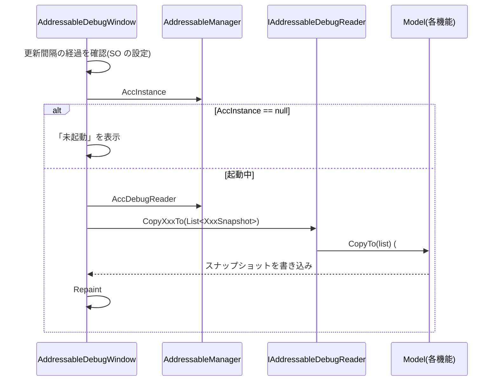
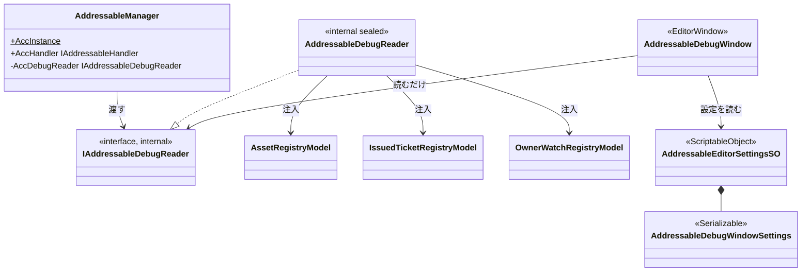

# 設計：AddressableManager Editor 共通基盤

> 対象：`requirements.md`（承認済み版） ／ 作成日：2026-10-13 ／ ステータス：承認待ち ／ 対象 Unity バージョン：6000.3.25f1

## 1. 実装アプローチ

この基盤の仕様は、ステップ4で `src/AddressableManager/Docs/specs/editor-debug-window-spec.md` として書き、仕様書を正とする。本書は、決定した設計と、ドキュメントを更新する順序・範囲だけを書く。**コードは書かない**（機能1の steering で実装する）。

方針：
- 到達手段は、既存の `IAddressableHandler` と同じ形にする。Manager が `Awake` で Model をローカル変数に出し、`LoadingController` と窓口 `AddressableDebugReader` の両方のコンストラクタへ手動で注入する。Manager は `#if UNITY_EDITOR internal IAddressableDebugReader AccDebugReader` で、インターフェイス型として窓口を渡す
- Window は `AddressableManager.AccInstance.AccDebugReader` だけを参照する。新しい static 状態は作らない。`AccInstance == null` のときは「未起動」と表示する
- 読み取り専用は、Window が `IAddressableDebugReader` 型しか持たないことで保つ。Model 側には `#if UNITY_EDITOR` の internal なコピー用メソッドだけを足し、呼ぶのは窓口に限る。Model ごとの読み取り専用インターフェイスは作らない
- 取得は、Window 側が持つ `List<T>` へ `<対象>Snapshot`（readonly struct）をコピーする形にする。更新は Window 側の一定間隔 pull（既定 0.5 秒・下限 0.1 秒）。Runtime 側にイベントを足さない
- Editor 側の設定は `AddressableEditorSettingsSO` が `AddressableDebugWindowSettings`（更新間隔）を保持する。型で探索し、0件ならエディター起動時に `Assets/Data/MAH/AddressableManager/Editor/AddressableEditorSettings.asset` へ自動作成する
- 窓口・スナップショットはすべて `#if UNITY_EDITOR` で囲み、本番ビルドから除外する。`InternalsVisibleTo("MAH.AddressableManager.Editor")` で Editor から internal 型が見えるようにする（コード変更は機能1）

配置と命名：

| 対象 | 名前 | 配置 | namespace |
|---|---|---|---|
| 窓口インターフェイス | `IAddressableDebugReader`（internal） | `Runtime/Core/DebugReader/` | `MAH.AddressableManager.Core` |
| 窓口の実装 | `AddressableDebugReader`（internal sealed） | `Runtime/Core/DebugReader/` | `MAH.AddressableManager.Core` |
| スナップショット | `<対象>Snapshot`（readonly struct、Definition 層） | 作る Model と同じ機能フォルダ（例：`Core/Loading/Model/`） | `MAH.AddressableManager.Core.<機能>` |
| Window | `AddressableDebugWindow` | `Editor/Window/` | `MAH.AddressableManager.Editor.Window` |
| Editor SO | `AddressableEditorSettingsSO` | `Editor/SettingsSync/` | `MAH.AddressableManager.Editor.SettingsSync` |
| Window 設定 | `AddressableDebugWindowSettings`（`[Serializable]`） | `Editor/SettingsSync/` | `MAH.AddressableManager.Editor.SettingsSync` |

実装時の判断：
- **窓口を機能フォルダの外に置く**：複数機能の Model を知るため。`AddressableHandler`（`Runtime/Core/Handler/`）と同じ理由で、conventions 7.4 の例外として備考に明記する。インターフェイスを `Core/Interfaces/` に置かないのは、Core 直下の共通物から機能フォルダのスナップショット型を参照することになるため
- **名前を Handler でなく Reader にする**：本モジュールの Handler は「操作の窓口」を意味する。読み取り専用の窓口に付けると、操作できるように見えるため。揃えるのは渡し方（インターフェイス型を `Acc〜` で渡す）だけ
- **Runtime 側に置く**：Editor フォルダに置くと Runtime の Manager から生成・注入できず、Model を Editor へ公開する必要が出る。そうなると読み取り専用が運用ルール頼みになる
- **SO の探索は型で行う**：配置場所はプロジェクトごとに変わり得るため、パスでなく `AssetDatabase.FindAssets("t:AddressableEditorSettingsSO")` で探す。複数件なら警告を出して1件目を使う
- **自動作成は `delayCall` で遅らせる**：エディター起動直後はインポート中で `AssetDatabase` が使えないことがあるため。将来の計測シンボルの整合チェック（設計仕様書 3.9.1、同じく `[InitializeOnLoad]`）と同じ入口に揃える

検討した代替案と却下理由：
- **Registry を `#if UNITY_EDITOR` の static 弱参照リストに登録する案**（設計仕様書 3.9 の案）：Manager がシングルトンなので「リスト」は過剰で、`AccInstance` と到達経路が二重になる
- **DI コンテナ経由で Manager を掴む案**（同上）：DI コンテナに依存しない方針に反する。本モジュールでは手動の `new` と注入で足りる
- **Model に直接読み取り API を足し、Editor が Model を持つ案**：`InternalsVisibleTo` で `AddEntry` などの書き込み API も見え、読み取り専用が運用ルール頼みになる
- **Model ごとに読み取り専用インターフェイスを作る案**：Window が機能数だけのインターフェイスを持つことになる。窓口1つにまとめれば、Window の依存は1つで済む
- **Runtime から push でイベント通知する案**：Model・Controller に発火箇所が散らばり、購読解除の漏れも増える。Window を閉じていても Runtime 側のコストが残る
- **0件のとき既定値で動作し、作成を促す表示にする案**：利用者のプロジェクトに無断でアセットが増えない利点はあるが、今回は自動作成を採る。作成したことはログで知らせ、移動してよいことを spec に明記する
- **窓口を Editor フォルダに置く案**：前述のとおり注入できないため却下

## 2. 変更するコンポーネント

ドキュメントのみ。パスは `src/AddressableManager/Docs/` を起点とする（リポジトリルートのものは明記）。

| 対象 | 変更内容 | 新規/修正 |
|---|---|---|
| `.steering/20261013-editor-foundation/`（リポジトリルート） | requirements / design / tasklist | 新規 |
| `specs/editor-debug-window-spec.md` | 共通基盤の機能仕様書。章立て：1 概要（メンバー表・持たないもの・位置づけ）／2 動作の全体像（到達手段・pull 更新・未起動時の表示）／3 設定項目（SO・探索・自動作成）／4 内部構成（窓口・スナップショット・Window の枠とタブの追加方法）／5 設計の判断と理由／6 改修ガイド／7 注意点・既知の制約 | 新規 |
| `addressable-manager-design.md` | 3.9 共通方針：到達手段の2案を確定した方式に置き換え、spec へのリンクを追加。3.1.1：Editor SO の探索・自動作成を一行追記。4章：フォルダ構成に `Runtime/Core/DebugReader/` と `AddressableDebugWindowSettings` を追加。6章：決定事項を追記 | 修正 |
| `conventions.md` | 7.2 に窓口・スナップショット・`AddressableDebugWindowSettings` の分類と、窓口を `Core` に置く備考を追加。10章に `<対象>DebugReader`・`<対象>Snapshot`・`<対象>Window` を追加 | 修正 |
| `Docs/glossary.md`（リポジトリルート） | 「スナップショット」「デバッグウィンドウ」を追加 | 修正 |
| `diagrams/editor-foundation-class.md`・`diagrams/index.md` | クラス図を新規作成し、index に登録 | 新規・修正 |

## 3. データ構造の変更

変更なし（ドキュメントのみ）。機能1で、次を追加する予定。

- `AddressableEditorSettingsSO`（新規のアセット）と `AddressableDebugWindowSettings`（更新間隔：既定 0.5 秒・下限 0.1 秒）
- マイグレーションは不要（新規のアセットで、既存の SO には触れない）

## 4. 影響範囲の分析

- 既存機能への影響：なし（コードを変更しない）
- 永続的ドキュメント（`Docs/`）への影響：上の「変更するコンポーネント」のとおり。設計仕様書 3.9 の到達手段2案を不採用にする変更を含む（要件の承認をもって承認とする）
- テストへの影響：なし。機能1で `AddressableDebugReader` のコピー処理の EditMode テストを追加する
- 規則への影響：窓口を `Core` に置くことを、conventions 7.4「Core 直下の共通物は機能フォルダを参照しない」の例外として明記する。明記しないと、後から規則違反に見える

## 5. 図表

呼び出し経路の概要を示す。クラス図は `Docs/diagrams/editor-foundation-class.md` に作成する（ステップ7）。

## 6. 検証方法

### テストコードでの検証

なし（ドキュメントのみ）。コードの検証は機能1の steering で行う。

### 手動での検証（ユーザーが実施）

| 手順 | 期待結果 |
|---|---|
| spec を、requirements の受け入れ条件と1項目ずつ突き合わせる | すべての項目が満たされている |
| 設計仕様書 3.9 を `grep` で「弱参照リスト」「DIコンテナ経由」で検索する | 到達手段の2案が残っていない |
| 新しい型名（`IAddressableDebugReader` / `AddressableDebugReader` / `AddressableDebugWindowSettings` / `<対象>Snapshot`）を spec・design・conventions・図で `grep` する | 表記揺れがない |
| `diagrams/index.md` を確認する | クラス図が登録されている |
