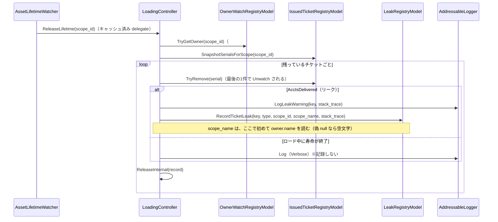
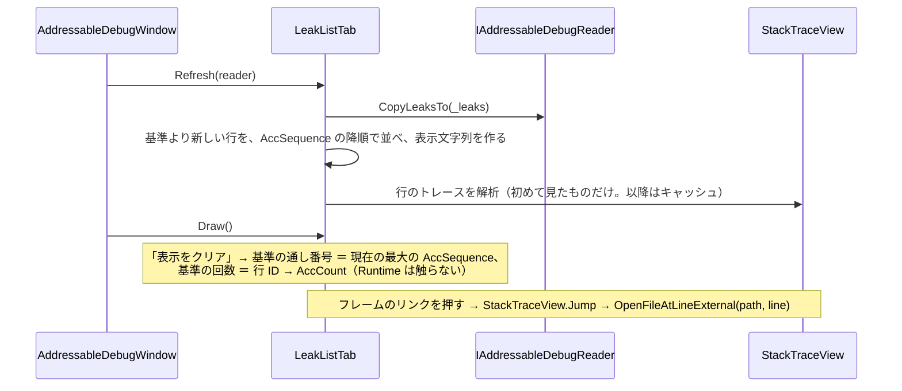
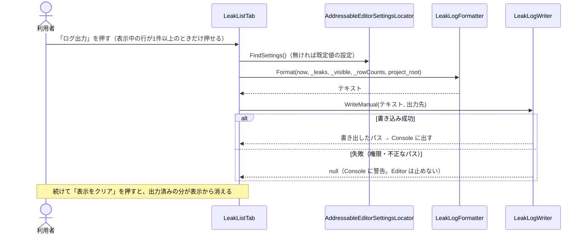
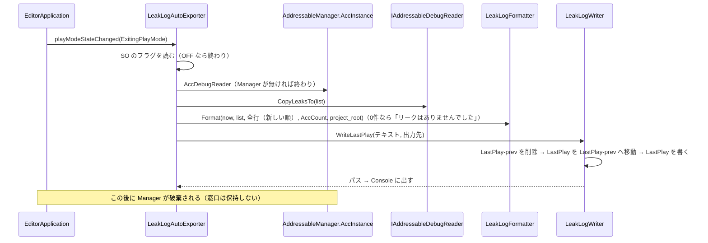

# 設計：AddressableManager Editor 機能2「リーク検出一覧」

> 対象：`requirements.md`（承認済み版） ／ 作成日：2026-10-14 ／ ステータス：承認待ち（2026-10-14 に「ログ出力」を追加） ／ 対象 Unity バージョン：6000.3.25f1

## 1. 実装アプローチ

共通基盤（`editor-debug-window-spec.md` 2〜6章）の上に、「リーク」タブを1つ載せる。`LoadingController.ReleaseLifetime` がリーク警告ログを出す箇所の隣で、Editor 限定の `LeakRegistryModel` へ記録し、窓口 `IAddressableDebugReader` から `Snapshot` で読む。スタックトレースのジャンプは、Editor 側の共通部品にして、2つのタブで使う。

- **記録の場所**：`ReleaseLifetime` の `#if UNITY_EDITOR` 側（既に `record.AccStackTrace` を渡している2箇所）。判定（`AccIsDelivered`・まとめチケット1枚1件）は既存のまま使うため、新しい判定は作らない。ログの出力と記録は同じ条件で行う
- **注入**：`LeakRegistryModel` は Manager の `Awake` でローカル変数に出し、`LoadingController`（`#if UNITY_EDITOR` のコンストラクタ引数）と `AddressableDebugReader` の両方へ渡す（既存の `asset_registry`・`issued_ticket_registry` と同じ形。Model を Controller 内で new しない）
- **集約**：`Dictionary<LeakKey, LeakRecord>`。`LeakKey`（readonly struct、`IEquatable`）は（種別＝単体／Label 一括・`AssetKey`・型・Label・寿命の種類・スタックトレース）。Label 一括は `AssetKey`・型を `default`/`null` にする。スタックトレースは、1行ぶんの文字列の比較になるが、リークの発生時（寿命回収）にしか走らないため許容する。同じ確保元は常に同じ文字列になる（`Environment.StackTrace` は呼び出し位置で決まり、コンストラクタで1回だけ記録されるため）
- **スコープ名の記録**：回収の**前**に Owner の `GameObject` 参照を取る（`_ownerWatch.TryGetOwner`。最後のチケットを取り除くと `TryRemoveTicket` が Unwatch するため、ループの中では取れない）。名前の読み出し（`GameObject.name` は文字列を確保する）は、**リークを記録するときだけ**行う。参照が偽 null（破棄済み。ポーリングで見つかった場合）なら名前なしにする
- **Scene 名の受け渡し**：`ReleaseLifetime(LifetimeScopeId)` のシグネチャは変えない（Watcher のキャッシュ済み delegate が使うため）。`#if UNITY_EDITOR` のフィールド `_unloadingSceneName` を、`HandleSceneUnloaded` が `try/finally` で設定・解除する。`ReleaseLifetime` は同期のため、他の呼び出しと交差しない
- **ジャンプ**：Editor 側の `StackTraceParser`（Unity 非依存の純粋ロジック。テスト可能）と `StackTraceView`（描画・キャッシュ・ジャンプ）。2つのタブが同じ部品を使う
- **既読扱い（クリア）**：`LeakListTab` が、クリア時点の「通し番号の最大値」と「行 ID → その時点の回数」を保持する。表示は、`AccSequence > 基準の通し番号` の行だけで、回数は `AccCount − 基準の回数` を出す。Runtime の記録は消えない
- **更新**：共通基盤のまま（`OnInspectorUpdate` の一定間隔 pull。表示中のタブだけ `Refresh`）
- **ログ出力（2026-10-14 追加）**：Editor 側だけで行い、Runtime は変えない。読み取りは既存の窓口 `CopyLeaksTo` だけ。
  - **文字列の組み立てとファイル操作を分ける**：`LeakLogFormatter`（Unity 非依存・テスト可能）が、行の一覧とクリア以降の回数を受け取ってテキストを作る。`LeakLogWriter` が、出力先の解決・フォルダの作成・書き込み・固定名の2ファイルの入れ替えを行う
  - **手動**：「リーク」タブの「ログ出力」ボタンが、表示中の行（`_visible`）とクリア以降の回数を `LeakLogFormatter` に渡し、`LeakLogWriter.WriteManual` で日時付きのファイルに書く。ダイアログは出さず、書き出したパスを Console に出す。ファイルへの書き込みだけで行の数は変わらないため、「表示をクリア」のような次のレイアウトでの反映は要らない
  - **自動**：`LeakLogAutoExporter`（`[InitializeOnLoad]`）が `playModeStateChanged` を購読し、`ExitingPlayMode`（Manager がまだ生きている）で、SO のフラグが ON なら、窓口から全リークを読んで `LeakLogWriter.WriteLastPlay`（固定名の上書き＋ `-prev` に1世代）で書く。Window とは独立で、Window を閉じていても動く。窓口は保持せず、毎回 `AccInstance` から取り直す
  - **設定**：`AddressableLeakLogSettings`（出力先・自動出力のフラグ）を `AddressableEditorSettingsSO` に足す（共通基盤と同じ `[Serializable]` の形）。SO が無いときは、既定値（自動出力 OFF・出力先 `Logs/AddressableManager`）で動く
  - **削除・上書きの範囲**：`WriteLastPlay` が触るのは固定名の `LastPlay` と `LastPlay-prev` だけ。パターンでの一括削除をしないため、手動のログは自動では消えない

検討した代替案と却下理由：
- **発生を全件並べる案**：同じ確保元のリークが大量に出ると、行が増え続ける。上限と捨て方の仕様が要る。集約なら件数が確保元の数で頭打ちになる（ユーザー決定）
- **窓口に Clear を足す案**：読み取り専用の原則（spec 6.4）の例外になる。既読扱いなら不要（ユーザー決定）
- **スコープ名を Editor 側で引く案**：リークは寿命の終了時に起きるため、取得時にはほぼ必ず破棄済みになる（ユーザー決定）
- **`ReleaseLifetime` に `scope_name` 引数を足す案**：本番ビルドの呼び出しにも引数が残る（`scene.name` の文字列確保を避けるため、呼び出し側に `#if` が要る）。Editor 限定のフィールドなら、本番ビルドに差分が出ない
- **`LoadingController` のコンストラクタ引数を任意（`= null`）にする案**：記録の抜けに気づけなくなる。必須引数にし、生成箇所を更新する
- **スタックトレースの解析結果を `LeakSnapshot` に持たせる案**：解析は表示のための処理で、Runtime の責務ではない。`Snapshot` は文字列のまま渡し、Editor 側で解析する
- **（ログ出力）保存ダイアログで保存先を選ぶ案**：自動出力と手動出力で出力先の扱いが分かれる。SO の出力先1つに揃え、押したらすぐ書けるようにする（ユーザー決定）
- **（ログ出力）発生のたびに Runtime が追記する案**：Runtime にファイル書き込みが入り、pull 方針（設計仕様書 3.9）と合わない。Play 終了時に Editor 側が読む形にする
- **（ログ出力）自動出力も日時付きで溜める案**：Play のたびにファイルが増え続ける。固定名の上書き＋1世代にする（ユーザー決定）
- **（ログ出力）自動出力で0件のとき、ファイルを書かない／消す案**：前の Play のファイルが残って取り違えやすく、直ったことの確認にも使えない。「リークはありませんでした」を書いて上書きする（ユーザー決定。設定にはしない）
- **（ログ出力）CSV・JSON で出す案**：スタックトレース（複数行）が読みにくくなる。テキストのみ（ユーザー決定）

## 2. 変更するコンポーネント

パスは `src/AddressableManager/Assets/@MAH/AddressableManager/` を起点とする（ドキュメントは `src/AddressableManager/Docs/` 起点）。

### コード（Runtime。すべて `#if UNITY_EDITOR`）

| 対象 | 変更内容 | 新規/修正 |
|---|---|---|
| `Runtime/Core/Loading/Model/LeakSnapshot.cs` | internal readonly struct。`AccId`（集約した行の ID。最初の発生で採番）・`AccSequence`（最終発生の通し番号）・`AccIsGroup`・`AccKey`・`AccAssetType`・`AccLabel`・`AccGroupCount`・`AccScopeKind`・`AccScopeValue`・`AccScopeName`（無いときは空文字）・`AccCount`・`AccLastTime`（`DateTime`）・`AccStackTrace` | 新規 |
| `Runtime/Core/Loading/Model/LeakRegistryModel.cs` | internal sealed。`RecordTicketLeak(AssetKey, Type, LifetimeScopeId, string scope_name, string stack_trace)`・`RecordGroupLeak(string label, int count, LifetimeScopeId, string scope_name, string stack_trace)`・`CopyLeaksTo(List<LeakSnapshot>)`（`Clear()` してから書き出す。`Dictionary` は具体型で `foreach`）・`Clear()`。内部に `LeakKey`・`LeakRecord`（private）。行 ID と通し番号は、Model が単調増加で採番する | 新規 |
| `Runtime/Core/Loading/Controller/LoadingController.cs` | コンストラクタに `LeakRegistryModel leaks`（`#if UNITY_EDITOR`）。`ReleaseLifetime`：ループの前に Owner の `GameObject` 参照を取り、2箇所の `#if UNITY_EDITOR` 側で、ログの隣で記録（スコープ名は記録するときだけ解決）。フィールド `_unloadingSceneName` と、`HandleSceneUnloaded` での設定・解除。`Dispose` で `_leaks.Clear()` は呼ばない（Manager の破棄で Model ごと捨てられるため、Registry 系の `Clear` と揃えて呼ぶかは実装時に既存の `Dispose` に合わせる） | 修正 |
| `Runtime/Core/DebugReader/IAddressableDebugReader.cs` | `void CopyLeaksTo(List<LeakSnapshot> leaks)` を追加 | 修正 |
| `Runtime/Core/DebugReader/AddressableDebugReader.cs` | コンストラクタに `LeakRegistryModel` を追加（null は `ArgumentNullException`）。`CopyLeaksTo` を委譲 | 修正 |
| `Runtime/Core/AddressableManager.cs` | `leak_registry` をローカル変数で作り、`LoadingController` と `AddressableDebugReader` へ注入（`#if UNITY_EDITOR`。`LoadingController` の引数の `#if` は、呼び出し側でも同じ条件で囲む） | 修正 |

### コード（Editor）

| 対象 | 変更内容 | 新規/修正 |
|---|---|---|
| `Editor/Window/StackTraceParser.cs` | internal static。`Environment.StackTrace` を行ごとに解析し、`StackFrame`（`DisplayText`・`Path`・`Line`・`CanJump`）の配列を返す。`FindFirstUserFrame(frames)`：`CanJump` で、モジュール内（パスに `/@MAH/AddressableManager/Runtime/` を含む）・パッケージキャッシュ（`/Library/PackageCache/` を含む）でない最初のフレームの添字（無ければ -1）。パスは `\` を `/` にそろえて判定する。`in <path>:<line>` は最後の `:` で分け（Windows のドライブレターを壊さない）、`<filename unknown>` や行番号 0 は `CanJump = false`。`Assets/`・`Packages/` で始まる相対パスは、プロジェクトのルートからの絶対パスにする | 新規 |
| `Editor/Window/StackTraceView.cs` | internal sealed。トレース文字列 → 解析結果（`StackFrame[]` と最初の利用者フレームの添字）の `Dictionary<string, …>` キャッシュ（`Clear()` で破棄）。`Draw(string stack_trace)`：ジャンプ可能なフレームは `EditorGUILayout.LinkButton`、それ以外は薄い色のラベル。全文コピーのボタン（`EditorGUIUtility.systemCopyBuffer`）。`TryGetFirstUserFrame(string, out StackFrame)`：行のジャンプボタン用。`Jump(StackFrame)`：`InternalEditorUtility.OpenFileAtLineExternal(path, line)`。解析は、初めて見たトレースの1回だけ確保し、以降はキャッシュを使う | 新規 |
| `Editor/Window/LeakListTab.cs` | internal sealed、`IDebugWindowTab`。タイトル「リーク」。`Refresh`：`reader.CopyLeaksTo(_leaks)` → 既読の基準を適用した表示順（`AccSequence` の降順）の添字リストと、表示用の文字列（行の見出し・スコープのラベル・最終時刻・回数）を作る。`Draw`：先頭の件数・「表示をクリア」・行（開閉・ジャンプボタン・開くと `StackTraceView`）。`Clear()`：Snapshot・開閉・基準・`StackTraceView` を破棄 | 新規 |
| `Editor/Window/AddressableDebugWindow.cs` | `OnEnable` の `_tabs` に `LeakListTab` を追加 | 修正 |
| `Editor/Window/RuntimeStateTab.cs` | `DrawStackTrace` と `_stackTraceStyle`・`_measureContent` を削除し、`StackTraceView`（フィールドで保持）の `Draw` に差し替え。`Clear()` で `StackTraceView` も破棄 | 修正 |
| `Editor/SettingsSync/AddressableLeakLogSettings.cs` | internal sealed、`[Serializable]`。`_outputFolder`（既定 `Logs/AddressableManager`）・`_exportOnExitPlayMode`（既定 false）。`AccOutputFolder`・`AccExportOnExitPlayMode`。既定値の公開コンストラクタと、値を指定する internal コンストラクタ。`ClampValues()`：出力先が空白なら既定値に戻す | 新規 |
| `Editor/SettingsSync/AddressableEditorSettingsSO.cs` | `[Header("リーク")] _leakLog = new AddressableLeakLogSettings()` と `AccLeakLog` を追加。`OnValidate` で `ClampValues()` | 修正 |
| `Editor/Window/LeakLogFormatter.cs` | internal static、Unity 非依存。`Format(DateTime exported_at, List<LeakSnapshot> leaks, List<int> rows, List<int> counts, string project_root)`：`rows` は出力する行の `leaks` 上の添字（出力順）、`counts` は行ごとの回数（手動はクリア以降の回数、自動は `AccCount`）。見出し（出力日時・リーク N 回・確保元 M 件）と、行ごとの回数・キーと型（Label 一括は Label と件数）・寿命とスコープ名（名前が無いときは ID / handle）・最終発生時刻・呼び出し元（`StackTraceParser.FindFirstUserFrame`。無ければ「不明」）・スタックトレース全文。`rows` が空のときは「リークはありませんでした」 | 新規 |
| `Editor/Window/LeakLogWriter.cs` | internal static。`ResolveFolder(project_root, output_folder)`（相対はルートから、絶対はそのまま。純粋）・`CreateFileName(DateTime)`（`AddressableLeaks_yyyyMMdd_HHmmss.txt`。純粋）・`WriteManual(text, folder)`（フォルダ作成・同名なら `_2`・`_3`…・UTF-8 BOM なしで書く・パスを返す）・`WriteLastPlay(text, folder)`（`LastPlay-prev` を消す → `LastPlay` を `-prev` へ移す → `LastPlay` を書く。固定名の2ファイルだけを触る）。IO の失敗は、例外を握って Console に警告を出し、null を返す（Editor・Play の終了を止めない） | 新規 |
| `Editor/Window/LeakLogAutoExporter.cs` | internal static、`[InitializeOnLoad]`。静的コンストラクタで `EditorApplication.playModeStateChanged` を購読（ドメインリロードのたびに1回だけ）。`ExitingPlayMode` で、`AddressableEditorSettingsLocator.FindSettings()`（無ければ既定値）のフラグが ON、かつ `AddressableManager.AccInstance` が生きているときだけ、`AccDebugReader.CopyLeaksTo` → 全行（`AccSequence` の降順・回数は `AccCount`）→ `LeakLogFormatter.Format` → `LeakLogWriter.WriteLastPlay`。0件でも書く。窓口は保持しない | 新規 |
| `Editor/Window/LeakListTab.cs`（ログ出力の追加分） | 見出しを `[ログ出力][表示をクリア]` に。「ログ出力」は、`_visible` の行とクリア以降の回数（`_rowCounts`：`BuildRows` で作る `List<int>`）を `LeakLogFormatter` → `LeakLogWriter.WriteManual` に渡す。出力先は押したときに `FindSettings()`（無ければ既定値）から読む。成功したらパスを Console に出す。`_visible.Count == 0` のときは `EditorGUI.BeginDisabledGroup` で押せなくする | 修正 |

### テスト（EditMode）

| 対象 | 変更内容 | 新規/修正 |
|---|---|---|
| `Tests/Editor/LeakRegistryModelTests.cs` | 集約・区別・更新・コピー（requirements 3章）。`LeakRegistryModel` を直接検証 | 新規 |
| `Tests/Editor/LoadingControllerLeakTests.cs` | Controller の記録の有無（返し済み／ロード中／明示 Release 済み／まとめチケット1枚1件／Owner・Scene のスコープ名／破棄済み Owner は名前なし）。`LoadingControllerTestBase` を継承 | 新規 |
| `Tests/Editor/StackTraceParserTests.cs` | Mono 形式の行・ファイル情報の無い行・Windows パス・相対パス・最初の利用者フレームの選択 | 新規 |
| `Tests/Editor/AddressableDebugReaderTests.cs` | `CopyLeaksTo`（Model の内容の書き出し・`Clear()`・取得後の不変・null 引数）を追加。生成の引数を更新 | 修正 |
| `Tests/Editor/LoadingControllerTestBase.cs`・`LoadingControllerPollingTests.cs`・`AddressableHandlerInitializeTests.cs`・`AddressableHandlerDownloadTests.cs` | `new LoadingController(...)` に `LeakRegistryModel` を渡す（`TestBase` は、テストから参照できるよう保持） | 修正 |
| `Tests/Editor/RuntimeStateTabTests.cs` | `DrawStackTrace` に依存していれば更新（実装時に確認。IMGUI の描画は自動テストの対象外） | 修正（必要時） |
| `Tests/Editor/AddressableLeakLogSettingsTests.cs` | 既定値（出力先 `Logs/AddressableManager`・自動出力 OFF）／空文字・空白の出力先は既定値に戻る／指定した値はそのまま使われる／SO の既定値と `OnValidate` | 新規 |
| `Tests/Editor/LeakLogFormatterTests.cs` | 見出しの件数と出力日時／渡した行の順／回数は渡した値／単体と Label 一括の表記／スコープ名と、名前が無いときの ID・handle／呼び出し元（最初の利用者のフレーム。無ければ「不明」）／スタックトレース全文／0件のときの文 | 新規 |
| `Tests/Editor/LeakLogWriterTests.cs` | 出力先の解決（相対・絶対・Windows のドライブレター）／手動のファイル名の書式／一時フォルダへの書き込みでフォルダが作られ、同名は連番／`WriteLastPlay` の1世代の入れ替え（2回目で `-prev` に移り、3回目で最初の内容が消える）／手動のログが消えない／書き込めないパスで null が返り、例外が出ない（一時フォルダは、テスト後に削除する） | 新規 |

### ドキュメント

| 対象 | 変更内容 | 新規/修正 |
|---|---|---|
| `.steering/20261014-editor-leak-list/` | requirements / design / tasklist | 新規 |
| `specs/editor-debug-window-spec.md` | 冒頭の実装状況、2.1（窓口に注入する Model に `LeakRegistryModel`）、2.4（タブの並び）、3.1（設定表に `AddressableLeakLogSettings`）、4.1（クラス表）、7章、8章の状態表、**8.2 リーク検出一覧**（概要・画面・Snapshot と窓口・スコープ名の記録・スタックトレースのジャンプ・設計の判断と理由・改修ガイド・注意点・テスト）、8.1 のスタックトレース表示を共通部品に合わせて更新 | 修正 |
| `addressable-manager-design.md` | 3.9(3) を実装済みの記述にし、spec 8.2 への参照を追記 | 修正 |
| `specs/loading-spec.md` | 10章の「機能2で行う」を、`LeakRegistryModel` への記録の記述に更新 | 修正 |
| `diagrams/editor-foundation-class.md` | `LeakRegistryModel`・`LeakSnapshot`・`LeakListTab`・`StackTraceView`・`StackTraceParser` を追加 | 修正 |
| `conventions.md` / `Docs/glossary.md` | 新しい命名パターン・用語（「リーク」「確保元」の使い分け）が出ていれば確認して更新 | 修正（必要時） |

## 3. データ構造の変更

- 永続データの変更は、`AddressableEditorSettingsSO` への項目の追加だけ（ログ出力の設定）。マイグレーションは不要（既存のアセットは、新しい項目が既定値で読み込まれる）。Runtime の SO・CSV・セーブデータは変更しない

| 項目（`AddressableLeakLogSettings`） | 型 | 既定 | 補正 |
|---|---|---|---|
| 出力先フォルダ | string | `Logs/AddressableManager`（プロジェクト直下の `Logs/` は、Unity がインポートせず、git の管理外） | 空・空白なら既定値に戻す。相対パスはプロジェクトのルート（`Assets/` の親）から、絶対パスはそのまま |
| Play 終了時に自動で出力する | bool | false | なし |

- 出力するファイル：手動は `AddressableLeaks_yyyyMMdd_HHmmss.txt`（溜める）、自動は `AddressableLeaks_LastPlay.txt`（上書き）と `AddressableLeaks_LastPlay-prev.txt`（前回分。1世代）。文字コードは UTF-8（BOM なし）
- Runtime に Editor 限定のデータが増える：`LeakRegistryModel`（確保元ごとの集約レコード。件数は確保元の数で頭打ち）
- `LeakSnapshot` の中身（`AccStackTrace` は文字列の参照のコピーで、複製はしない）：

| フィールド | 単体 | Label 一括 |
|---|---|---|
| `AccIsGroup` | false | true |
| `AccKey`・`AccAssetType` | 確保したキー・型 | `default`・`null` |
| `AccLabel`・`AccGroupCount` | 空・0 | Label・まとめチケットの件数 |
| `AccScopeKind`・`AccScopeValue`・`AccScopeName` | 最後に発生した寿命の情報（名前が無いときは空文字） | 同左 |
| `AccCount`・`AccLastTime`・`AccSequence` | 集約した回数・最終時刻・最終の通し番号 | 同左 |

- 集約の同一判定（`LeakKey`）：単体＝`AssetKey`・型・寿命の種類・スタックトレース／Label 一括＝Label・寿命の種類・スタックトレース。**スコープの値（Owner の ID・Scene の handle）は含めない**（別の Owner・別のシーンで同じ呼び出し元のリークが起きても、同じ行にまとめて回数を数えるため。最終のスコープだけを表示する）

## 4. 影響範囲の分析

- 既存機能への影響：
  - `LoadingController`：コンストラクタ引数（`#if UNITY_EDITOR`）の追加と、`ReleaseLifetime` の記録の呼び出しの追加のみ。解放経路（`ReleaseInternal`）・ログの内容と条件・例外は変えない。`HandleSceneUnloaded` はフィールドの設定と解除が増えるだけ
  - `AddressableManager.Awake`：Model を1つ生成して渡す。本番ビルドでは差分なし
  - `RuntimeStateTab`：スタックトレースの表示が、選択コピー用のラベルから、リンク付きの表示＋コピーボタンに変わる
  - 本番ビルド：追加分はすべて `#if UNITY_EDITOR` か Editor アセンブリで、変更なし
- 永続的ドキュメント（Docs/）への影響：上の「ドキュメント」のとおり
- テストへの影響：
  - `new LoadingController(...)` の生成箇所を更新する（`TestBase`・`PollingTests`・`HandlerInitializeTests`・`HandlerDownloadTests`）。`new AddressableDebugReader(...)`（`AddressableDebugReaderTests`）も更新する
  - 追加：`LeakRegistryModelTests`・`LoadingControllerLeakTests`・`StackTraceParserTests`、`AddressableDebugReaderTests` へのケース追加
- ログ出力の影響：
  - `AddressableEditorSettingsSO`：項目の追加のみ。既存のアセットの Inspector に「リーク」が既定値で出る
  - Runtime・窓口・Model・本番ビルド：変更なし（ログ出力は Editor アセンブリだけ）
  - `LeakListTab`：見出しにボタンが1つ増え、`BuildRows` が行ごとの回数（`_rowCounts`）を保持するようになる。既存の表示・「表示をクリア」の動きは変えない
- リスクと実装時の確認点：
  - **`Environment.StackTrace` の書式**：Mono 形式（`at X.Y () [0x00000] in /path/File.cs:42`）を前提にする。実環境のトレースを1度採取して、テストの入力に使う。解析できない行は、ジャンプ不可の表示にするだけで、例外にしない
  - **`OnDestroy` の中で `GameObject.name` を読めるか**：実装時に PlayMode のサンプルで確認する（読めない場合は、スコープ名を ID 表示にする）
  - **async のフレーム**：利用者側の `MoveNext` の行も「最初の利用者フレーム」になり得る（行番号は正しいため、そのまま対象にする）
  - **クリアの取りこぼし**：Refresh の後からクリアまでの間に起きたリークは、クリアの基準に含まれないため、クリア後に表示される（隠さない側に倒す）
  - **（ログ出力）手動出力の鮮度**：「ログ出力」は、最後の Refresh（既定 0.5 秒間隔）の時点のスナップショットを書く。直後に起きたリークは、次の更新まで入らない（画面に見えている内容と同じ）
  - **（ログ出力）Play 停止そのものが原因の回収**：`ExitingPlayMode` は、シーンの破棄（`sceneUnloaded`・Owner の `OnDestroy`）より前に呼ばれる。停止に伴って起きる回収は、自動出力に含まれない（Manager の `Dispose` による強制解放は、もともとリークとして記録しない）。spec の注意点に書く
  - **（ログ出力）IO の失敗**：権限・不正なパス・ファイルが使用中で、書き込みや移動が失敗しても、例外を握って Console に警告を出す。`ExitingPlayMode` の中で例外を投げて Play の終了を妨げない
  - **（ログ出力）`-prev` の移動**：`File.Move` は上書きできないため、先に `-prev` を削除してから移す。途中で失敗した場合は、`LastPlay` が消えず、どちらかが残る状態になる（警告を出して終わる）
  - **（ログ出力）スタックトレース全文のサイズ**：確保元ごとに1回だけの文字列で、行数は確保元の数で頭打ちのため、ファイルは大きくならない

## 5. 図表

クラス構成の差分は `Docs/diagrams/editor-foundation-class.md` に反映する（実装後）。処理の流れは次のとおり。

### リークの記録（Owner 寿命・`OnDestroy` 経由）

- Scene 寿命：`HandleSceneUnloaded(scene)` が `_unloadingSceneName = scene.name` を設定 → `ReleaseLifetime` → `finally` で解除。記録するときに `_unloadingSceneName` をスコープ名にする
- Label 一括：最初に回収した1件で `RecordGroupLeak` を1回だけ呼ぶ（既存の「まとめチケット1枚1件」の分岐の中）
- 非同期処理は含まない（`ReleaseLifetime` は同期）ため、キャンセル・エラーのフローは無い

### 表示と既読扱い

### ログ出力（手動）

### ログ出力（Play 終了時の自動）

