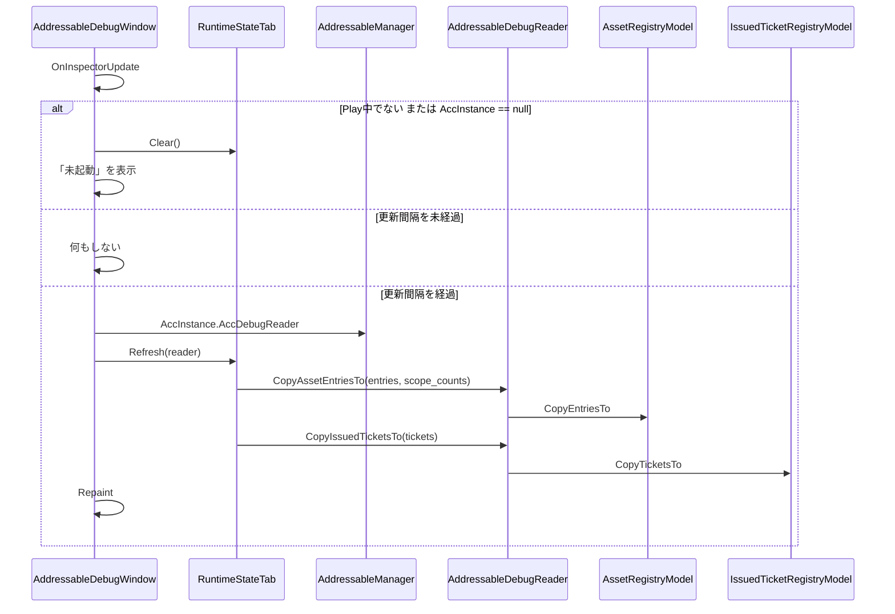

# 設計：AddressableManager Editor 機能1「実行時の読み込み/解放状態の確認」

> 対象：`requirements.md`（承認済み版） ／ 作成日：2026-10-14 ／ ステータス：承認済み ／ 対象 Unity バージョン：6000.3.25f1

## 1. 実装アプローチ

共通基盤の設計（`.steering/20261013-editor-foundation/design.md`、`specs/editor-debug-window-spec.md`）をそのままコードにし、その上に「実行時状態」タブを1つ載せる。

- **到達手段**：Manager が `Awake` で `AssetRegistryModel`・`IssuedTicketRegistryModel` をローカル変数に出し、`LoadingController` と `AddressableDebugReader` の両方へ注入する。`#if UNITY_EDITOR internal IAddressableDebugReader AccDebugReader` で渡す。Window は `AccInstance.AccDebugReader` を毎回取り直し、保持しない
- **コピーの形**：Model に `#if UNITY_EDITOR` の internal なコピー用メソッドを足し、窓口が委譲する。Window 側が持つ `List` を `Clear()` して書き出す（新規の配列・リストを作らない）
- **`CountByScope` の渡し方**：`Dictionary` は `readonly struct` に持てないため、**フラットな `List<ScopeCountSnapshot>` に全エントリ分を連結して書き出し、`AssetEntrySnapshot` に開始位置と件数を持たせる**。確保なしで内訳を渡せる
- **エントリとチケットの対応**：`IssuedTicketSnapshot` に `AssetKey`＋型＋スコープ（種別・値）を値で持たせ、タブが一致するものを探す。internal の `AssetEntryKey` は Snapshot に出さない（Editor に見せる internal 型を増やさない）。件数は数百規模のため、描画時の線形探索で足りる
- **スコープ名の解決**：Runtime には持たせず、タブ（Editor 側）で行う。Owner は InstanceID から GameObject 名、Scene は `handle` が一致する読み込み中のシーン名を引く。見つからなければ「破棄済み」と表示する。Snapshot に `UnityEngine.Object` を持たせない方針を守るため
- **更新**：`OnInspectorUpdate` で Play 中かつ更新間隔を超えたときだけ `Refresh` し `Repaint`。`EditorApplication.timeSinceStartup` で経過を測る。Play 外・`AccInstance == null` ではタブの `List` を `Clear()` して「未起動」を表示する
- **タブの枠**：`IDebugWindowTab`（`AccTitle`・`Refresh`・`Clear`・`Draw`）。Window は `IDebugWindowTab[]` をフィールドに持ち、`GUILayout.Toolbar` で切り替える。今回のタブは `RuntimeStateTab` の1つで、後続の機能は配列に足す
- **折りたたみの状態**：エントリごとの開閉は、`AssetKey`＋型を文字列化したキーで持つと毎フレーム確保が出るため、**値タプルをキーにした `HashSet<(AssetKey, Type)>`（開いているものだけを保持）** で持つ。消えたエントリの分は放置し（再登場時に開いたままになるだけで実害がない）、タブの `Clear()`（未起動に戻ったとき）で空にする
- **設定**：`AddressableEditorSettingsLocator`（`[InitializeOnLoad]`）が型で探索・自動作成する。Window は毎回 SO を探索せず、`OnEnable` で取得して保持する（SO が無い場合は既定値の `AddressableDebugWindowSettings`）

検討した代替案と却下理由：
- **Snapshot の中に `CountByScope` の配列を持たせる案**：エントリごとに配列を確保するため、一時コレクションを都度確保しない方針に反する。フラットな List＋開始位置・件数にする
- **Runtime 側でスコープ名（GameObject 名・シーン名）を解決する案**：`UnityEngine.Object` を Runtime の Snapshot に持たせることになり、Model・Reader をピュアC#に保てない。Editor 側のタブで解決する
- **UI Toolkit で表にする案**：既存の Editor コード（Drawer・AdvancedDropdown）が IMGUI で、pull ごとのリストの再バインドも要るため、IMGUI にした（ユーザー決定）
- **窓口から `Dictionary` ごと渡す案**：Model の内部状態が Editor に見え、読み取り専用が運用ルール頼みになる

## 2. 変更するコンポーネント

パスは `src/AddressableManager/Assets/@MAH/AddressableManager/` を起点とする（ドキュメントは `src/AddressableManager/Docs/` 起点、`Docs/glossary.md` はリポジトリルート）。

### コード

| 対象 | 変更内容 | 新規/修正 |
|---|---|---|
| `Runtime/Core/Loading/Model/AssetEntrySnapshot.cs` | `AccKey`・`AccAssetType`・`AccAssetName`（アセット名の文字列コピー。ロード完了前・破棄済みは空）・`AccRefCount`・`AccStatus`・`AccScopeCountStart`・`AccScopeCountLength`。internal readonly struct、`#if UNITY_EDITOR` | 新規 |
| `Runtime/Core/Loading/Model/ScopeCountSnapshot.cs` | `AccScopeKind`・`AccScopeValue`・`AccCount` | 新規 |
| `Runtime/Core/Loading/Model/IssuedTicketSnapshot.cs` | `AccSerial`・`AccKey`・`AccAssetType`・`AccScopeKind`・`AccScopeValue`・`AccIsDelivered`・`AccIsGroup`・`AccStackTrace` | 新規 |
| `Runtime/Core/Loading/Lifetime/LifetimeScopeId.cs` | internal アクセサ `AccKind`・`AccValue` を追加 | 修正 |
| `Runtime/Core/Loading/Model/AssetEntryModel.cs` | `CopyScopeCountsTo(List<ScopeCountSnapshot>)`（追記のみ）。`#if UNITY_EDITOR` | 修正 |
| `Runtime/Core/Loading/Model/AssetRegistryModel.cs` | `CopyEntriesTo(List<AssetEntrySnapshot>, List<ScopeCountSnapshot>)`（両方を Clear して書き出す）。`#if UNITY_EDITOR` | 修正 |
| `Runtime/Core/Loading/Model/IssuedTicketRegistryModel.cs` | `CopyTicketsTo(List<IssuedTicketSnapshot>)`。`#if UNITY_EDITOR` | 修正 |
| `Runtime/Core/DebugReader/IAddressableDebugReader.cs` | `CopyAssetEntriesTo`・`CopyIssuedTicketsTo`。internal interface、`#if UNITY_EDITOR` | 新規 |
| `Runtime/Core/DebugReader/AddressableDebugReader.cs` | 2つの Model を注入され、委譲するだけ。internal sealed、`#if UNITY_EDITOR` | 新規 |
| `Runtime/Core/AddressableManager.cs` | Model をローカル変数に出して注入。`_debugReader`・`AccDebugReader`（`#if UNITY_EDITOR`）。`OnDestroy` で `null` に戻す | 修正 |
| `Runtime/AssemblyInfo.cs` | `InternalsVisibleTo("MAH.AddressableManager.Editor")` を追加（日付・理由・使ってよい型の限定をコメントに書く） | 修正 |
| `Editor/SettingsSync/AddressableDebugWindowSettings.cs` | `[Serializable]`。更新間隔（既定 0.5・下限 0.1）と `ClampValues()` | 新規 |
| `Editor/SettingsSync/AddressableEditorSettingsSO.cs` | `[CreateAssetMenu(menuName = "MAH/Addressable/EditorSettings")]`。`OnValidate` で補正 | 新規 |
| `Editor/SettingsSync/AddressableEditorSettingsLocator.cs` | `[InitializeOnLoad]`。型で探索・複数件の警告・0件のとき `delayCall` で自動作成。Window 用の取得メソッド | 新規 |
| `Editor/Window/IDebugWindowTab.cs` | タブの契約（`AccTitle`・`Refresh`・`Clear`・`Draw`） | 新規 |
| `Editor/Window/AddressableDebugWindow.cs` | メニュー・ツールバー・pull 更新・「未起動」表示 | 新規 |
| `Editor/Window/RuntimeStateTab.cs` | エントリ → スコープ内訳 → チケットの描画、スコープ名の解決、開閉状態 | 新規 |
| `Tests/Editor/AddressableDebugReaderTests.cs` | コピー内容・Clear・取得後の不変・空の Registry | 新規 |
| `Tests/Editor/AddressableDebugWindowSettingsTests.cs` | 下限補正 | 新規 |
| `Tests/Editor/MAH.AddressableManager.Editor.Tests.asmdef` | Editor アセンブリへの参照（設定のテストに必要な場合のみ） | 修正（必要時） |

### ドキュメント

| 対象 | 変更内容 | 新規/修正 |
|---|---|---|
| `.steering/20261014-editor-runtime-state/` | requirements / design / tasklist | 新規 |
| `specs/editor-debug-window-spec.md` | 冒頭の実装状況、2.4（メニュー・タブの並び）、4章（`IDebugWindowTab`・Locator）、6.1（タブ追加手順を実コードと照合）、7章（internal 型を使わないレビュー観点の再確認）、8章（機能1の節を追記・状態表を更新） | 修正 |
| `conventions.md` | 10章：Snapshot の実名、`<対象>Tab` の命名パターン | 修正 |
| `diagrams/editor-foundation-class.md` | 実コードのメンバー名に更新 | 修正 |
| `specs/loading-spec.md` | 10章の「EditorWindow での一覧表示は Editor 拡張の実装時に行う」の参照先を更新 | 修正 |

## 3. データ構造の変更

- 新規アセット `AddressableEditorSettingsSO`（`AddressableDebugWindowSettings`：更新間隔 0.5 秒・下限 0.1 秒）。Editor アセンブリのためビルドに含まれない。新規のため、マイグレーションは不要（既存の SO には触れない）
- Runtime のデータ構造（Model のフィールド・Registry の構造）は変更しない。追加するのは、コピー用メソッドと、Snapshot の型だけ

## 4. 影響範囲の分析

- 既存機能への影響：
  - `AddressableManager.Awake`：Model の `new` をローカル変数に出すだけで、注入先・順序は同じ
  - `LifetimeScopeId`：アクセサの追加のみ。等価判定・`GetHashCode` は変えない
  - 本番ビルド：追加分はすべて `#if UNITY_EDITOR` か Editor アセンブリで、変更なし
- 永続的ドキュメント（Docs/）への影響：上の「ドキュメント」のとおり。設計仕様書 3.9(2) の表示項目と一致していることを確認する（現時点で更新不要の見込み）
- テストへの影響：既存テストは変更しない。`AddressableDebugReaderTests`・`AddressableDebugWindowSettingsTests` を追加する。実装時に確認する点：
  - `InternalsVisibleTo` の追加で、Editor アセンブリから internal 型が見えるだけで、既存のコンパイルに影響しないこと
  - Unity 6000.3 で `EditorUtility.InstanceIDToObject` が非推奨（EntityId 系への移行）になっていないか。警告が出る場合は、非推奨でない API を使う
- 規約への影響：`conventions.md` 7.4 の例外（窓口を `Core` に置く）は設計済みで追記不要

## 5. 図表

概要の流れは次のとおり（クラス構成は `Docs/diagrams/editor-foundation-class.md`、共通基盤の流れは `.steering/20261013-editor-foundation/design.md` 5章）。



`CountByScope` の連結の形（エントリ側が開始位置と件数で参照する）：

```
entries      : [E0{start=0,len=2}] [E1{start=2,len=1}] [E2{start=3,len=0}]
scope_counts : [Manual:1] [Owner:12345:1] [Scene:7:3] 
                \__ E0 __/                  E1
```
