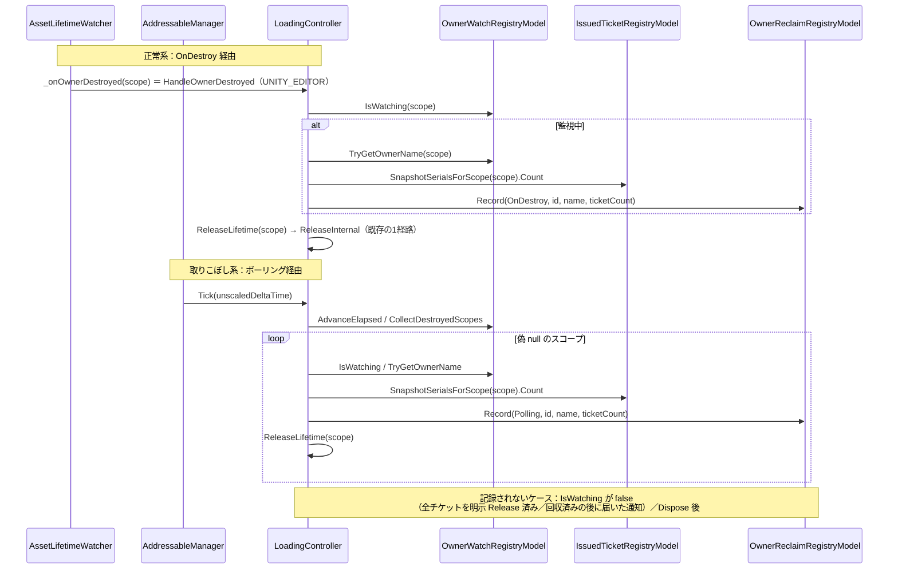
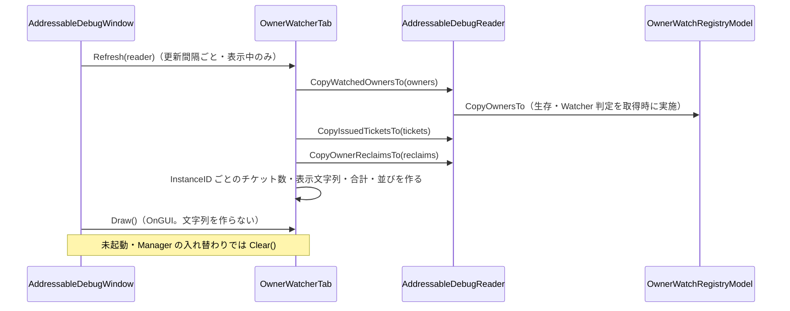

# 設計：AddressableManager Editor 機能3「owner Watcher の可視化」

> 対象：`requirements.md`（承認済み版） ／ 作成日：2026-10-15 ／ ステータス：承認待ち ／ 対象 Unity バージョン：6000.3.25f1

## 1. 実装アプローチ

共通基盤（`editor-debug-window-spec.md` 2〜6章）の上に、「Owner」タブを1つ載せる。Owner の回収が起きる2つの入口（Watcher の `OnDestroy` からの通知／ポーリング）で、**解放の直前に** Editor 限定の `OwnerReclaimRegistryModel` へ記録し、監視中の一覧は `OwnerWatchRegistryModel` から `Snapshot` で読む。どちらも窓口 `IAddressableDebugReader` 越しに取得する。

- **記録の場所**：Watcher に渡す delegate を `#if UNITY_EDITOR` のときだけ `HandleOwnerDestroyed`（記録 → `ReleaseLifetime`）にし、`PollDestroyedOwners` のループにも同じ記録を足す。**解放は従来どおり `ReleaseLifetime` → `ReleaseInternal` の1経路**で、新しい解放経路は作らない。本番ビルドでは、delegate は従来どおり `ReleaseLifetime` そのもの（呼び出しの段が増えない）
- **delegate はキャッシュする**：`_onOwnerDestroyed` はコンストラクタで1回だけ代入する既存のフィールド。`HandleOwnerDestroyed` はメソッドグループの代入なので、毎回の生成は起きない
- **記録の条件**：`_ownerWatch.IsWatching(scope_id)` のときだけ記録する。明示 Release で全チケットが尽きて監視が外れた Owner の破棄、ポーリング回収後に遅れて届く `OnDestroy`、`OnDestroy` 回収後のポーリングは、いずれも `IsWatching == false` になるため、記録されない（二重記録の防止に、新しい状態を持たない）
- **チケット数は回収前に読む**：`ReleaseLifetime` の中でチケットが取り除かれるため、`_tickets.SnapshotSerialsForScope(scope_id).Count` を `ReleaseLifetime` の呼び出し前に読む。このバッファは `ReleaseLifetime` 内でも使い回されるが、`Count` を整数で取り出してから呼ぶため干渉しない
- **Owner 名は登録時に保持する**：`OwnerWatchRegistryModel.Watch` が、`#if UNITY_EDITOR` で `Dictionary<LifetimeScopeId, string> _ownerNames` に `owner.name` を保存する（登録1回につき文字列1つ。Editor 限定）。ポーリングで見つかる Owner は偽 null で名前が取れないため、取りこぼしの調査に必要
- **集約**：`LeakRegistryModel` と同じ構成の `Dictionary<ReclaimKey, ReclaimRecord>`。キーは（回収経路・Owner 名）。**InstanceID は含めない**（同じ Prefab を生成・破棄するたびに ID が変わるため。最後の ID だけ持つ）。件数は Owner 名の種類で頭打ちになる
- **監視中一覧の生存・Watcher 状態**：`OwnerWatchRegistryModel.CopyOwnersTo` が、`GameObject` の偽 null 判定（`AccIsAlive`）と、`TryGetComponent<AssetLifetimeWatcher>`（`AccHasWatcher`）・`AssetLifetimeWatcher.IsRegistered(scope)`（`AccIsRegistered`）を取得時に調べて、`bool` で `Snapshot` に詰める。`GameObject` や `Watcher` の参照は `Snapshot` に持たせない。この Model は既に `GameObject` を保持しており、Editor 限定の読み取りに留まるため、層の例外とはしない（CLAUDE.md の「Model はピュアC#」は Unity API を呼ぶロジックを置かない趣旨。判定は Editor 限定のコピー用メソッド内に限る）
- **チケット数は Editor 側で付ける**：`OwnerWatcherTab` が `CopyIssuedTicketsTo` の結果を、Owner の InstanceID ごとに数える（機能1で Entry とチケットの対応を Editor 側で付けたのと同じ方針）。Model 同士を結びつけず、窓口の追加メソッドを増やさない
- **注入**：`OwnerWatchRegistryModel` は Manager の `Awake` でローカル変数に出し、`LoadingController`（既存の引数）と `AddressableDebugReader`（新規の引数）の両方へ渡す。`OwnerReclaimRegistryModel` も同様に生成し、`LoadingController`（`#if UNITY_EDITOR` の引数）と `AddressableDebugReader` へ渡す
- **更新**：共通基盤のまま（`OnInspectorUpdate` の一定間隔 pull。表示中のタブだけ `Refresh`）。表示用の文字列・件数・合計は `Refresh` で作り、`Draw` では作らない

検討した代替案と却下理由：
- **`ReleaseLifetime` に回収経路の引数を足す案**：本番ビルドの呼び出しにも引数が残る。Watcher の delegate が `Action<LifetimeScopeId>` で、シグネチャを変えられない。入口側で記録する形なら、解放経路は1つのまま
- **`AssetLifetimeWatcher` が `OnDestroy` の通知を記録する案**：Watcher を Editor 限定のロジックで汚し、Controller の `_isDisposed` 判定・`IsWatching` 判定を迂回してしまう。記録は Controller に集約する
- **回収の記録を発生順に全件並べる案**：Owner の生成・破棄を繰り返すと行が増え続ける。集約なら Owner 名の種類で頭打ちになる（リークと同じ判断）
- **キーに InstanceID を含める案**：生成のたびに別の行になり、集約の意味がなくなる
- **Owner 名を回収時に解決する案**：ポーリングで見つかる Owner は偽 null で名前が取れない。登録時に保持する
- **Watcher の貼り付け状態を `IAssetLifetimeWatcherBinder` から取る案**：窓口が Service 層を知ることになり、「Registry と Service の両方を知ってよいのは Controller だけ」に反する。Model の保持する `GameObject` から直接調べる
- **チケット数を Model に持たせる（Owner の行にカウンタ）案**：`IssuedTicketRegistryModel` と二重管理になる。Editor 側で `CopyIssuedTicketsTo` から数える
- **`LoadingController` のコンストラクタ引数を任意（`= null`）にする案**：記録の抜けに気づけなくなる。必須引数にし、生成箇所を更新する（機能2と同じ）

## 2. 変更するコンポーネント

パスは `src/AddressableManager/Assets/@MAH/AddressableManager/` を起点とする（ドキュメントは `src/AddressableManager/Docs/` 起点）。

### コード（Runtime。すべて `#if UNITY_EDITOR`）

| 対象 | 変更内容 | 新規/修正 |
|---|---|---|
| `Runtime/Core/Loading/Model/OwnerReclaimRoute.cs` | internal enum。`OnDestroy = 0`・`Polling = 1` | 新規 |
| `Runtime/Core/Loading/Model/OwnerReclaimSnapshot.cs` | internal readonly struct。`AccId`・`AccSequence`・`AccRoute`・`AccOwnerName`・`AccLastInstanceId`・`AccCount`・`AccTicketCount`（回収したチケット数の累計）・`AccLastTime`（`DateTime`） | 新規 |
| `Runtime/Core/Loading/Model/OwnerReclaimRegistryModel.cs` | internal sealed。`Record(OwnerReclaimRoute, int instance_id, string owner_name, int ticket_count)`・`CopyReclaimsTo(List<OwnerReclaimSnapshot>)`（`Clear()` してから。`Dictionary` は具体型で `foreach`）・`Clear()`。内部に `ReclaimKey`（経路・名前。`IEquatable`）・`ReclaimRecord`（private）。ID と通し番号は Model が単調増加で採番（`LeakRegistryModel` と同形） | 新規 |
| `Runtime/Core/Loading/Model/OwnerWatchSnapshot.cs` | internal readonly struct。`AccInstanceId`・`AccOwnerName`（登録時の名前）・`AccIsAlive`・`AccHasWatcher`・`AccIsRegistered` | 新規 |
| `Runtime/Core/Loading/Model/OwnerWatchRegistryModel.cs` | `_ownerNames` の追加。`Watch` で名前を保存、`Unwatch`・`Clear` で外す（いずれも `#if UNITY_EDITOR`）。`TryGetOwnerName(scope_id, out string)`・`CopyOwnersTo(List<OwnerWatchSnapshot>)`（`Clear()` してから。`_watchedOwners` を具体型で `foreach`、**Owner 種別のスコープだけ**。生存・Watcher 判定を取得時に行う）を追加。本番ビルドの動作は不変 | 修正 |
| `Runtime/Core/Loading/Lifetime/AssetLifetimeWatcher.cs` | `#if UNITY_EDITOR` で `internal bool IsRegistered(LifetimeScopeId scope) => _scopes.Contains(scope);` を追加 | 修正 |
| `Runtime/Core/Loading/Controller/LoadingController.cs` | コンストラクタに `OwnerReclaimRegistryModel owner_reclaims`（`#if UNITY_EDITOR`、`leaks` の後ろ。null は `ArgumentNullException`）。`_onOwnerDestroyed` の代入を `#if UNITY_EDITOR` で `HandleOwnerDestroyed`、それ以外は `ReleaseLifetime`。`HandleOwnerDestroyed`（private。`_isDisposed` なら何もしない → `RecordOwnerReclaim(OnDestroy, scope)` → `ReleaseLifetime`）。`PollDestroyedOwners` のループで `RecordOwnerReclaim(Polling, scope)` → `ReleaseLifetime`。`RecordOwnerReclaim`（private。`IsWatching` のときだけ、`TryGetOwnerName`・チケット数・`scope_id.AccValue` を渡して `Record`）。`Dispose` で `_ownerReclaims.Clear()`（`_leaks.Clear()` と揃える） | 修正 |
| `Runtime/Core/DebugReader/IAddressableDebugReader.cs` | `void CopyWatchedOwnersTo(List<OwnerWatchSnapshot> owners)`・`void CopyOwnerReclaimsTo(List<OwnerReclaimSnapshot> reclaims)` を追加 | 修正 |
| `Runtime/Core/DebugReader/AddressableDebugReader.cs` | コンストラクタに `OwnerWatchRegistryModel`・`OwnerReclaimRegistryModel` を追加（null は `ArgumentNullException`）。2メソッドを委譲 | 修正 |
| `Runtime/Core/AddressableManager.cs` | `owner_watch`（`OwnerWatchRegistryModel`）・`owner_reclaim_registry` をローカル変数に出し、`LoadingController`・`AddressableDebugReader` の両方へ注入（`#if UNITY_EDITOR` は既存の `leak_registry` と同じ形） | 修正 |

### コード（Editor）

| 対象 | 変更内容 | 新規/修正 |
|---|---|---|
| `Editor/Window/OwnerWatcherTab.cs` | internal sealed、`IDebugWindowTab`。タイトル「Owner」。`Refresh`：`CopyWatchedOwnersTo`・`CopyIssuedTicketsTo`・`CopyOwnerReclaimsTo` を3つの `List` に取得し、InstanceID ごとのチケット数（`Dictionary<int,int>` を再利用）・監視行のラベル・状態の種別・回収行の並び（ポーリング優先、その中で `AccSequence` の降順）・回収行のラベル・合計（`OnDestroy` 回数・ポーリング回数・ポーリング割合）を作る。`Draw`：見出し・監視中の行（状態の色：緑＝貼り付け済みで登録あり／赤＝貼り付けなしまたは未登録／黄＝破棄済み・未回収。マークは `RuntimeStateTab` の色の考え方に合わせ、Dark/Light 両対応の中間の明るさ）・回収の行。`Clear()`：3つの `List`・集計を空にする。`GUIStyle` は最初の `Draw` で作る | 新規 |
| `Editor/Window/AddressableDebugWindow.cs` | `OnEnable` の `_tabs` に `OwnerWatcherTab` を追加（「リーク」の後ろ） | 修正 |

### テスト（EditMode）

| 対象 | 変更内容 | 新規/修正 |
|---|---|---|
| `Tests/Editor/OwnerReclaimRegistryModelTests.cs` | 集約・区別・更新・コピー（requirements 3章）。`OwnerReclaimRegistryModel` を直接検証。`Clear()`／取得後の不変／ゴミ入りの `List` が `Clear()` される | 新規 |
| `Tests/Editor/LoadingControllerOwnerReclaimTests.cs` | `LoadingControllerTestBase` を継承。`WatcherBinder.SimulateOwnerDestroyed` で `OnDestroy` 経路の記録・`DestroyImmediate` ＋ `Tick` でポーリング経路の記録（登録時の名前）・チケット数が回収前の件数・全チケットを明示 Release した後の破棄は記録なし・`OnDestroy` 回収後のポーリングで二重記録なし・ポーリング回収後の `OnDestroy` で二重記録なし・`Dispose` 後は記録なし・回収の動作（RefCount・リークの記録）が従来どおり | 新規 |
| `Tests/Editor/AddressableDebugReaderTests.cs` | `CopyWatchedOwnersTo`（生存・破棄済み・名前・本物の `AssetLifetimeWatcherBinder` で Bind した場合の `AccHasWatcher`/`AccIsRegistered`・Watcher を貼っていない場合の false・Scene/Manual スコープが含まれない）・`CopyOwnerReclaimsTo`・null 引数を追加。生成の引数を更新 | 修正 |
| `Tests/Editor/LoadingControllerTestBase.cs`・`LoadingControllerPollingTests.cs`・`AddressableHandlerInitializeTests.cs`・`AddressableHandlerDownloadTests.cs` | `new LoadingController(...)` に `OwnerReclaimRegistryModel` を渡す（`TestBase` は、テストから参照できるよう保持。`OwnerWatchRegistryModel` も保持して、`CopyOwnersTo` の検証に使えるようにする） | 修正 |

### ドキュメント

| 対象 | 変更内容 | 新規/修正 |
|---|---|---|
| `.steering/20261015-editor-owner-watcher/` | requirements / design / tasklist | 新規 |
| `specs/editor-debug-window-spec.md` | 冒頭の実装状況、2.1（窓口に注入する Model に `OwnerWatchRegistryModel`・`OwnerReclaimRegistryModel`。「`OwnerWatchRegistryModel` は機能3で注入する」の記述を更新）、2.4（タブの並び）、4.1（クラス表）、8章の状態表、**8.3 owner Watcher の可視化**（概要・画面・Snapshot と窓口・回収の記録・設計の判断と理由・改修ガイド・注意点・テスト） | 修正 |
| `addressable-manager-design.md` | 3.9(5) を実装済みの記述にし、spec 8.3 への参照を追記 | 修正 |
| `specs/loading-spec.md` | 5.4 の Watcher に渡す delegate の記述と、Model 一覧（7.3）の `OwnerWatchRegistryModel`・`OwnerReclaimRegistryModel` を追随 | 修正 |
| `diagrams/editor-foundation-class.md` | `OwnerReclaimRegistryModel`・`OwnerReclaimSnapshot`・`OwnerWatchSnapshot`・`OwnerReclaimRoute`・`OwnerWatcherTab` を追加 | 修正 |
| `conventions.md` / `Docs/glossary.md` | 新しい命名パターン・用語（「回収経路」「取りこぼし」の使い分け）が出ていれば確認して更新 | 修正（必要時） |

## 3. データ構造の変更

- **永続データの変更なし**。`AddressableEditorSettingsSO`・Runtime SO・CSV・セーブデータは変更しない。設定項目も足さない。マイグレーションは不要
- Runtime に Editor 限定のデータが増える：`OwnerReclaimRegistryModel`（経路×Owner 名ごとの集約レコード。件数は Owner 名の種類で頭打ち）と、`OwnerWatchRegistryModel` の `_ownerNames`（監視中の Owner 1件につき名前1つ。監視が外れると削除）
- `OwnerWatchSnapshot` の中身：

| フィールド | 内容 |
|---|---|
| `AccInstanceId` | Owner の GameObject の InstanceID（スコープの値） |
| `AccOwnerName` | 登録時の GameObject 名（登録後にリネームされても変わらない） |
| `AccIsAlive` | 取得時点で GameObject が生きているか（偽 null でない） |
| `AccHasWatcher` | 取得時点で `AssetLifetimeWatcher` が貼られているか（破棄済みなら false） |
| `AccIsRegistered` | その Watcher に、このスコープが登録されているか（Watcher なしなら false） |

- `OwnerReclaimSnapshot` の中身：

| フィールド | 内容 |
|---|---|
| `AccId` | 集約した行の ID（最初の発生で採番） |
| `AccSequence` | 最後に発生したときの通し番号 |
| `AccRoute` | `OnDestroy` / `Polling` |
| `AccOwnerName` | 登録時の Owner 名（無いときは空文字） |
| `AccLastInstanceId` | 最後に回収された Owner の InstanceID |
| `AccCount`・`AccTicketCount` | 回収の回数・回収したチケット数の累計 |
| `AccLastTime` | 最終発生時刻 |

- 集約の同一判定（`ReclaimKey`）：回収経路・Owner 名。InstanceID は含めない

## 4. 影響範囲の分析

- 既存機能への影響：
  - `LoadingController`：コンストラクタ引数（`#if UNITY_EDITOR`）の追加、Editor 時の Watcher の delegate の差し替え、`PollDestroyedOwners` への記録の呼び出しの追加のみ。解放経路（`ReleaseInternal`）・ログの内容と条件・例外・`ReleaseLifetime` のシグネチャは変えない。Editor では、Watcher の通知が `HandleOwnerDestroyed` を一段挟む（記録 → `ReleaseLifetime`）
  - `OwnerWatchRegistryModel`：Editor 限定のフィールドとメソッドの追加のみ。`Watch` の呼び出し元（`ResolveOwnerScope`）は変えない。Editor の `Watch` で `owner.name` の文字列確保が1回増える（登録1回につき）
  - `AssetLifetimeWatcher`：Editor 限定のメソッド1つの追加のみ
  - `AddressableManager.Awake`：Model を2つ生成して渡す。本番ビルドでは差分なし
  - 本番ビルド：追加分はすべて `#if UNITY_EDITOR` か Editor アセンブリで、`_onOwnerDestroyed` の代入も従来どおり
- 永続的ドキュメント（Docs/）への影響：上の「ドキュメント」のとおり
- テストへの影響：
  - `new LoadingController(...)` の生成箇所を更新する（`TestBase`・`PollingTests`・`HandlerInitializeTests`・`HandlerDownloadTests`）。`new AddressableDebugReader(...)`（`AddressableDebugReaderTests` の生成・null 引数の3行）も更新する
  - 追加：`OwnerReclaimRegistryModelTests`・`LoadingControllerOwnerReclaimTests`、`AddressableDebugReaderTests` へのケース追加
- リスクと実装時の確認点：
  - **`CopyOwnersTo` の `TryGetComponent`**：更新間隔（既定 0.5 秒）ごと、監視数分。Window を閉じていればゼロ。大量の Owner を監視する状況では、`Refresh` の負荷が増える点を spec の注意点に書く
  - **名前は登録時のもの**：登録後のリネームは反映されない（注意点として spec に書く）
  - **`HandleOwnerDestroyed` の中での記録の順序**：`RecordOwnerReclaim` は `ReleaseLifetime` の前に呼ぶ（チケット数と `IsWatching` を、回収で消える前に読むため）。`ReleaseLifetime` 内で `UnwatchOwnerIfNeeded` が `_ownerNames` を消すため、記録後に名前が必要になる処理は無い
  - **`OnDestroy` 経路の `AccIsAlive`**：`OnDestroy` の通知の最中は、GameObject はまだ偽 null でないことがある。ただし、この時点で記録するのは登録時の名前だけで、生存判定には依存しない
  - **ポーリングの二重回収**：`CollectDestroyedScopes` が返すバッファを `foreach` している間に `ReleaseLifetime` が `Unwatch` する。既存の挙動（`CollectDestroyedScopes` は再利用バッファのスナップショットを返す）で安全なため、記録の追加でも変わらない
  - **一度も Active にならない GameObject**：`AssetLifetimeWatcher.OnDestroy` は Awake されていない Component では呼ばれないため、ポーリングでしか回収されない。手動検証の「ポーリング経路」の再現に使う
  - **Watcher の `AccHasWatcher` が赤になるケース**：`FakeAssetLifetimeWatcherBinder` ではなく、実際の Binder を使う Play 中の確認でだけ意味がある。EditMode のテストでは、本物の `AssetLifetimeWatcherBinder` と `new GameObject()` で検証する

## 5. 図表

クラス構成の差分は `Docs/diagrams/editor-foundation-class.md` に反映する（実装後）。処理の流れは次のとおり。

### Owner の回収の記録（`OnDestroy` 経由・ポーリング経由）

### Window の更新（pull）

非同期処理は含まないため、キャンセル・エラー時のフローはない。
