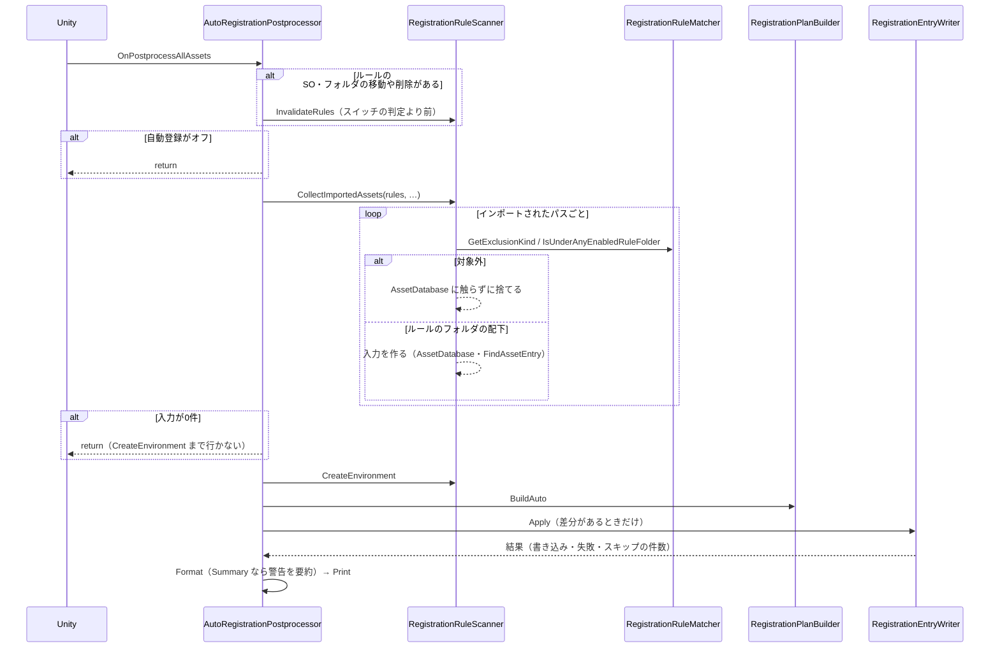
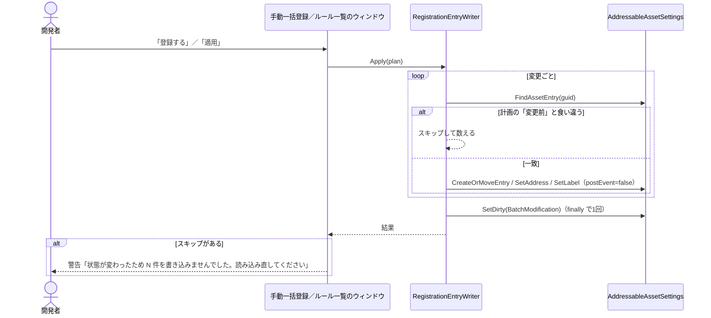

# 設計：アセットの登録（自動登録・手動一括登録）のレビュー指摘修正

> 対象：`requirements.md`（承認済み版） ／ 作成日：2026-10-24 ／ ステータス：承認待ち
> 備考：仕様の正は `src/AddressableManager/Docs/specs/asset-registration-spec.md`。今回は仕様書を書き換えず、更新する箇所は実装のあとに一覧で報告する。

## 1. 実装アプローチ

仕様（何を登録するか・どの順で処理するか）は変えず、**キャッシュの捨て方・書き込み前の確認・走査の絞り込み・入力の確定のタイミング・ログの出し方・規約**を直す。Editor アセンブリの `Editor/Registration/` の中で完結させる。

- **キャッシュを捨てる条件**（`AutoRegistrationPostprocessor`）：`InvalidateRules()` の判定を、自動登録スイッチの `return` より前に移す。移動されたもの・削除されたものにフォルダが含まれるときも捨てる。ルールの入力は、`ToInput()` を呼んだ時点のフォルダの**パス**を持つため、フォルダの移動・名前の変更でパスが古くなる。移動はフォルダかどうかを `AssetDatabase.IsValidFolder` で調べ、削除は拡張子のないパスで見る（削除後は種別を調べられないため。拡張子のないファイルも含まれるが、捨てても再計算が走るだけで害はない）
- **書き込み前の確認**（`RegistrationEntryWriter.ApplyChange`）：計画の `RegistrationChange` が持つ「変更前」（新規か・グループ・アドレス）と、今のエントリを比べる。食い違えばスキップして数え、結果（`RegistrationApplyResult`）に返す。2つのウィンドウは、スキップがあれば警告と「読み込み直してください」を出す
- **インポートの事前の絞り込み**（`RegistrationRuleScanner.CollectImportedAssets` ＋ `RegistrationRuleMatcher.IsUnderAnyEnabledRuleFolder`）：AssetDatabase に触る前に、パスの文字列だけで判定する。`Ignored` のものと、今のパスも移動元も有効なルールのフォルダの外にあるものを捨てる。入力が0件になれば、`CreateEnvironment`（全エントリの走査）まで行かない。移動元も見るのは、「ルールに当たらなくなった」の警告を出すため。Resources は `Ignored` ではないので、警告はこれまでどおり出る
- **Matcher の確保の削減**：`"/" + path` をやめる（パスは必ず `Assets/` で始まる）。`\` があるときだけ `Replace` する。拡張子は最後の `.` の位置から `string.Compare(…, OrdinalIgnoreCase)` で比べ、確保しない。拡張子なしの扱いは変えない
- **入力の確定とキャッシュ**（Inspector・手動一括登録）：文字列の項目に `[Delayed]` を付け、確定してから反映する。Inspector のプレビューは、対象フォルダのアセットの一覧と `RegistrationEnvironment` を持ち、集め直すのはフォルダが変わったとき・`OnEnable`・Undo/Redo のときだけ。それ以外は `RegistrationRulePreviewBuilder.Build` だけをやり直す。重なりの警告は、前回の組を `[NonSerialized]` で持ち、変わったときだけ出す
- **警告の要約**（`RegistrationLogFormatter.Format`）：`Summary` で警告が `MAX_SUMMARY_WARNINGS`（5）を超えたら、1件にまとめる。`PerAsset` は全件。PlanBuilder は警告を1件ずつ持ったままにする
- **ルール一覧の描画**：差分の行の文字列を `BeginReapply` のときに1回だけ作って持つ。差分と警告は、行の高さを固定して見えている行だけを描く（手動一括登録の `DrawRows` と同じ方式）。描画は private のメソッド1つにまとめて共有する
- **規約**：private のフィールド＋`Acc` のアクセサに直す。アクセサの中の関数は、メソッド（`Count〜()`・`GetTargetFolderPath()`）にするか、コンストラクタで求めて readonly のフィールドに持つ

検討した代替案と却下理由：
- **押した時点で計画を作り直してから書き込む案**：利用者が確認したダイアログ・差分と違う内容を書くことになる。Writer で食い違いを検出してスキップするほうが、見せた内容と書く内容がずれない。自動登録の経路も同時に守れる
- **PlanBuilder の警告を、種類付きの構造にして要約する案**：要約の単位は種類ごとになるが、`AccWarnings` を使う箇所とテストを大きく直す必要がある。今回は Formatter で件数を見るだけにし、「5件を超えたら1件」の単純な規則にした
- **グループ名に使えない文字を Windows の集合で固定する案**：メンバーの OS による判定の差は解消できるが、仕様書 6.5・11.2 の記述が変わる。ユーザーの決定により、今回はコードを変えず、既知の制約として仕様書に明記する
- **Inspector のプレビューを、`OnValidate` で無効にして毎回集め直す案**：キー入力のたびに `FindAssets` と全エントリの走査が走る。キャッシュと `[Delayed]` を組み合わせる
- **`CollectImportedAssets` の後ろ（PlanBuilder）で絞る案**：その時点では、すでに全アセット分の AssetDatabase の呼び出しと `CreateEnvironment` が済んでいる。入力を作る前に絞る
- **削除されたフォルダを、パスの記録から判定する案**：削除後は種別を調べられず、記録を持つ仕組みが増える。拡張子のないパスで見るだけで、捨てても害はない

## 2. 変更するコンポーネント

コードは `src/AddressableManager/Assets/@MAH/MAH-AddressableManager/` を起点とする（開発フォルダ。配布フォルダには触れない）。

### コード（Editor）

| 対象 | 変更内容 | 新規/修正 |
|---|---|---|
| `Editor/Registration/AutoRegistrationPostprocessor.cs` | キャッシュを捨てる判定をスイッチの前に移す。`ContainsFolder`・`ContainsDeletedFolder` を足す。`CollectImportedAssets` に `rules` を渡す | 修正 |
| `Editor/Registration/RegistrationRuleScanner.cs` | `CollectImportedAssets` に `rules` を足し、AssetDatabase に触る前に絞り込む | 修正 |
| `Editor/Registration/RegistrationRuleMatcher.cs` | `IsUnderAnyEnabledRuleFolder` を足す。`GetExclusionKind` の `"/" + path` をやめる。`IsMatch` の `Replace` を `\` があるときだけにする。拡張子を確保せずに比べる | 修正 |
| `Editor/Registration/RegistrationEntryWriter.cs` | `ApplyChange` の最初で、変更前と今のエントリを比べ、食い違えばスキップして数える | 修正 |
| `Editor/Registration/RegistrationApplyResult.cs` | スキップ件数を足す。フィールドを private にし、`AccAppliedCount`・`AccFailedCount`・`AccSkippedCount`・`AccCanceled` にする | 修正 |
| `Editor/Registration/RegistrationConflict.cs` | ルールの GUID の一覧（`AccRuleGuids`）を足す | 修正 |
| `Editor/Registration/RegistrationPlanBuilder.cs` | `AddConflict` で、名前と GUID を組のまま名前順に並べる | 修正 |
| `Editor/Registration/RegistrationPlan.cs` | `RegistrationGroupRequest` を private のフィールド＋`AccName`・`AccTemplateAssetGuid` にする。`AccAddedCount` など4つを `CountAdded()`・`CountMoved()`・`CountReaddressed()`・`CountLabelChanged()` に置き換える | 修正 |
| `Editor/Registration/RegistrationChange.cs` | `AccGroupChanged`・`AccAddressChanged`・`AccLabelsChanged` を、コンストラクタで求めた readonly のフィールドにする（アクセサの名前は変えない） | 修正 |
| `Editor/Registration/RegistrationManualRow.cs` | `AccCanCheck` を、コンストラクタで求めた readonly のフィールドにする | 修正 |
| `Editor/Registration/RegistrationLogFormatter.cs` | `MAX_SUMMARY_WARNINGS` を足す。`Summary` で警告が5件を超えたら Warning を1件にまとめる。件数のメソッド名の変更に追従する | 修正 |
| `Editor/Registration/AddressableAutoRegistrationRuleSO.cs` | 文字列の項目とリストに `[Delayed]` を付ける。`AccTargetFolderPath` を削除し、`GetTargetFolderPath()` を internal にする。重なりの組を `[NonSerialized]` で持ち、変わったときだけ警告する | 修正 |
| `Editor/Registration/AddressableAutoRegistrationRuleEditor.cs` | 対象フォルダのアセットと `RegistrationEnvironment` をキャッシュする。`GetTargetFolderPath()` の呼び出しに追従する | 修正 |
| `Editor/Registration/AddressableRegistrationRuleWindow.cs` | 差分の行の文字列を1回だけ作る。差分と警告を、見えている行だけ描く。`SelectRule` を GUID にする。スキップの表示 | 修正 |
| `Editor/Registration/AddressableManualRegistrationWindow.cs` | サムネイルのキャッシュと `GetCachedIcon`。グループ・Label に `[Delayed]`。`"{Rule.Name"` で判定。`Collect` が完了したかを返し、メッセージの上書きをやめる。スキップの表示 | 修正 |
| `Editor/Registration/RegistrationRuleAssetCreator.cs` | `Cancelled` のオーバーライドで SO を破棄する。`Rule` を private の `_rule` にする | 修正 |

### テスト（EditMode）

| 対象 | 変更内容 | 新規/修正 |
|---|---|---|
| `Tests/Editor/RegistrationRuleMatcherTests.cs` | `IsUnderAnyEnabledRuleFolder` のテスト（配下・外・無効なルール・移動元）を足す。既存の拡張子のテストが通ること | 修正 |
| `Tests/Editor/RegistrationPlanBuilderTests.cs` | 競合の名前と GUID の並びのテストを足す。`.Name`・`.TemplateAssetGuid`・`AccAddedCount`・`AccMovedCount` の名前の変更に追従する | 修正 |
| `Tests/Editor/RegistrationLogFormatterTests.cs` | 警告の要約のテストを足す。`RegistrationConflict`・`RegistrationGroupRequest` の変更に追従する | 修正 |

## 3. データ構造の変更

- `RegistrationConflict`：ルールの GUID の一覧（`AccRuleGuids`）を追加する。コンストラクタの引数が増えるため、テストの呼び出しも直す
- `RegistrationApplyResult`：スキップ件数を追加し、フィールドを private にしてアクセサに置き換える
- `RegistrationGroupRequest`・`RegistrationChange`・`RegistrationManualRow`：アクセサの名前は変わらないか、`Acc` 付きに変わるだけで、持つ値は同じ
- 保存するデータ（ルールの SO・Editor SO・シリアライズするウィンドウのフィールド）：**変更なし**。ルールの SO のフィールド名・型は変えず、`[Delayed]` と `[NonSerialized]` の追加だけなので、既存のルールの SO はそのまま読める
- マイグレーション：不要

## 4. 影響範囲の分析

- 既存機能への影響：
  - 自動登録：ルールの対象外のインポートで、何も起きなくなる（体感の改善）。ルールの対象のインポートの結果は変わらない
  - 手動一括登録・当て直し：状態が変わっていたときだけ、スキップして警告を出す。それ以外の登録結果は変わらない
  - Inspector：文字列の項目は、確定するまで反映されない（打っている途中のプレビューが出なくなる）
  - ログ：「まとめだけ」のとき、6件以上の警告が1件にまとまる（「1件ずつ」は変わらない）
  - Runtime・ほかの Editor 機能（Window/・Attribute/）への影響はない
- リスク：
  - `[Delayed]` がリストの要素に効くかは、Unity 6000.3 で確かめていない。効かなければリストの `[Delayed]` は外し、プレビューのキャッシュだけにする
  - Writer のスキップ判定が、手で変えたエントリ（自動登録が「戻す」対象）を誤ってスキップしないか。比べるのは計画を作った時点の「変更前」なので、計画と書き込みの間に変わったときだけスキップされる。テストでは覆えないため、手動で確かめる
  - 拡張子の比較の書き換えで、判定が変わらないか。既存の Matcher のテストで守る
  - 削除されたパスの判定が「拡張子のないパス」なので、拡張子のないファイルの削除でもキャッシュを捨てる。再計算が走るだけで害はない
- 永続的ドキュメント（Docs/）への影響：`asset-registration-spec.md` の 2.4・8章（警告の要約）、4.3・5.4（スキップ）、3.6（`[Delayed]`・プレビューのキャッシュ）、11.2（グループ名は OS 依存の既知の制約）、9.1（`RegistrationConflict` の GUID・`RegistrationApplyResult` のスキップ件数）が更新要。今回は書き換えず、実装のあとに一覧で報告する。`conventions.md`・設計仕様書は影響なし
- テストへの影響：`RegistrationRuleMatcherTests`・`RegistrationPlanBuilderTests`・`RegistrationLogFormatterTests` を修正・追加する。ほかの既存テスト（`RegistrationMacroExpanderTests`・`RegistrationRulePreviewBuilderTests`・`AddressableRegistrationSettingsTests`）は無修正で通ること

## 5. 図表

自動登録（修正後）。非同期処理はない。

ウィンドウからの書き込み（状態が変わっていた場合）：

いずれも今回の修正に伴う一時的な図で、`Docs/diagrams/` には登録しない（恒久的な価値が生じたときに昇格する）。
