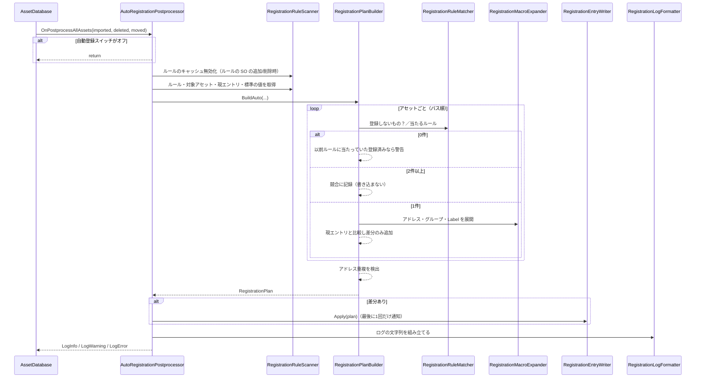
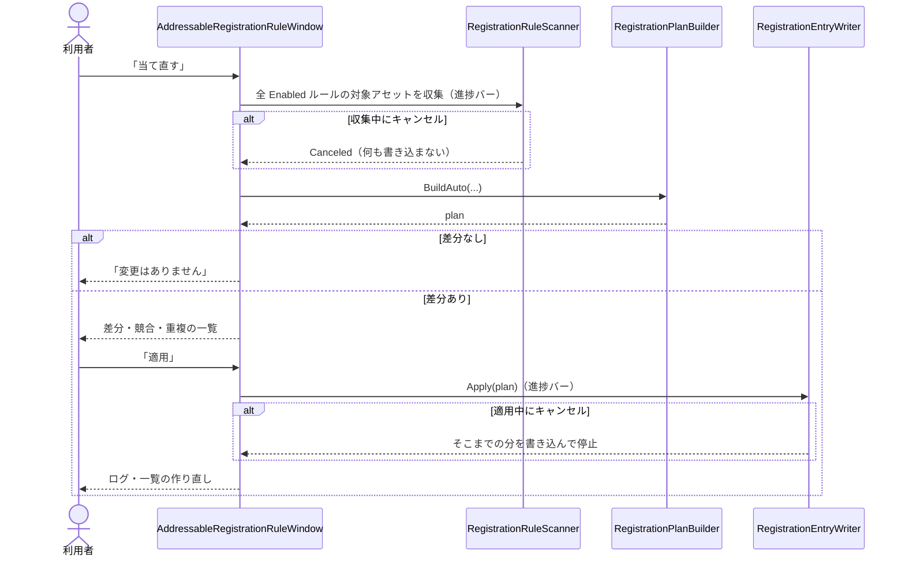
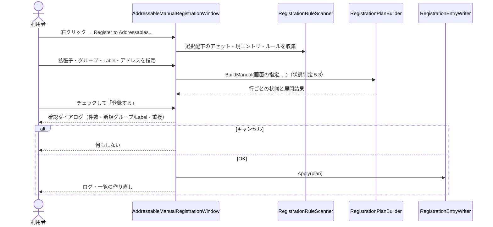

# 設計：AddressableManager Editor 機能7「アセットの登録（自動登録・手動一括登録）」

> 対象：`requirements.md`（承認済み版） ／ 作成日：2026-10-24 ／ ステータス：承認済み
> 仕様の正：`src/AddressableManager/Docs/specs/asset-registration-spec.md`（以下「仕様」。章番号は仕様の章）。本書は実装の設計であり、仕様を複製しない。

## 1. 実装アプローチ

**「入力を集める → 計画を作る → 書き込む」の3段を、自動登録・当て直し・手動一括登録・Inspector プレビューで共通にする。**

```
Scanner（Unity依存）→ RuleInput / AssetInput（文字列のみ）→ Matcher / Expander / PlanBuilder（Unity非依存）→ RegistrationPlan → Writer（Unity依存・書き込みはここだけ）
```

- Unity に依存するのは Scanner・Writer・Postprocessor・ウィンドウ・Inspector・Dropdown だけ。判定・展開・計画・ログ整形は文字列・`List`・`HashSet`・`Dictionary` のみで書き、偽の入力で EditMode テストする（Dependency Check の `DependencyCheckInput` / `DependencyCheckAggregator` と同じ分け方）
- 手動一括登録は、画面の指定を `RegistrationRuleInput` と同じ形にして PlanBuilder に渡す（`BuildManual`）。自動登録は `BuildAuto`
- PlanBuilder は入力をパス順に処理し、同じ入力なら同じ計画になる（仕様 2.2）。差分がなければ変更を作らず、Writer は空の計画なら何も書かない
- 標準の値のマクロ（`{UnityEngine.Application.version}` 等）は、Expander が Unity API を呼ばず、Scanner が作った `RegistrationMacroValues`（名前→値の表）を受け取る
- ルールの SO は Scanner がキャッシュする。`AutoRegistrationPostprocessor` が imported / deleted に含まれるルールの SO を検出し、`OnValidate` でも無効化する。インポートのたびに `FindAssets` しない
- 書き込みは Writer が1回の `Apply` で行い、変更通知は最後にまとめる（件数分の再描画・保存を避ける）。進捗バー・キャンセルは Writer と Scanner が持つ（`try/finally` で必ず消す）
- UI は既存ウィンドウに合わせて IMGUI。状態は `[SerializeField] private`、表示行は dirty のときだけ作り直し、ボタン処理は描画後に実行する

検討した代替案と却下理由（詳細は仕様 10章）：
- ルールを1 SO にリストで持つ → 競合の単位が分かりにくい。1 SO ＝ 1フォルダにした
- 競合を優先順位で解決 → どのルールが効くか分からなくなる。エラーにして登録しない
- マクロを `EvaluateString` に任せる → EditMode でテストできない。決めた一覧だけ自前で展開する
- 登録の共通設定を専用 SO に分ける → 設計仕様書 3.1.1 の方針に反する。Editor SO に `[Serializable]` クラスで持たせる（ルールの SO だけはデータなので例外）
- Postprocessor 内で非同期（`delayCall`）に書き込む → 実装時の確認（仕様 11.2）で、同期書き込みに問題が出た場合のみ採用する

## 2. 変更するコンポーネント

パスは開発フォルダ `src/AddressableManager/Assets/@MAH/MAH-AddressableManager/` 起点。

### コード（Editor）

| 対象 | 変更内容 | 新規/修正 |
|---|---|---|
| `Editor/SettingsSync/AddressableRegistrationSettings.cs` | 仕様 8章の6項目。`DEFAULT_*` 定数・`public` 既定コンストラクタ・テスト用 `internal` コンストラクタ・`ClampValues()`（既存の `AddressableDependencyCheckSettings` と同形式） | 新規 |
| `Editor/SettingsSync/AddressableEditorSettingsSO.cs` | `_registration` / `AccRegistration` を追加。`OnValidate` に null 補完と `ClampValues()` | 修正 |
| `Editor/SettingsSync/AddressableEditorSettingsLocator.cs` | `FindRegistrationSettings()` を追加（SO が無ければ既定値） | 修正 |
| `Editor/Registration/` の enum（`RegistrationTargetMode`・`RegistrationAddressMode`・`RegistrationLogDetail`・`ManualRegistrationState`） | 対象指定（拡張子／All）・追従／固定・ログの細かさ・手動登録の状態 | 新規 |
| `Editor/Registration/RegistrationRuleInput.cs` / `RegistrationAssetInput.cs` / `RegistrationMacroValues.cs` | Matcher・PlanBuilder への入力（Unity 非依存）。拡張子は小文字・ドットなしに正規化して保持 | 新規 |
| `Editor/Registration/RegistrationPlan.cs`（`RegistrationChange` 含む） | 差分（追加・グループ移動・アドレス変更・Label 追加／削除・新規グループ）と警告・エラー | 新規 |
| `Editor/Registration/RegistrationConflict.cs` / `RegistrationDuplicate.cs` | 競合・重複の表示用データ。ウィンドウで保持するため `[Serializable]` クラス | 新規 |
| `Editor/Registration/RegistrationRuleMatcher.cs` | 当たるルールの判定・7.2 のうちパスで判定できる除外・ルール間の重なり検出・glob（`**` `*` `?`） | 新規 |
| `Editor/Registration/RegistrationMacroExpander.cs` | `{ }` 展開（6.2・6.3）、`:lower` / `:upper`、知らないマクロの扱い、空結果・使えない文字の検出 | 新規 |
| `Editor/Registration/RegistrationPlanBuilder.cs` | `BuildAuto` / `BuildManual`、差分判定、警告、アドレス重複（全エントリ対象） | 新規 |
| `Editor/Registration/RegistrationLogFormatter.cs` | まとめ／1件ずつ／競合の組ごと（最初の5件）／重複 | 新規 |
| `Editor/Registration/RegistrationRuleScanner.cs` | ルールの SO の探索・キャッシュ・変換、対象アセットの収集、現エントリの読み取り、標準の値の表の作成、進捗バー | 新規 |
| `Editor/Registration/RegistrationEntryWriter.cs` | 計画の書き込み（グループ作成・`CreateOrMoveEntry`・アドレス・Label）。**`AddressableAssetSettings` に書き込む唯一のクラス** | 新規 |
| `Editor/Registration/AddressableAutoRegistrationRuleSO.cs` | ルールの SO（仕様 3.1）。`CreateAssetMenu`、`Reset` で初期値コピー、`OnValidate` で重なり警告とキャッシュ無効化 | 新規 |
| `Editor/Registration/AutoRegistrationPostprocessor.cs` | `OnPostprocessAllAssets`。スイッチ確認 → 入力収集 → 計画 → 書き込み → ログ | 新規 |
| `Editor/Registration/AddressableAutoRegistrationRuleEditor.cs` | Inspector とプレビュー（値の変更時のみ再計算） | 新規 |
| `Editor/Registration/RegistrationExtensionDropdown.cs` | 拡張子の複数選択（`AdvancedDropdown`。`AddressablePathDropdown` と同形式） | 新規 |
| `Editor/Registration/AddressableRegistrationRuleWindow.cs` | ルール一覧・作成・競合と重複・当て直す。メニュー `MAH/Addressable/Auto Registration` | 新規 |
| `Editor/Registration/AddressableManualRegistrationWindow.cs` | 手動一括登録。右クリック `Assets/MAH/Addressable/Register to Addressables...`（`MenuItem` の validate 付き） | 新規 |

### テスト（EditMode、`Tests/Editor/`）

| 対象 | 内容 | 新規/修正 |
|---|---|---|
| `RegistrationRuleMatcherTests` | 配下／外・拡張子の正規化・空拡張子・All と除外・glob・Enabled・競合・入れ子・7.2 | 新規 |
| `RegistrationMacroExpanderTests` | 6.2・6.3 の全マクロ・変換・知らないマクロ・空結果・大文字小文字の区別・`{Rule.Name}` 無し | 新規 |
| `RegistrationPlanBuilderTests` | 追加・差分なし・移動・アドレス変更・Label 増減・差し戻し・ルール外れ・追従／固定・空の扱い・重複・手動の状態と Label 追加のみ・同一入力→同一計画 | 新規 |
| `RegistrationLogFormatterTests` | まとめ・1件ずつ・競合の組ごと（5件） | 新規 |
| `AddressableRegistrationSettingsTests` | 既定値・`ClampValues`・SO の `OnValidate`（`SerializedObject` 経由） | 新規 |

### ドキュメント（実装後。指示を受けてから）

| 対象 | 変更内容 | 新規/修正 |
|---|---|---|
| `src/AddressableManager/Docs/specs/asset-registration-spec.md` | 実装状況を「実装済み」に、9章のクラス名を確定名に、11.2 の確認結果を反映 | 修正 |
| `src/AddressableManager/Docs/addressable-manager-design.md` | 4章のクラス名が変わった場合のみ | 修正 |
| `Docs/usage.md` | 6章の「すべて読み取り専用」の記述を修正し、登録機能（ルールの SO・マクロ・手動一括登録・環境依存マクロの表）の節を追加（英語） | 修正 |

## 3. データ構造の変更

- **Editor SO（`AddressableEditorSettingsSO`）**：フィールド `_registration`（`AddressableRegistrationSettings`）を追加。**マイグレーション不要**（既存アセットでは未保存の項目がコードの既定値になり、`OnValidate` で null を補う。既存の `_dependencyCheck` 追加時と同じ）
- **ルールの SO（`AddressableAutoRegistrationRuleSO`）**：新設。利用者が何個でも作るデータで、設定 SO の方針（設計仕様書 3.1.1）の対象外。対象フォルダは GUID で保持。置き場所は自由で、型検索で探す
- **Addressables の設定（`AddressableAssetSettings`）**：本機能が書き込む。ルールの SO を作るまで書き換えない
- Runtime SO・セーブデータ・外部スキーマの変更はなし

## 4. 影響範囲の分析

- 既存機能への影響：Runtime・デバッグウィンドウ・Dependency Check に影響なし。Editor SO は項目の追加のみ。自動登録は既定で有効だが、ルールの SO を作るまで何も起きない。Addressables 自身の AssetPostprocessor と同じタイミングで動くため、順序と再インポートの連鎖は実装時に確認する（仕様 11.2）
- 永続的ドキュメント（Docs/）への影響：上記「ドキュメント」の表のとおり。`Docs/usage.md` の「読み取り専用」記述は本機能で事実と食い違うため修正が必須
- テストへの影響：Editor テストの追加のみ。既存テストの修正なし。`InternalsVisibleTo("MAH.AddressableManager.Editor.Tests")` は設定済みで、`internal` の型をテストから参照できる
- 実装時の確認項目（仕様 11.2）：登録可否の判定 API が呼べるか／`Create` メニューでの `Reset` と作成場所の取得／Postprocessor 内の書き込み順序と再インポートの連鎖／グループ名に使えない文字の条件／変更通知のまとめ方。結果が仕様と食い違う場合は、仕様の更新提案を先に出す

## 5. 図表

### 自動登録（正常系・競合）


### 当て直す（確認・キャンセル）


### 手動一括登録


## 6. 実装後の変更点（2026-10-24 追記）

上の 1〜5 は着手前の設計。実装の途中でユーザーの指示により、次の点を変えた（最終の構成は `src/AddressableManager/Docs/specs/asset-registration-spec.md` 9章が正）。

- **手動一括登録の画面を作り直した**：設定を先に決めて読み込む形をやめ、開いた時点で対象の配下をすべて読み込んで一覧に出し、拡張子のオン／オフと行のチェックで絞り込む形にした。画面で決めるのは「追加先のグループ」と「Label」だけで、アドレスのテンプレート・除外パターン・新規グループの Template は Editor SO の値を使う。登録済みのアセットは一覧に出さない。サムネイル、2段表示、見えている行だけを描く作り、下部の固定（各種設定・ボタン）を追加した
- **Editor SO に「既定の追加先グループ」（`_defaultTargetGroup`）を追加した**（手動一括登録のみ）
- **ルールの SO の作成は `CreateAssetMenu` をやめ、独自の `MenuItem`（`RegistrationRuleAssetCreator`）にした**（作成時に確実に初期値をコピーするため）
- **グループ名を書く項目の名前を「追加先のグループ」（`_targetGroup`、旧 `_groupTemplate`）に改めた**（Group Template の SO と紛らわしいため）。旧名は `FormerlySerializedAs` で引き継ぐ
- **右クリックのメニューを `Assets/MAH/Register to Addressables...`（priority 10000）にした**
- **「4. 影響範囲」の表に無い型を足した**：`RegistrationMacroContext`、`RegistrationEnvironment`、`RegistrationAssetInput`、`RegistrationEntryInput`、`RegistrationManualRow`、`RegistrationLogOutput`、`RegistrationLogPrinter`、`RegistrationRulePreviewBuilder` ほか、`RegistrationExtensionDropdown` / `RegistrationLabelDropdown` / `RegistrationGroupDropdown`、`RegistrationListProperty`。設計時の `RegistrationMacroValues` は、`RegistrationMacroContext` に統合した
- **`RegistrationConflict` / `RegistrationDuplicate` は `[Serializable]` にしなかった**（Unity 非依存に保つため。ウィンドウは再コンパイル後に結果を作り直す）
- **ルールの SO の重なりの警告は、選択して編集しているときだけ Console に出す**（`OnValidate` は読み込みのたびにも呼ばれるため）
- **Addressables の `IsPathValidForEntry` は `internal` で呼べないため、同じ条件を `RegistrationRuleMatcher` に持った**
