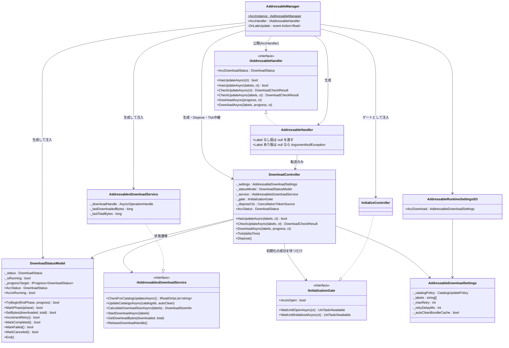
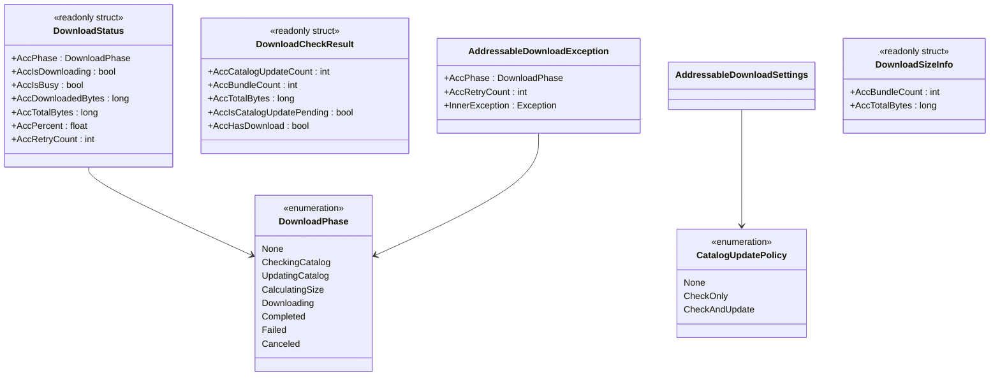

# クラス図：ダウンロード（Download）

> 最終更新日：2026-10-08
> 仕様は [`Docs/specs/download-spec.md`](../specs/download-spec.md) 7章を参照。

## 1. Manager・Handler・Controller・Model・Service

Manager が DownloadController・`DownloadStatusModel`・Service・Handler を生成し、InitializeController を `IInitializationGate` として DownloadController に注入する。利用者の入口は Handler（`IAddressableHandler`）で、ダウンロードの API を DownloadController へ転送する。DownloadController は InitializeController・LoadingController を参照しない。

- 図は、Download に関わる部分だけを描いている。`IAddressableHandler` の初期化・読み込み・解放のメンバー、LoadingController、`InitializeStateModel` などは、[`initialize-class.md`](initialize-class.md)・[`loading-class.md`](loading-class.md) を参照する
- `IInitializationGate` は `Runtime/Core/Interfaces/`（共通物）に置く。Initialize・Loading・Download から参照されるため（initialize-spec 7.4）。`WaitUntilInitializedAsync` は Download 用で、`LoadBeforeInitializePolicy` に関係なく、初期化の成功まで待つ
- `DownloadStatusModel` は `Runtime/Core/Download/Model/` に置く。触るのは DownloadController だけ。**遷移のたびに `DownloadStatus`（`readonly struct`）を作り直して保持する**ため、`AccStatus` は取得した時点の値のコピーになる。結果（`Completed` / `Failed` / `Canceled`）の記録後と、実行中でないときの遷移は、何も変えず `false` を返す（最後の通知を1回だけにするため。download-spec 7.2）
- `End()` は、通知先を外し、実行中を解除する。最後の通知を届けた後に、`finally` から呼ぶ（download-spec 7.3）
- `IAddressablesDownloadService` が、Addressables を呼ぶ唯一の層。非同期の戻り値は、UniTask が導入されていれば UniTask、無ければ Awaitable。`GetDownloadBytes` は、handle の状態確認を伴うため、アクセサではなくメソッド（conventions 2章）。ダウンロード中でなければ、最後に読んだ値を返す
- `AddressableHandler` は `Runtime/Core/Handler/`（namespace `MAH.AddressableManager.Core`）に置く。Handler は設定を持たないため、Label なし版は `null` を渡し、DownloadController が Runtime SO の Label に解決する（download-spec 7.1）

## 2. 公開する型と設定

- `DownloadPhase` / `DownloadStatus` / `DownloadCheckResult` / `AddressableDownloadException` は、利用者が戻り値・引数・`catch` で直接触れる外部依存型（namespace `MAH.AddressableManager`）。`CatalogUpdatePolicy` と `AddressableDownloadSettings`、`DownloadSizeInfo` は内部実装型（`MAH.AddressableManager.Core.Download`）
- `DownloadStatus` の割合 `AccPercent` と処理中の判定 `AccIsBusy` は、アクセサの中で計算せず、生成時に求める（conventions 2章）。`Completed` のときの割合は 1。`default` の値は、一度も処理していない状態（`AccPhase == None`）
- `DownloadCheckResult.AccIsCatalogUpdatePending` は、`CheckOnly` で、更新のあるカタログがあるのに適用していないときに `true`。このとき、件数と容量は、保留中の更新を含まない今のカタログに対する値（download-spec 2.1）
- 失敗の例外は `DownloadStatus` には持たせず、呼び出し元の `await` に `AddressableDownloadException` として返す（download-spec 2.5）
