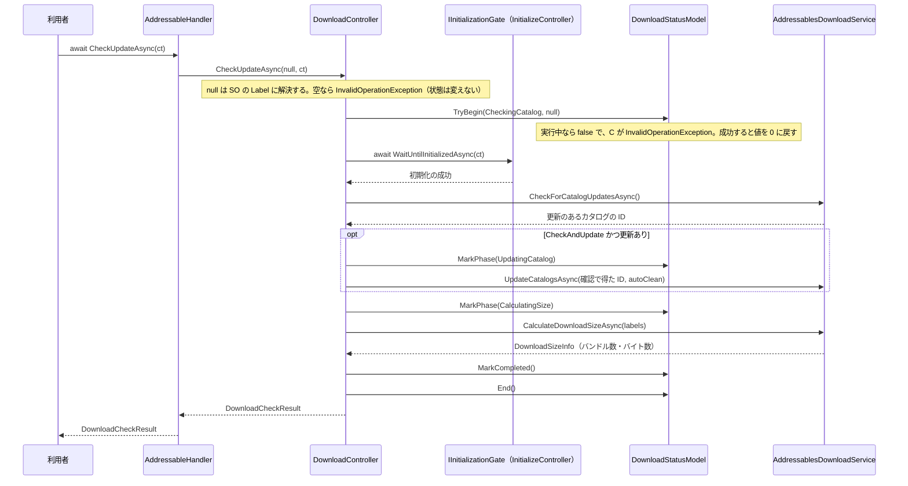
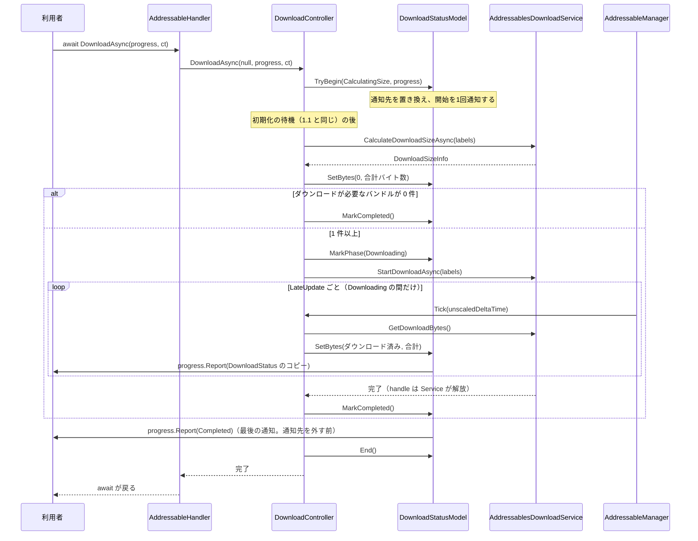
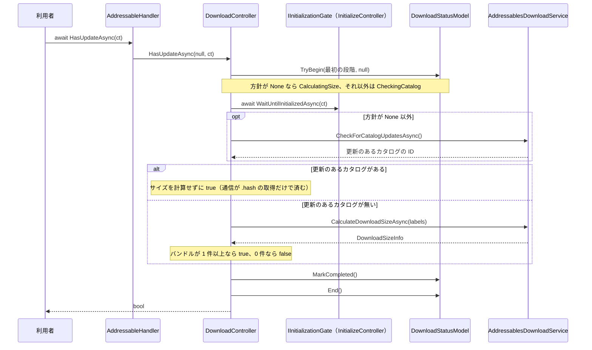
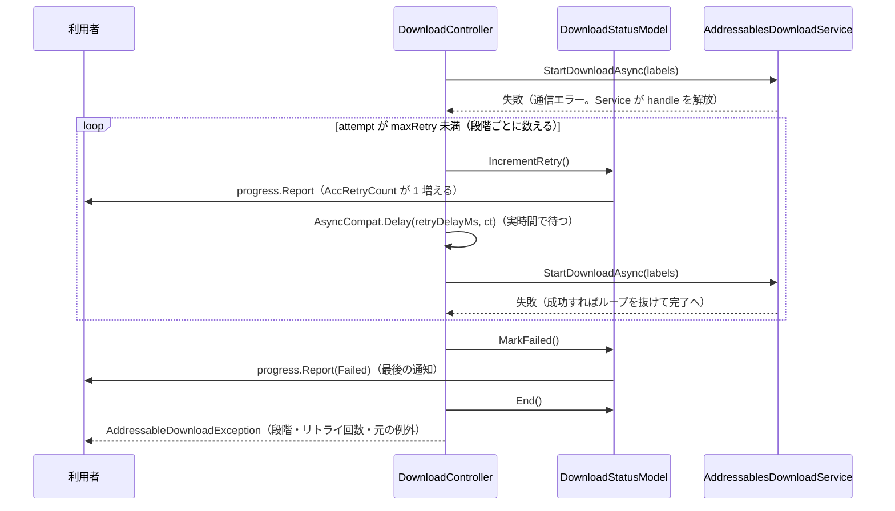
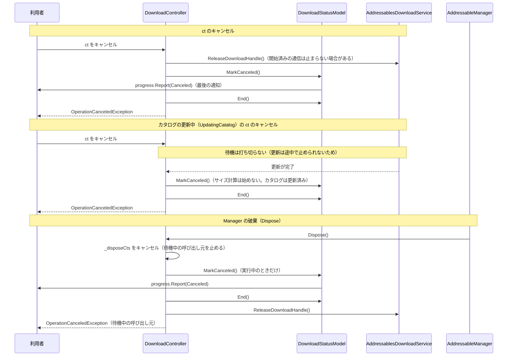
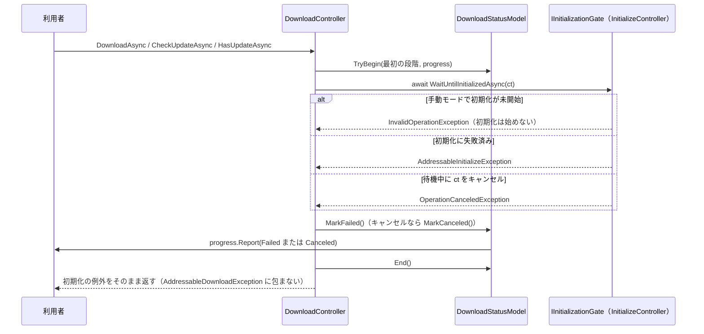
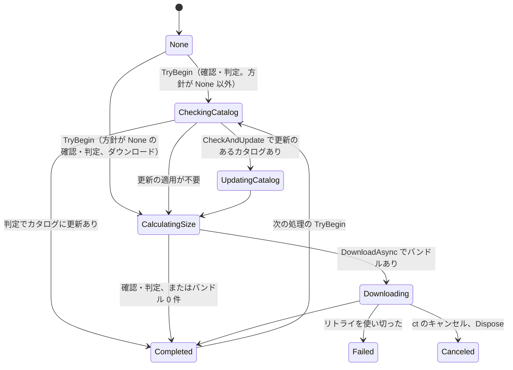

# シーケンス図：ダウンロード（Download）

> 最終更新日：2026-10-08
> 仕様は [`Docs/specs/download-spec.md`](../specs/download-spec.md) 2章・5章・7章を参照。

## 1. 更新の確認 → 確認ダイアログ → ダウンロード（正常系）

### 1.1 更新の確認（`CheckUpdateAsync`）

- 方針が `None` のときは、カタログの確認と更新を飛ばし、最初の段階が `CalculatingSize` になる。`CheckOnly` では更新（`UpdateCatalogsAsync`）を呼ばない（download-spec 2.1）
- `UpdateCatalogsAsync` には、確認で得たカタログ ID を明示して渡す（`null` を渡すと、別の確認で立ったフラグの分まで更新するため。download-spec 6章）
- 利用者は、戻り値の件数と容量を確認ダイアログに出して、同意されたら 1.2 の `DownloadAsync` を呼ぶ

### 1.2 ダウンロードと進捗（`DownloadAsync`）

- `Tick` は `Downloading` のときだけ働く。ダウンロードしていないときは、先頭で戻り、通知もしない（download-spec 7.6）
- 通知で届く値は、その時点のコピー（`readonly struct`）。後から変わらない。別の UI は、毎回 `AccDownloadStatus` を取得し直せば、同じ値を読める（download-spec 4.1）
- **最後の通知（`Completed` / `Failed` / `Canceled`）は、通知先を外す前に1回だけ届く**。順序は、結果の記録 → `Report` → `End` → 呼び出し元へ完了・例外（download-spec 7.3）
- `DownloadAsync` は、バンドルをキャッシュに保存するだけで、カタログは更新しない。完了したら handle をすぐ解放し、アセットは読み込まない（download-spec 1章・7.5）

## 2. 更新の有無の判定（`HasUpdateAsync`）

- **どの方針でも `UpdateCatalogs` は呼ばない**（download-spec 2.2）。カタログの確認だけでは、読み込みに使うカタログは書き換わらない（download-spec 6章）
- カタログを更新したが、まだダウンロードしていない状態でも、サイズの計算（今のカタログのバンドルを数える）で `true` になる

## 3. 失敗・リトライ・キャンセル・初期化の待機

### 3.1 失敗とリトライ（リトライを使い切る場合）

- リトライは、カタログの確認・更新・サイズ計算・ダウンロードの各段階で、同じ流れ。リトライ回数は段階ごとに数え、段階が進むと `AccRetryCount` は 0 に戻る（download-spec 2.5）
- 失敗の例外は `DownloadStatus` には持たせず、呼び出し元の `await` に返す。受け取る側は、最後の通知の `AccPhase == Failed` で失敗を判定する

### 3.2 キャンセルと `Dispose`

- **`UpdatingCatalog` 中は、`ct` のキャンセルで待機を打ち切らず、更新の完了後に `Canceled` で終える**。Addressables の更新は途中で止められず、待機だけをやめて `Canceled` を返すと、返した後に裏でカタログが更新されるため（download-spec 2.5）。`Dispose` では、更新の完了を待たずに終わる。更新が失敗してリトライを待っている間は、`ct` ですぐ打ち切れる
- `Dispose` は、継続の実行順に頼らず、`Canceled` の通知と `End` を自分で行う。後から再開した継続側の `MarkCanceled` / `End` は、何も変えずに戻る（Model が、結果の記録後の遷移を無視するため。download-spec 7.2）
- `Dispose` の順序は、Loading → Download → Initialize（Download は初期化の待機を持つため、Initialize より先に止める。download-spec 2.5）
- 破棄後の呼び出しは `ObjectDisposedException`

### 3.3 初期化の待機で失敗する場合

- この場合、Service は呼ばれない。待機中の段階は、その処理の最初の段階（`AccIsBusy` が `true`）で、前の処理の結果が残らない（download-spec 5章）

## 4. 段階の遷移

- `Completed` / `Failed` / `Canceled` は、**次の処理が始まるまで残る**（`None` に戻らない）。次の `TryBegin` で、最初の段階になり、バイト数とリトライ回数が 0 に戻る。`Failed` / `Canceled` からも同じ（download-spec 2.4）
- `Failed` と `Canceled` へは、処理中の4つの段階（`CheckingCatalog` / `UpdatingCatalog` / `CalculatingSize` / `Downloading`）のどこからでも遷移する（図は `Downloading` だけを描いている）。初期化の待機での失敗・キャンセルも同じ
- `None` は、一度も処理していない間だけ。処理中かどうかは `AccIsBusy`、ダウンロード中かどうかは `AccIsDownloading` で判定する
