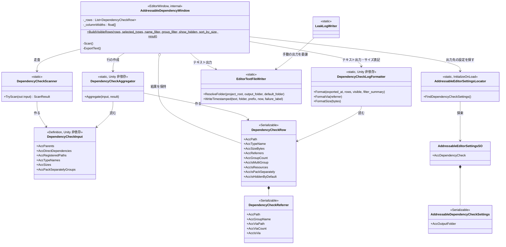
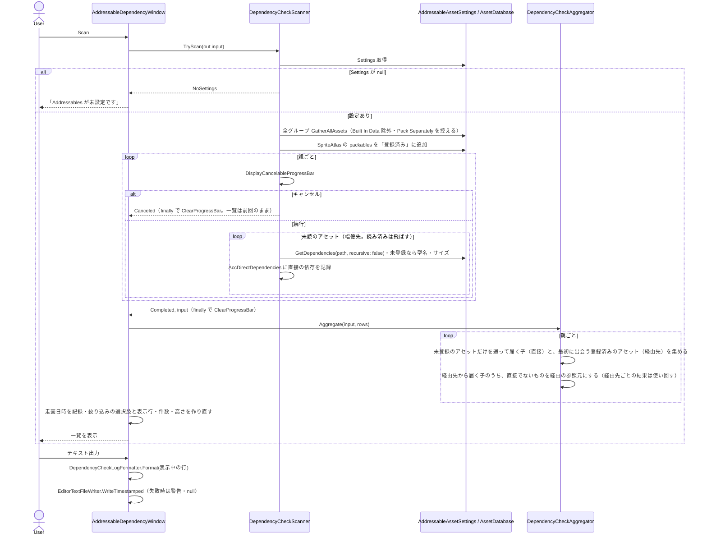

# クラス図：Editor Dependency Check（未登録の依存の確認）

> 最終更新日：2026-10-15（直接／経由の区別・「複数グループ」への言い換えを反映）
> 仕様は [`Docs/specs/editor-dependency-check-spec.md`](../specs/editor-dependency-check-spec.md) を参照。実コードのメンバー名で描いている。
> デバッグウィンドウの共通基盤（窓口 `IAddressableDebugReader`・Snapshot・pull 更新）は使わない。窓口・`AddressableManager` には触れない（Runtime のログ出力 `AddressableLogger` だけを使う）。

## 1. クラス図

`AddressableDependencyWindow` が、走査（`DependencyCheckScanner`）→ 集約（`DependencyCheckAggregator`）→ 表示・絞り込み・出力を順に呼ぶ。Unity の API に触れるのは、`DependencyCheckScanner` とウィンドウだけで、集約と整形はパスと型名の文字列だけで動く（EditMode テストで偽の入力を使える）。

## 2. Scan の流れ

