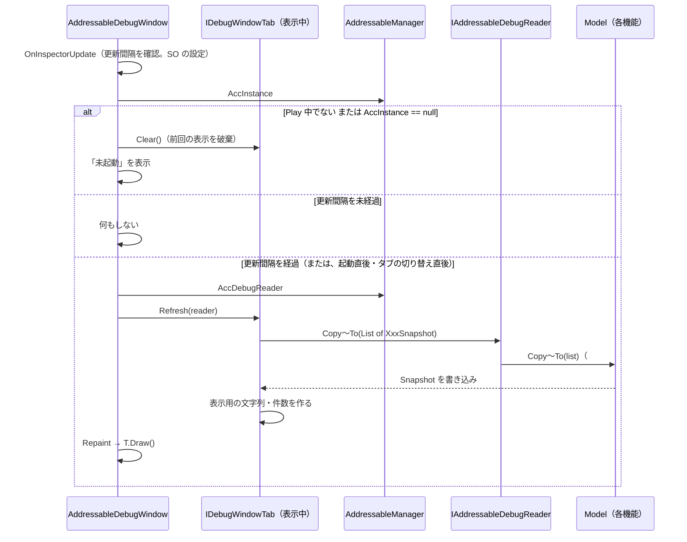
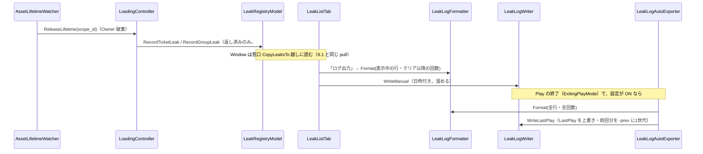
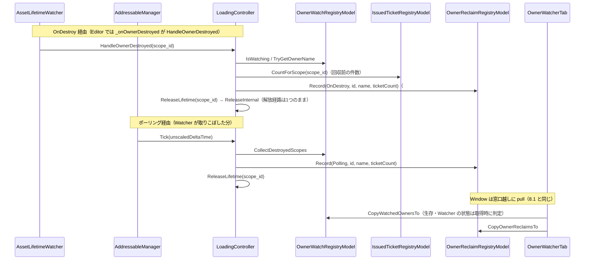

# クラス図：Editor デバッグウィンドウの共通基盤

> 最終更新日：2026-10-15
> 仕様は [`Docs/specs/editor-debug-window-spec.md`](../specs/editor-debug-window-spec.md) を参照。
> 共通基盤と機能1（実行時状態）・機能2（リーク検出一覧）・機能3（owner Watcher の可視化）の実装に合わせて、実コードのメンバー名で描いている。機能4以降を足すときは、窓口・Snapshot・タブを追記する。

## 1. 窓口・Model・Window・設定

Manager が Model を作り、Controller と窓口 `AddressableDebugReader` の両方へコンストラクタで注入する。Window は `AddressableManager.AccInstance.AccDebugReader` から、読み取り専用の `IAddressableDebugReader` だけを受け取り、表示中のタブ（`IDebugWindowTab`）へ渡す。Window とタブは Model にも Controller にも触れない。窓口・Snapshot・Model のコピー用メソッドは `#if UNITY_EDITOR` で囲まれ、本番ビルドに含まれない。

```mermaid
classDiagram
    class AddressableManager {
        <<MonoBehaviour>>
        +AccInstance : AddressableManager$
        +AccHandler : IAddressableHandler
        ~AccDebugReader : IAddressableDebugReader
    }
    class IAddressableDebugReader {
        <<interface, internal>>
        +CopyAssetEntriesTo(entries, scope_counts)
        +CopyIssuedTicketsTo(tickets)
        +CopyLeaksTo(leaks)
        +CopyWatchedOwnersTo(owners)
        +CopyOwnerReclaimsTo(reclaims)
    }
    class AddressableDebugReader {
        <<internal sealed>>
    }
    class AssetRegistryModel {
        <<Model>>
        ~CopyEntriesTo(entries, scope_counts)
    }
    class AssetEntryModel {
        <<Model>>
        ~CopyScopeCountsTo(scope_counts)
    }
    class IssuedTicketRegistryModel {
        <<Model>>
        ~CountForScope(scopeId)
        ~CopyTicketsTo(tickets)
    }
    class OwnerWatchRegistryModel {
        <<Model>>
        ~TryGetOwnerName(scope_id, out name)
        ~CopyOwnersTo(owners)
        名前の保持と読み取りは Editor 限定
    }
    class OwnerReclaimRegistryModel {
        <<Model, Editor 限定>>
        ~Record(route, instance_id, owner_name, ticket_count)
        ~CopyReclaimsTo(reclaims)
        経路と Owner 名ごとに集約
    }
    class LeakRegistryModel {
        <<Model, Editor 限定>>
        ~RecordTicketLeak(...)
        ~RecordGroupLeak(...)
        ~CopyLeaksTo(leaks)
        確保元ごとに集約
    }
    class AssetEntrySnapshot {
        <<readonly struct>>
        AccKey / AccAssetType / AccAssetName
        AccRefCount / AccStatus
        AccScopeCountStart / AccScopeCountLength
    }
    class ScopeCountSnapshot {
        <<readonly struct>>
        AccScopeKind / AccScopeValue / AccCount
    }
    class IssuedTicketSnapshot {
        <<readonly struct>>
        AccSerial / AccKey / AccAssetType
        AccScopeKind / AccScopeValue
        AccIsDelivered / AccIsGroup / AccStackTrace
    }
    class LeakSnapshot {
        <<readonly struct>>
        AccId / AccSequence / AccIsGroup
        AccKey / AccAssetType / AccLabel / AccGroupCount
        AccScopeKind / AccScopeValue / AccScopeName
        AccCount / AccLastTime / AccStackTrace
    }
    class OwnerWatchSnapshot {
        <<readonly struct>>
        AccInstanceId / AccOwnerName
        AccIsAlive / AccHasWatcher / AccIsRegistered
    }
    class OwnerReclaimSnapshot {
        <<readonly struct>>
        AccId / AccSequence / AccRoute / AccOwnerName
        AccLastInstanceId / AccCount / AccTicketCount / AccLastTime
    }
    class OwnerReclaimRoute {
        <<enum, Editor 限定>>
        OnDestroy / Polling
    }
    class LoadingController {
        <<Controller>>
        ReleaseLifetime でリークを記録
        Owner の回収経路を、解放の直前に記録
    }
    class AddressableDebugWindow {
        <<EditorWindow>>
        -_tabs : IDebugWindowTab[]
        メニュー MAH/Addressable/Debug Window
    }
    class IDebugWindowTab {
        <<interface, internal>>
        +AccTitle
        +Refresh(reader)
        +Clear()
        +InvalidateLabels()
        +Draw()
    }
    class RuntimeStateTab {
        <<internal sealed>>
        絞り込み All / Manual / Scene / Owner
    }
    class LeakListTab {
        <<internal sealed>>
        確保元ごとの一覧・表示をクリア（既読扱い）・ログ出力
    }
    class OwnerWatcherTab {
        <<internal sealed>>
        監視中の Owner と Watcher の状態・回収経路の記録
    }
    class StackTraceView {
        <<internal sealed>>
        リンク・コピー・ジャンプ
    }
    class StackTraceParser {
        <<static, Unity 非依存>>
        +Parse(stack_trace, project_root)
        +FindFirstUserFrame(frames)
        モジュール内の判定 メソッドの名前空間＋PackageCache
    }
    class EditorProjectPath {
        <<static>>
        +GetProjectRoot()
    }
    class LeakLogFormatter {
        <<static, Unity 非依存>>
        +Format(exported_at, leaks, rows, counts, project_root)
    }
    class LeakLogWriter {
        <<static>>
        +WriteManual(text, folder, now)
        +WriteLastPlay(text, folder)
    }
    class EditorTextFileWriter {
        <<static>>
        +ResolveFolder(project_root, output_folder, default_folder)
        +WriteTimestamped(text, folder, prefix, now, failure_label)
        Dependency Check と共有
    }
    class LeakLogAutoExporter {
        <<static, InitializeOnLoad>>
        ExitingPlayMode で自動出力
    }
    class AddressableEditorSettingsLocator {
        <<static, InitializeOnLoad>>
        +FindSettings()
        +FindLeakLogSettings()
    }
    class AddressableEditorSettingsSO {
        <<ScriptableObject>>
    }
    class AddressableDebugWindowSettings {
        <<Serializable>>
        更新間隔 既定0.5秒・下限0.1秒
    }
    class AddressableLeakLogSettings {
        <<Serializable>>
        出力先 既定 Logs/AddressableManager
        Play 終了時の自動出力 既定OFF
    }

    AddressableManager --> LoadingController : 生成・Model を注入
    AddressableManager --> AddressableDebugReader : 生成・Model を注入
    AddressableManager --> IAddressableDebugReader : AccDebugReader で渡す
    AddressableDebugReader ..|> IAddressableDebugReader
    AddressableDebugReader --> AssetRegistryModel : 読むだけ
    AddressableDebugReader --> IssuedTicketRegistryModel : 読むだけ
    AddressableDebugReader --> LeakRegistryModel : 読むだけ
    AddressableDebugReader --> OwnerWatchRegistryModel : 読むだけ
    AddressableDebugReader --> OwnerReclaimRegistryModel : 読むだけ
    AssetRegistryModel o-- AssetEntryModel
    LoadingController --> AssetRegistryModel : 読み書き
    LoadingController --> IssuedTicketRegistryModel : 読み書き
    LoadingController --> OwnerWatchRegistryModel : 読み書き
    LoadingController --> LeakRegistryModel : 書き込む（Editor 限定）
    LoadingController --> OwnerReclaimRegistryModel : 書き込む（Editor 限定）
    AssetRegistryModel ..> AssetEntrySnapshot : 作る
    AssetEntryModel ..> ScopeCountSnapshot : 作る
    IssuedTicketRegistryModel ..> IssuedTicketSnapshot : 作る
    LeakRegistryModel ..> LeakSnapshot : 作る
    OwnerWatchRegistryModel ..> OwnerWatchSnapshot : 作る
    OwnerReclaimRegistryModel ..> OwnerReclaimSnapshot : 作る
    OwnerReclaimSnapshot --> OwnerReclaimRoute : 経路
    AddressableDebugWindow --> IAddressableDebugReader : 取得して、表示中のタブへ渡す
    AddressableDebugWindow o-- IDebugWindowTab
    RuntimeStateTab ..|> IDebugWindowTab
    RuntimeStateTab --> IAddressableDebugReader : Refresh の間だけ使う
    RuntimeStateTab --> AssetEntrySnapshot : 表示
    RuntimeStateTab --> ScopeCountSnapshot : 表示
    RuntimeStateTab --> IssuedTicketSnapshot : 表示
    RuntimeStateTab --> StackTraceView : スタックトレースの表示
    LeakListTab ..|> IDebugWindowTab
    LeakListTab --> IAddressableDebugReader : Refresh の間だけ使う
    LeakListTab --> LeakSnapshot : 表示
    LeakListTab --> StackTraceView : スタックトレースの表示・ジャンプ
    LeakListTab --> LeakLogFormatter : ログ出力（手動）
    LeakListTab --> LeakLogWriter : ログ出力（手動）
    OwnerWatcherTab ..|> IDebugWindowTab
    OwnerWatcherTab --> IAddressableDebugReader : Refresh の間だけ使う
    OwnerWatcherTab --> OwnerWatchSnapshot : 表示
    OwnerWatcherTab --> OwnerReclaimSnapshot : 表示
    OwnerWatcherTab --> IssuedTicketSnapshot : チケット数の集計
    StackTraceView --> StackTraceParser : 解析
    StackTraceView --> EditorProjectPath : ルートの取得
    LeakListTab --> EditorProjectPath : ログ出力のルート
    LeakLogAutoExporter --> EditorProjectPath : ログ出力のルート
    LeakLogFormatter --> StackTraceParser : 呼び出し元の判定
    LeakLogAutoExporter --> IAddressableDebugReader : ExitingPlayMode で読む（保持しない）
    LeakLogAutoExporter --> LeakLogFormatter : 組み立て
    LeakLogAutoExporter --> LeakLogWriter : 書き込み（LastPlay）
    LeakLogWriter --> EditorTextFileWriter : 出力先の解決・日時付きの書き込みを委譲
    AddressableDebugWindow --> AddressableEditorSettingsLocator : 設定を探す
    AddressableEditorSettingsLocator --> AddressableEditorSettingsSO : 探索・自動作成
    AddressableEditorSettingsSO *-- AddressableDebugWindowSettings
    AddressableEditorSettingsSO *-- AddressableLeakLogSettings
    LeakLogAutoExporter --> AddressableEditorSettingsLocator : 設定を探す
    LeakListTab --> AddressableEditorSettingsLocator : 出力先の設定を探す
```

## 2. 更新（pull）の流れ

- Window は窓口への参照を保持せず、毎回 `AccInstance` から取り直す。タブも、`Refresh` の引数で受け取って使い切る
- Runtime 側からは通知しない。Window を閉じていれば Runtime 側のコストはゼロ
- 取り直すのは表示中のタブだけ。別のタブへ切り替えた直後は、次の更新間隔を待たずに取り直す

## 3. リークの記録とログ出力の流れ（機能2）

- 手動の出力は、表示中の行だけ。自動の出力は、そのセッションの全リーク（「表示をクリア」とは無関係）
- 自動出力が削除・移動するのは、固定名の `AddressableLeaks_LastPlay.txt` と `-prev` だけ

## 4. Owner の回収経路の記録の流れ（機能3）

- 記録するのは、`IsWatching` が true の Owner だけ。明示 `Release` で監視が外れた Owner や、回収済みの Owner への遅れて届く通知は、記録されない（二重記録の防止）
- 本番ビルドでは、Watcher に渡す delegate は従来どおり `ReleaseLifetime` そのもの
