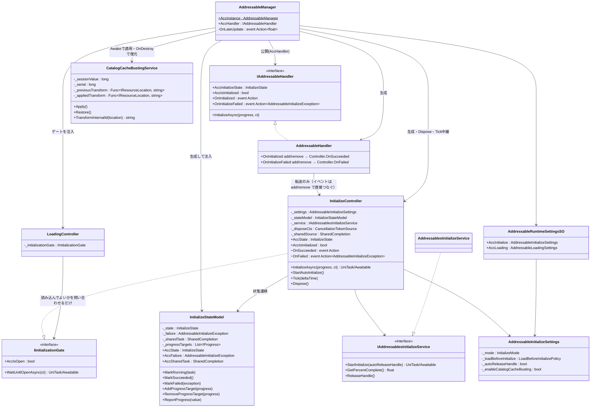
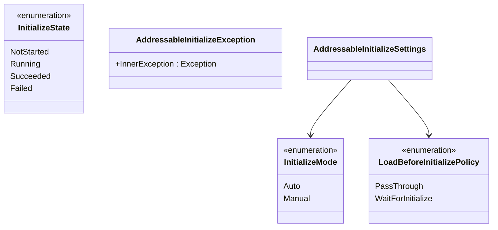

# クラス図：初期化（Initialize）

> 最終更新日：2026-10-05
> 仕様は [`Docs/specs/initialize-spec.md`](../specs/initialize-spec.md) 7章を参照。

## 1. Manager・Controller・Service

Manager が InitializeController・`InitializeStateModel`・Service・Handler を生成し、InitializeController を `IInitializationGate` として LoadingController に注入する。利用者の入口は Handler（`IAddressableHandler`）で、初期化の API を InitializeController へ転送する。InitializeController と LoadingController は互いを参照しない。

- `IInitializationGate` は `Runtime/Core/Interfaces/`（共通物）に置く。Initialize・Loading の両方から参照されるため（initialize-spec 7.4）
- `InitializeStateModel` は `Runtime/Core/Initialize/Model/` に置く。触るのは InitializeController だけで、LoadingController はゲートを通す（initialize-spec 7.2）。`MarkRunning` は `NotStarted` から、`MarkSucceeded` / `MarkFailed` は `Running` からのみ遷移させる（`Succeeded` / `Failed` は終端）
- `IAddressablesInitializeService` は、初期化1回分の開始・進捗・完了の受け渡し（同期の例外も失敗として渡す）・handle の解放を持つ。進捗はアクセサではなく `GetPercentComplete()`（handle の状態確認を伴うため。conventions 2章「アクセサ内で関数を呼ばない」）。完了後は 1 を返す
- 公開イベント（`OnInitialized` / `OnInitializeFailed`）は、Handler が `add` / `remove` で InitializeController の内部イベント（`OnSucceeded` / `OnFailed`）へ直接つなぐ。Handler は購読の状態を持たず、Manager は購読も中継もしない。購読側の例外は Controller が受け止めてログにする（initialize-spec 7.7）
- `AddressableHandler` は `Runtime/Core/Handler/`（namespace `MAH.AddressableManager.Core`）に置く。複数機能の Controller を知るため、機能フォルダの外に置く

## 2. 設定と外部依存型

- `InitializeState` と `AddressableInitializeException` は利用者が直接触れる外部依存型（namespace `MAH.AddressableManager`）。2つの設定用 enum は内部実装型（`MAH.AddressableManager.Core.Initialize`）
