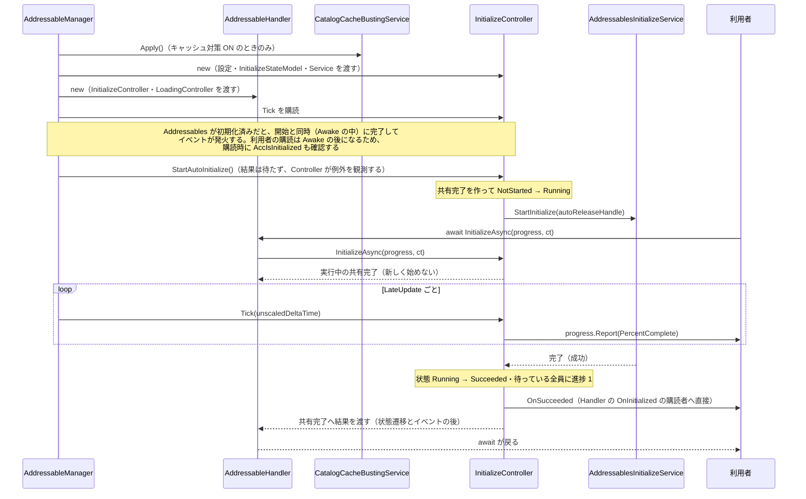
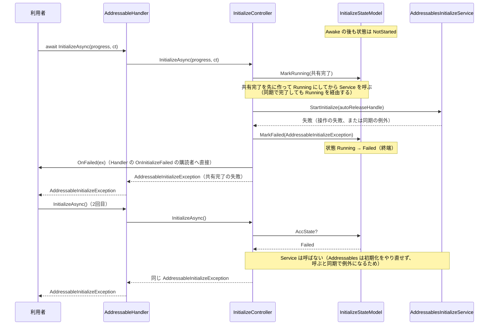
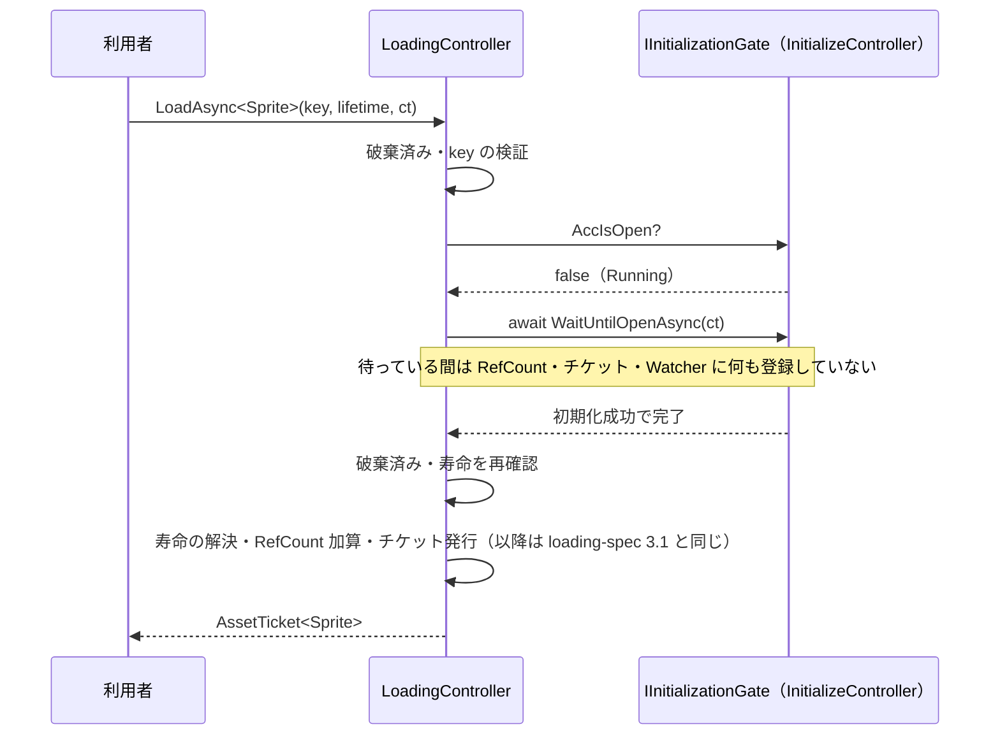
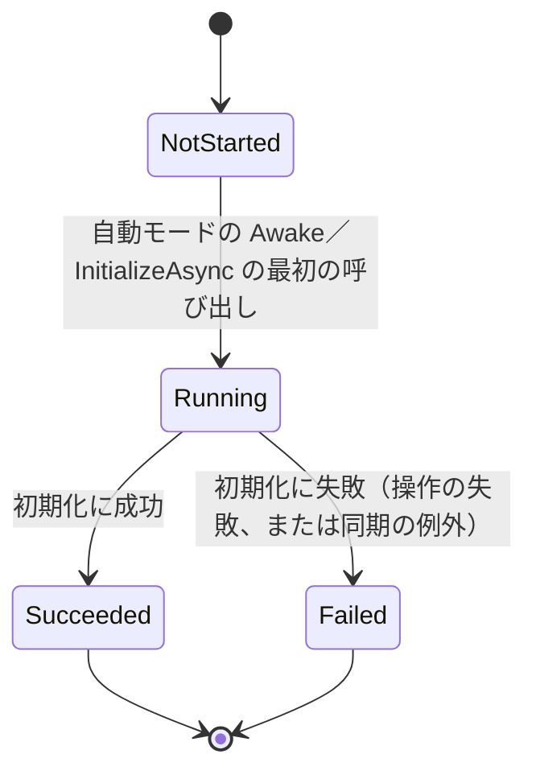

# シーケンス図：初期化（Initialize）

> 最終更新日：2026-10-05
> 仕様は [`Docs/specs/initialize-spec.md`](../specs/initialize-spec.md) 2章・5章・7章を参照。

## 1. 自動モード：Awake で始まり、利用者が後から待つ

## 2. 手動モード：利用者が呼んだ時点で始まる（失敗）

- 失敗は、待っている `InitializeAsync` と `OnInitializeFailed` の両方に届く。イベントは1回だけ発火する（initialize-spec 4章）
- 失敗した後は、Handler の読み込みもゲートで止まる（3章の図の後の注記）

## 3. WaitForInitialize：初期化中の Load は完了を待つ

- 手動モードで未開始なら `WaitUntilOpenAsync` は `InvalidOperationException`、初期化が失敗していれば `AddressableInitializeException` を投げる（initialize-spec 5章）
- 待機中に Manager が破棄されると、ゲートからは `OperationCanceledException` が届き、LoadingController が `ObjectDisposedException` に変換する。待機中に寿命が終わった（owner の破棄・シーンのアンロード）場合は `OperationCanceledException`（initialize-spec 5章・5.1）
- `PassThrough`（初期化に失敗していないとき）、または初期化に成功済みなら `AccIsOpen` が `true` で、`await` は起きない
- **初期化に失敗した後は、`PassThrough` でも `AccIsOpen` が `false` になり**、`WaitUntilOpenAsync` はすぐに `AddressableInitializeException` を投げる。Addressables は呼ばれず、RefCount・チケット・Watcher にも何も残らない（initialize-spec 5章）

## 4. 状態遷移

- `Succeeded` / `Failed` は終端。`InitializeStateModel` の遷移メソッドがこれを守る
- `Failed` の後の `InitializeAsync` は、Service を呼ばずに同じ例外を返し続ける（Addressables はアプリを再起動するまで初期化をやり直せないため。initialize-spec 10.1）
- Manager の破棄（`Dispose`）では状態は変化せず、待っている呼び出し元には `OperationCanceledException` が届く
