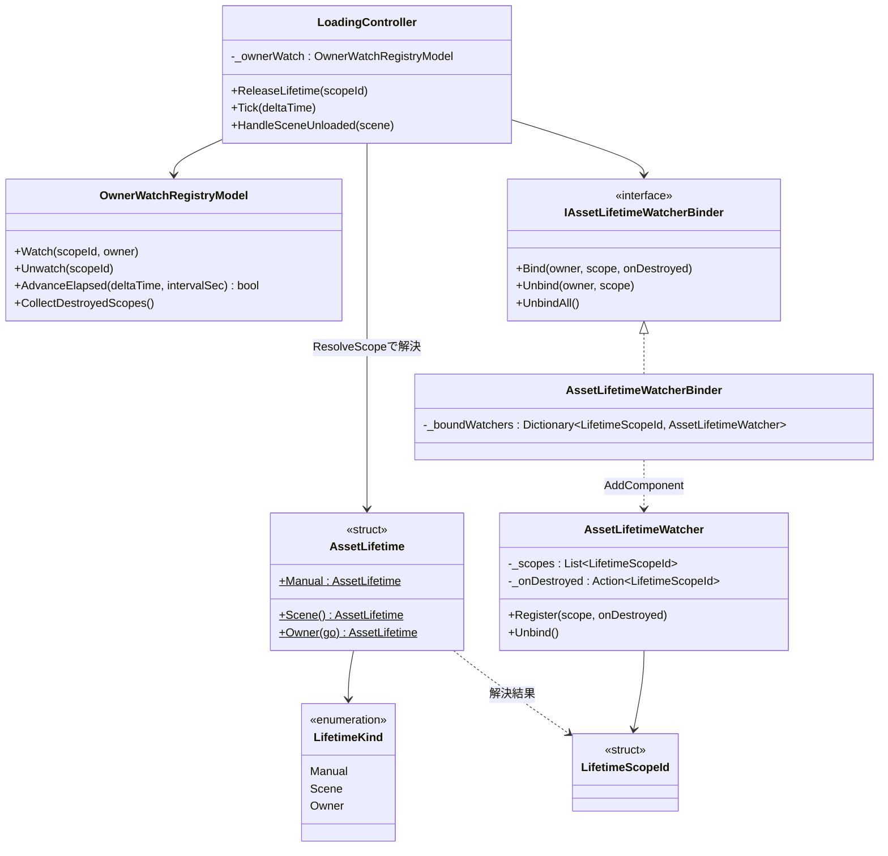
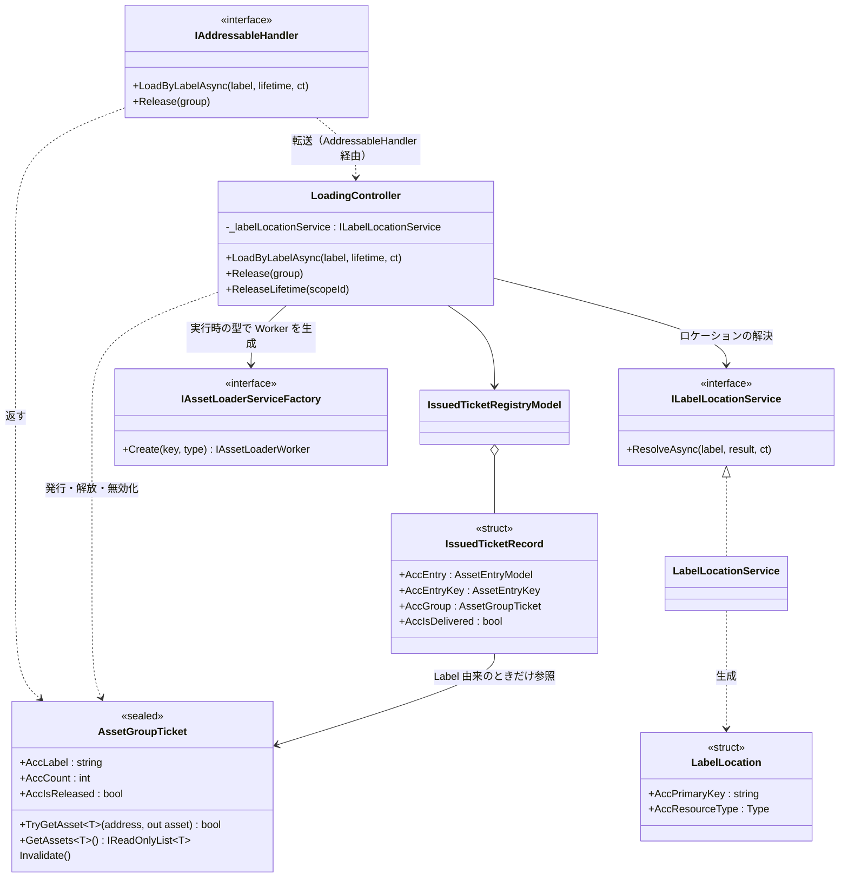

# クラス図：読み込み・解放（Loading）

> 最終更新日：2026-10-05
> 仕様は [`Docs/specs/loading-spec.md`](../specs/loading-spec.md) を参照。ノード数が多いため「Controller・Model・Service」「Lifetime」「Label 一括ロード」の3枚に分けている。

## 1. Controller・Model・Service

Manager から Handler・Controller を経由して Service に至る、読み込み・解放の主経路。

```mermaid
classDiagram
    class AddressableManager {
        +AccInstance : AddressableManager$
        +AccHandler : IAddressableHandler
    }
    class IAddressableHandler {
        <<interface>>
        +初期化のメンバー（initialize-class.md）
        +LoadAsync~T~(key, lifetime, ct)
        +Release~T~(ticket)
        +LoadByLabelAsync(label, lifetime, ct)
        +Release(group)
    }
    class AddressableHandler {
        -_loadingController : LoadingController
        -_initializeController : InitializeController
    }
    class LoadingController {
        -_registry : AssetRegistryModel
        -_tickets : IssuedTicketRegistryModel
        -_serviceFactory : IAssetLoaderServiceFactory
        -_initializationGate : IInitializationGate
        +LoadAsync~T~(key, lifetime, ct)
        +Release~T~(ticket)
        +LoadByLabelAsync(label, lifetime, ct)
        +Release(group)
        +ReleaseLifetime(scopeId)
        +Tick(deltaTime)
    }
    class IInitializationGate {
        <<interface>>
        +AccIsOpen : bool
        +WaitUntilOpenAsync(ct) UniTask/Awaitable
    }
    class AssetRegistryModel {
        +TryGetEntry(entryKey)
        +AddEntry(entryKey, worker)
        +RemoveEntryIfSame(entryKey, entry) bool
    }
    class IssuedTicketRegistryModel {
        +IssueSerial() long
        +Register(serial, entryKey, entry, scopeId, group)
        +TryRemove(serial) bool
        +SnapshotSerialsForScope(scopeId)
    }
    class AssetEntryModel {
        +AccKey : AssetKey
        +AccEntryKey : AssetEntryKey
        +AccWorker : IAssetLoaderWorker
        +AccRefCount : int
        +AccAssetType : Type
    }
    class AssetEntryKey {
        <<struct>>
        +AccKey : AssetKey
        +AccAssetType : Type
    }
    class IAssetLoaderServiceFactory {
        <<interface>>
        +Create~T~(key) IAssetLoaderWorker
        +Create(key, type) IAssetLoaderWorker
    }
    class AssetLoaderServiceFactory
    class IAssetLoaderWorker {
        <<interface>>
        +LoadAsync(token)
        +AccAsset : Object
    }
    class AddressableLoaderBase~T~ {
        <<abstract>>
    }
    class AssetLoaderService~T~
    class AssetKey {
        <<struct>>
        +AccKind : Kind
        +AccValue : string
    }
    class AssetTicket~T~ {
        <<struct>>
        +AccKey : AssetKey
        +AccAsset : T
    }

    AddressableManager --> IAddressableHandler : 公開(AccHandler)
    AddressableManager ..> LoadingController : Awakeで生成
    IAddressableHandler <|.. AddressableHandler
    AddressableHandler --> LoadingController : 転送のみ
    LoadingController --> AssetRegistryModel
    LoadingController --> IssuedTicketRegistryModel
    LoadingController --> IAssetLoaderServiceFactory
    LoadingController --> IInitializationGate : 読み込んでよいかを問い合わせる
    LoadingController ..> "AssetTicket~T~" : 発行
    AssetRegistryModel o-- AssetEntryModel
    AssetEntryModel --> IAssetLoaderWorker
    IAssetLoaderServiceFactory <|.. AssetLoaderServiceFactory
    AssetLoaderServiceFactory ..> "AssetLoaderService~T~" : 生成
    IAssetLoaderWorker <|.. "AssetLoaderService~T~"
    "AddressableLoaderBase~T~" <|-- "AssetLoaderService~T~"
    AssetEntryModel --> AssetKey
    AssetEntryModel --> AssetEntryKey
    AssetEntryKey --> AssetKey
    AssetRegistryModel ..> AssetEntryKey : 判定キー
    "AssetTicket~T~" --> AssetKey
```

読み方：Handler（`AddressableHandler`。`Core/Handler/`）は状態を持たず、読み込み・解放を `LoadingController` へ、初期化を `InitializeController` へ転送するだけ（この図では Loading 側のみ示す）。`(AssetKey, 型)`（`AssetEntryKey`）の同一判定と `AssetTicket<T>` の二重解放防止のロジックは Controller が持ち、実ロードは `AssetLoaderService<T>`（`AddressableLoaderBase<T>` の派生）に委ねる。Worker の生成は `IAssetLoaderServiceFactory` を経由し、EditMode テストで偽の実装に差し替える。`IInitializationGate`（`Core/Interfaces/`）は InitializeController が実装し、Manager が注入する。Loading は Initialize 機能を参照しない（[`initialize-class.md`](initialize-class.md)・initialize-spec 7.4）。

## 2. Lifetime

寿命の指定と、Owner 破棄検知・自動回収の構造。



読み方：`LoadingController` は `AddComponent` を直接呼ばず、`IAssetLifetimeWatcherBinder` を経由して `AssetLifetimeWatcher` を貼る（テストで差し替えるため）。`AssetLifetimeWatcher.OnDestroy` が主経路、`LoadingController.Tick` によるポーリングが保険。

## 3. Label 一括ロード

`LoadByLabelAsync` で使う型。ロケーションの解決は Service 層（`ILabelLocationService`）が担い、まとめチケット（`AssetGroupTicket`）が中身を型ごとに取り出す。解放は、1件ずつの解放と同じ経路を通る。



読み方：`LoadByLabelAsync` は、`ILabelLocationService` で (PrimaryKey, ResourceType) の組を得て、組ごとに `Create(key, type)` で Worker を作り、1件ずつの Load と同じ手順でチケットを登録する。`IssuedTicketRecord` がまとめチケットへの参照を持つため、寿命による回収のときに、まとめチケットを無効にしてリーク警告を1件にまとめられる。
