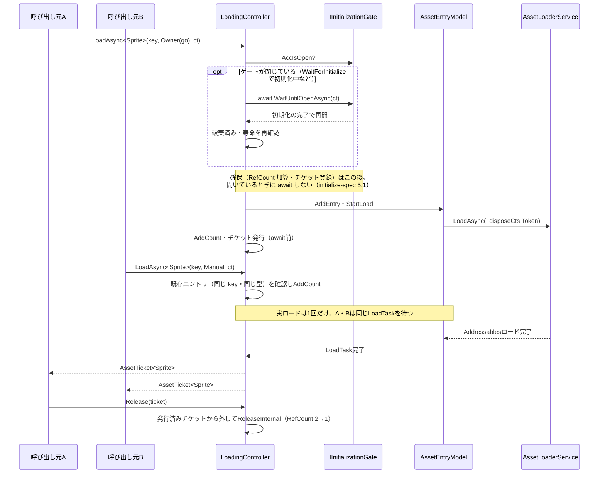
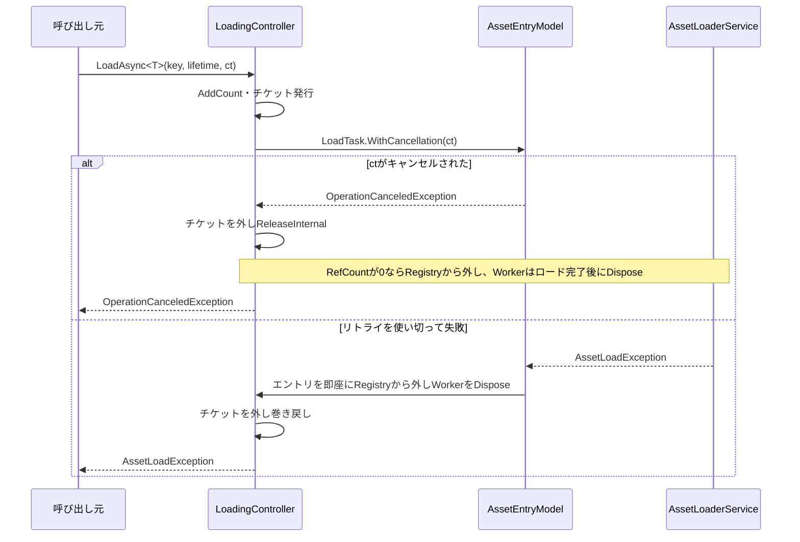
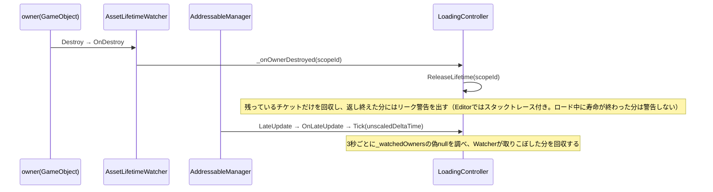
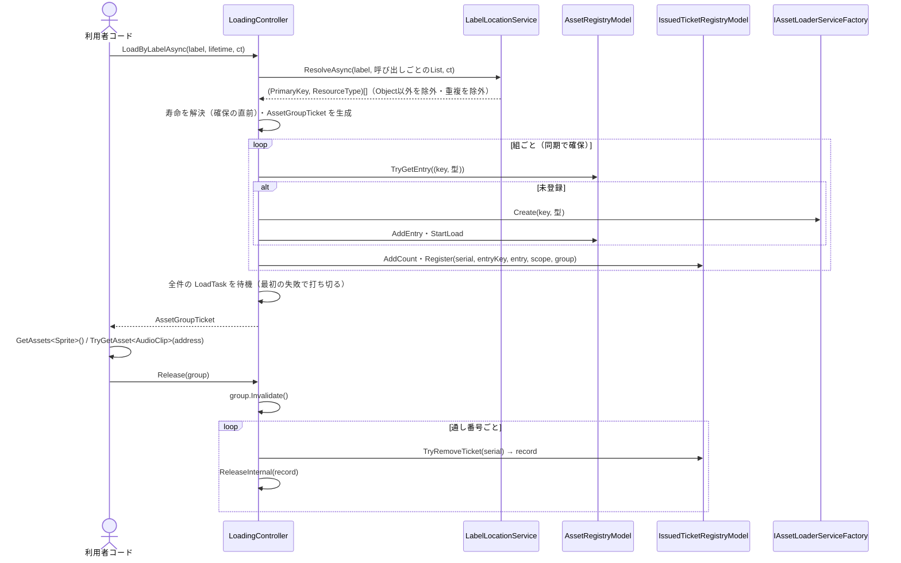
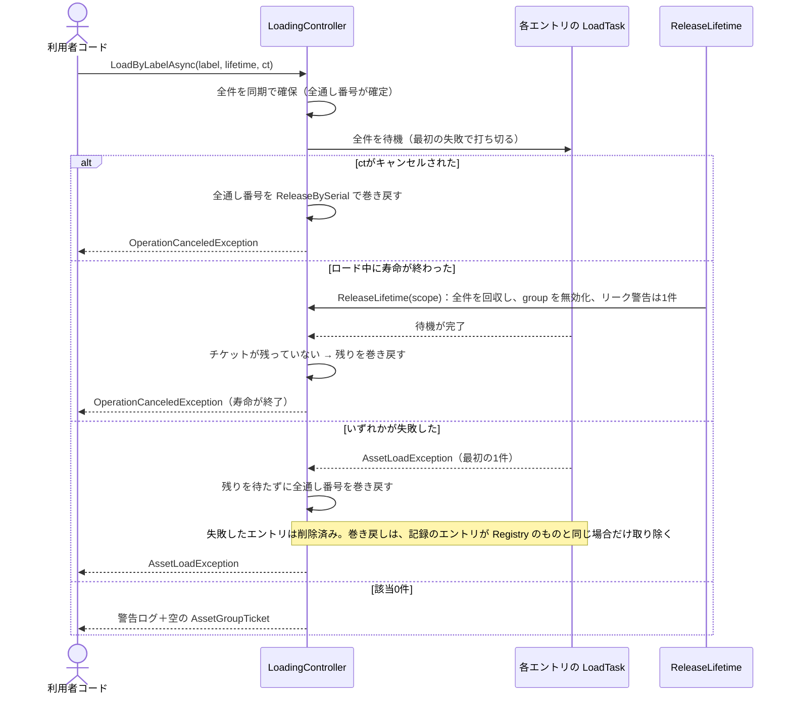

# シーケンス図：読み込み・解放（Loading）

> 最終更新日：2026-10-05
> 仕様は [`Docs/specs/loading-spec.md`](../specs/loading-spec.md) 3章・5章・13章を参照。

## 1. 正常系：読み込みと重複ロードの共有

A と B は1つの `LoadTask` を共有する。RefCount が 0 になるまで Worker は Dispose されない。初期化ゲートが閉じているときの例外（失敗・未開始・待機中のキャンセル・破棄・寿命の終了）は [`initialize-sequence.md`](initialize-sequence.md) 3章を参照。`LoadByLabelAsync` も、ロケーションの解決より前に同じ位置で待つ。

## 2. キャンセル・失敗

キャンセルで止まるのは呼び出し元の待機だけで、実ロードは止めない。失敗したエントリはすぐ消えるので、次の Load では新しく実ロードが始まる。

## 3. 自動回収：Owner の破棄

回収の経路は3つ。Watcher が主経路、ポーリングがその保険、Manager の破棄が最終防衛線。Scene 寿命の場合は、Manager が中継した `sceneUnloaded` を `HandleSceneUnloaded` が受け取り、`ReleaseLifetime` を呼ぶ。

## 4. 正常系：Label 一括ロードと解放

確保（同期）で全件の通し番号が先にそろい、待機はその後に行う。解放は、1件ずつの解放と同じ `ReleaseInternal` を通る。Label で読んだ Sprite は、単体の `LoadAsync<Sprite>` と同じエントリを共有する。

## 5. 異常系：Label 一括ロードの失敗・キャンセル・寿命の終了

例外の優先順位は、キャンセル、寿命の終了、ロードの失敗の順（仕様書13.10）。ロード中のエントリは、RefCount が 0 になると Registry から外れ、Worker はロード完了後に解放される。
